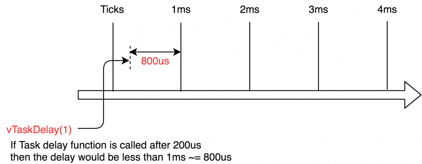
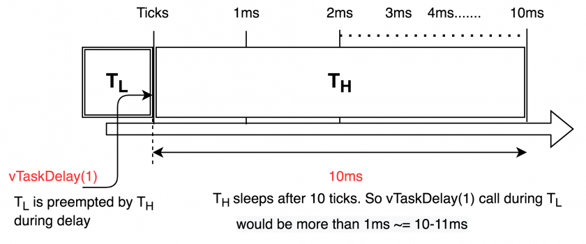

`vTaskDelay()` is a naive function, but it is important to understand how it really works.

- The function expects a parameter in "tick time" (not necessarily in milliseconds). 
- The function will sleep the current task for approximately the tick time. 
- The function will trigger a "software interrupt" to perform a cooperative scheduling event and allow another task to run. 

---

#### `vTaskDelay(1)`

For FreeRTOS configuration where 1 tick is 1 millisecond, the following is true:

- The function may sleep for less than 1 millisecond 

If you use a `vTaskDelay(1)` Ideally, you will get a delay somewhere between `0ms` and `1ms`. If you ask for a 2 ticks delay, you will get a delay between 1ms and 2ms. The low end of the range happens if the `vTaskDelay()` is called right after the end of a tick as shown in the figure below.

 

---

Assuming FreeRTOS configuration where 1 tick is 1 millisecond again, the following is also true:

- The function may sleep for more than 1 millisecond 

The delay of course can also be extended if the currently running task is preempted by the higher priority task during the delay and takes over the CPU for some time or it never gives up the CPU. As the delay just affect when this task is eligible to get CPU time.

