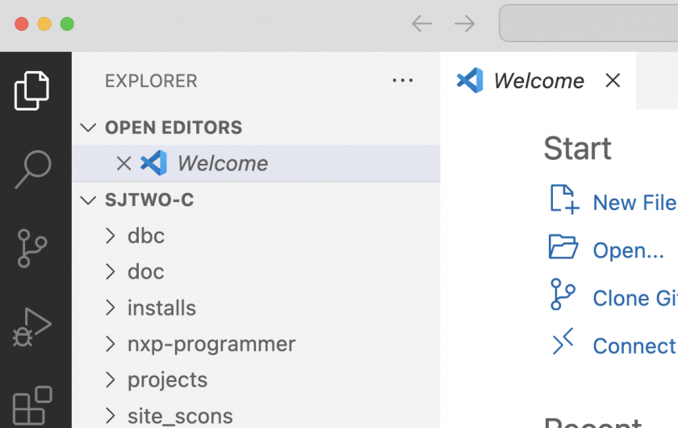
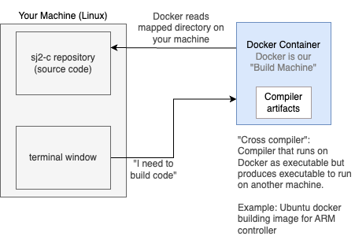

### Setup Environment

1. Install docker for your machine 
  - If you have linux, install docker for linux 
  - If you have Mac, install. docker for mac 
  - etc. 
2. Clone the [SJ2-C repository](https://gitlab.com/sjtwo-c-dev/sjtwo-c) 
  - `git clone https://gitlab.com/sjtwo-c-dev/sjtwo-c.git` 
3. Open the folder you just cloned in VSCode 
  -  

### Build the Docker container

Building the docker container means that you are building the docker container that will ultimately build the RTOS simulator code and let you run that code.

1. `python ./run setup` 



### Use Docker to build FreeRTOS simulator executable

Once you have built your docker image using the `python ./run setup` command, you can now shell into the Docker container to build and run the RTOS simulator:

```bash
# Shell into the Docker container
./run shell

# If shell is successful, you will see something like this at the command-prompt:
#root@9b9c100d9f83:~/sjtwo-c

# Build a native executable using the "scons" build system:
scons --project=x86_freertos

# Run an executable in the Docker container
_build_x86_freertos/x86_freertos.exe

```

Another alternate option is that you could run these commands without shelling into the Docker container:

```bash
# Build a native executable
./run build -- --project=x86_freertos

# Run an executable in the Docker container
./run exe -- _build_x86_freertos/x86_freertos.exe

```