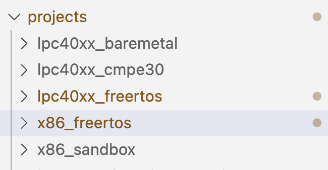

In this assignment, we will experiment with RTOS tasks and see the multitasking in action. You may use the x86_freertos project folder to experiment with your code since this folder is already setup for the FreeRTOS POSIX simulator.



We will walk you through the different phases of the assignment. Your assignment should be turned in using a Gitlab Merge Request after the entire assignment is complete. You do not need to submit separate code per part.

### Part 1: Setup Skeleton

Please setup the skeleton of your code using the reference code below. Requirements for this part are:

1. Create a task with an infinite loop that invokes `print_function("++++\n")` 
2. Sleep the task for 100 ticks 
3. Create the task with priority 2 

```c
void  eat_cpu() {
  for (int i = 0; i < 1 * 1000 * 1000; i++) {
    ;
  }
}

void print_function(const char *string) {
  for (int i = 0; i < strlen(string); i++) {
    putchar(string[i]);
    eat_cpu();
  }
}

int main(void) {
  // TODO: For you:
  xTaskCreate(printer_task, "name", 1000, NULL, 3, NULL);

  puts("Starting FreeRTOS Scheduler ..... \r\n");
  vTaskStartScheduler();

  return 0;
}
```

At this point, you should build your code and test it before moving on.

### Part 2: Multiple tasks

For this part, let us create two tasks that print a specific pattern. You can leverage from the "task parameter" that you can pass to a task like so:

```c
void printer_task(void *p) {
  const char *what_to_print = (const char*) p;
  while(1) {
    print_function(what_to_print);
  }
}

int main(void) {
  xTaskCreate(printer_task, "name", 1000, "++++\n", 3, NULL);
  ...
```

Requirements:

1. Retain existing that that prints `++++\n` 
2. Create a new task that prints `` 
3. `----\n` 
4. Create both tasks with priority 2 

Build and run the code and note down observations.

### Part 3: Round-robin scheduler

So far what we should have observed is that when a task gives up its CPU using vTaskDelay() or another function that "blocks", the time allocation is given to other tasks that may be equal or lower priority. If we deliberately design the code such that tasks do not sleep, then the round-robin scheduler will kick-in. This round-robin scheduler requires "preemptive scheduler" option which is typically enabled by default by all RTOSes.

```c
void task_1(void *p) {
  const char *what_to_print = "----\n";
  while(1) {
    print_function(what_to_print);
    eat_cpu();
  }
}

void task_2(void *p) {
  const char *what_to_print = "++++\n";
  while(1) {
    print_function(what_to_print);
    eat_cpu();
  }
}

int main(void) {
  //xTaskCreate(cpu_utilization_print_task, "cpu", 1, NULL, PRIORITY_LOW, NULL);

  xTaskCreate(task_1, "name", 1000, "++++\n", 3, NULL);
  xTaskCreate(task_2, "name", 1000, "****\n", 3, NULL);
  
  puts("Starting FreeRTOS Scheduler ..... \r\n");
  vTaskStartScheduler();

  return 0;
}

```

### Assignment Submission

At this point you should have performed a number of experiments to get to know the RTOS scheduler. Note that all RTOSes will behave the same way. The scheduling policy is always A) High priority first, and then B) Round-robin scheduling between equal priority tasks.

Please create a README.MD file and add that to your MR to explain the following:

1. Change the priority of the `++++` task to 2, and the priority of the `----` task to 1 
  - Have the `++++` task invoke vTaskDelay(100) 
  - What is the output of the code? 
2. Change the priorities of both tasks to 1 
  - What is the output of the code? 
  - What is different from the previous part? 
3. Remove the vTaskDelay(100) with eat_cpu() 
  - Use equal priorities for both tasks 
  - What is the output of the code? 
4. With equal priorities, make a change at FreeRTOSConfig.h and set `#define configUSE_PREEMPTION 0`   
  - Ensure that you modify the FreeRTOS file at your project folder, such as x86_freertos 
  - What is the output of the code? 
  - Explain how the pre-emption option is behaving