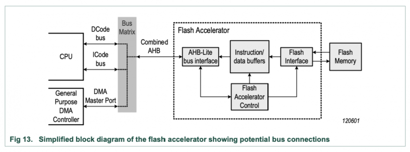

Chapter 4 of LPC40xx controller outlines the information about the flash accelerator module.

Typically in a microcontroller, there is either an internal or external flash memory that is interfaced over a serial bus (SPI). This memory needs to be memory mapped to the processor and hence the intent of the flash accelerator module is to provide an abstraction between the CPU and the serial memory.

### Critical Thinking Questions

**1. Flash Accelerator Functionality**  
a. What is the main purpose of the flash accelerator in the LPC408x/407x microcontroller?  
b. Describe how the flash accelerator improves CPU performance when accessing flash memory.

**2. Flash Accelerator Blocks**  
a. Identify the main functional blocks of the flash accelerator.  
b. What are the roles of the I-code and D-code buses in the context of the flash accelerator?

**3. Prefetch Mechanism**  
a. Explain the difference between a "fetch" and a "prefetch" in the flash accelerator.  
b. Why does the flash accelerator prioritize data access over instruction fetch?

**4. Flash Programming Issues**  
a. Why can't the flash memory be accessed during programming or erase operations?  
b. What steps must be taken to prevent a system failure during flash memory programming?

**5. Flash Accelerator Configuration Register**  
a. What does the FLASHCFG register control in the flash accelerator?  
b. How does changing the FLASHCFG register affect the flash accelerator’s operation?

**6. CPU Stalls and Flash Access**  
a. What happens if a flash instruction fetch and a flash data access occur simultaneously?  
b. Under what conditions would the CPU experience a stall during flash memory access?