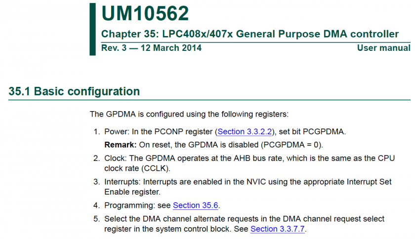

##### Objective

- Copy data from one memory block to another memory block using DMA controller 
- Use implemented driver to compare the performance between DMA copy and CPU copy 

 

---

##### Part 0: Read the DMA chapter

The first step is to familiarize yourself with the DMA peripheral. Read the LPC user manual multiple times before you start the assignment.



 

---

##### Part 1: Basic DMA driver

In this portion of the lab, you will implement GPDMA driver by choosing one of the DMA channels (0-7, preferably 7) for performing memory-to-memory copy between 2 arrays. You will be modifying DMA registers available in `lpc40xx.h`

```c
#include <stdbool.h>
  
#include "lpc40xx.h"
#include "lpc_peripherals.h"

typedef enum {
  DMA__CHANNEL_0 = 0,
  DMA__CHANNEL_1,
  DMA__CHANNEL_2,
  DMA__CHANNEL_3,
  DMA__CHANNEL_4,
  DMA__CHANNEL_5,
  DMA__CHANNEL_6,
  DMA__CHANNEL_7,
} dma__channel_e;

LPC_GPDMACH_TypeDef *dma_channels[] = {LPC_GPDMACH0, LPC_GPDMACH1, LPC_GPDMACH2, LPC_GPDMACH3,
                                       LPC_GPDMACH4, LPC_GPDMACH5, LPC_GPDMACH6, LPC_GPDMACH7};

void dma__initialize(void) {
  // 1. Power on GPDMA peripheral; @see "lpc_peripherals.h"
  lpc_peripheral__turn_on_power_to(...); // Fill in the arguments
}

void dma__copy(dma__channel_e channel, const void *dest, void *source, uint32_t size_in_bytes);
  // 2. Enable GPDMA - Set the Enable bit in Config register
  
  // 3. Clear any pending interrupts on the channel to be used by writing to the IntTCClear
  // and IntErrClear register. The previous channel operation might have left interrupt active

  // 4. Write the source address into the CSrcAddr register.
  dma_channels[channel]->CSrcAddr = (uint32_t)source;
  
  // 5. Write the destination address into the DestAddr register.
  
  // 6. Write the control information into the Control register in one instruction
  // transfer size [11:0]
  // source burst size [13:12]
  // dest burst size [15:14]
  // source transfer width [20:18]
  // destination transfer width [23:21]
  // source address increment [26]
  // destination address increment [27]
  // TCI enable

  // Enable channel by setting enable bit for the channels CConfig register

  // IMPORTANT:
  // Poll for DMA completion here
}

bool check_memory_match(const void *src_addr, const void *dest_addr, size_t size) {
  // Write code to check the data of source and destination arrays
  // Hint: You may use memcmp()
}

int main(void) {
  const uint32_t array_len = _____; //specify a length (< 2^12)

  // Be aware that you only have 64K of RAM where stack memory begins
  // You can make these 'static uint32_t' or make them global to not use stack memory
  uint32_t src_array[array_len];
  uint32_t dest_array[array_len];

  // Initialize the source array items to some random numbers

  // Choose a free DMA channel with the priority needed.
  // DMA channel 0 has the highest priority and
  // DMA channel 7 the lowest priority
  dma__initialize();
  dma__copy(...);        // fill in the arguments
    
  const bool memory_matches = check_memory_match(...); // fill in the arguments

  while (true) {
  }

  return 1; // main() shall never return
}
```

 

---

##### Part 2: Compare Performance of various methods

Reuse code from [Part 1](#h3skd7kt32t18sycplsrt13og84b5e). Reference the code below to measure the time taken for DMA copy, programmatic copy and standard library function `memcpy()`

```c
#include <string.h>

// Declare source and destination memory for the lab
static uint8_t memory_array_source[4096];
static uint8_t memory_array_destination[4096];

// Re-initialize the memory so they do not match
static void reset_memory(void) {
  for (size_t i = 0; i < sizeof(memory_array_source); i++) {
    memory_array_source[i] = i;
    memory_array_destination[i] = i + 1;
  }
}

// Copy memory using standard library memcpy()
static uint32_t memory_copy__memcpy(void) {
  const uint32_t start_time_us = sys_time__get_uptime_us();
  {
    memcpy(...); // TODO: Fill in the parameters
  }
  const uint32_t end_time_us = sys_time__get_uptime_us();
  
  return (end_time_us - start_time_us);
}

// Copy memory using the DMA
static uint32_t memory_copy__dma(void) {
  const uint32_t start_time_us = sys_time__get_uptime_us();
  {
    dma__copy(...); // TODO: Fill in the parameters
  }
  const uint32_t end_time_us = sys_time__get_uptime_us();
  
  return (end_time_us - start_time_us);
}

static uint32_t memory_copy__loop(void) {
  const uint32_t start_time_us = sys_time__get_uptime_us();
  {
    // TODO: Use a for loop
  }
  const uint32_t end_time_us = sys_time__get_uptime_us();
  
  return (end_time_us - start_time_us);
}

int main()
{
  dma__initialize(...);

  // Test 1:
  reset_memory();
  const uint32_t dma_us = memory_copy__dma();
  if (!check_memory_match(memory_array_source, memory_array_destination, sizeof(memory_array_source)) {
    puts("ERROR: Memory copy did not work");
  }

  // TODO: Reset memory, then perform memory copy, and check if memory matches
  // Test 2:
  const uint32_t loop_us = memory_copy__loop();
  
  // Test 3:
  const uint32_t memcpy_us = memory_copy__memcpy();
 
  printf("DMA copy completed in: %lu microsec\n", dma_us);
  printf("For loop completed in: %lu microsec\n", loop_us);
  printf("memcpy completed in  : %lu microsec\n", memcpy_us);
 
  while (true) {
  }
  return 1; // main() shall never return
}
```

 

---

##### Requirements

- [Part 1](#bkmrk-part-1%3A-basic-dma-dr) and [Part 2](#bkmrk-part-1a.-implement-t) must be completed and fully functional. 
  - You are encouraged to ask questions for any line of code that is not well understood (or magical). 
- Try changing source burst size and destination burst size bits to understand performance improvements 
  - Note the time taken in each case and turn in the screenshots 
- Should be able to make it work for any DMA channels(0-7) or array size  

  - We may ask you to change the channel or array length and then recompile and re-flash your board to and prove it works 

#### What to turn in:

- Turn in the **screenshots** of terminal output for different burst size 

**Extra Credit - Make program to choose DMA channels using onboard buttons and run DMA copy process**

 

 

---