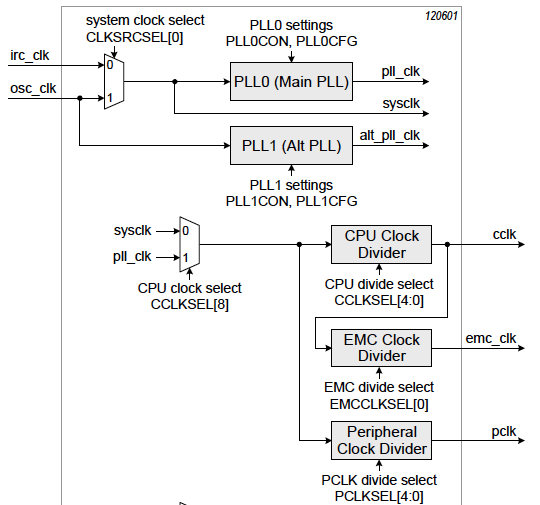

One of the first aspects of a startup process is CPU clock configuration. Usually, a microcontroller would have an internal "RC" oscillator, which is referenced in the diagram below as an IRC. This internal oscillator allows the CPU to boot before the application code can switch to another clock source if desired.

### Exercise

Note that because you will be altering the clock source, your UART driver which is used to output printf() data may not work.

1. OSC clock 
  1. Verify if you have an external oscillator installed on your board 
  2. Switch the CLCKSEL[8] to switch to SYSCLK 
  3. Modify CLKSRCSEL[0] to switch to OSC clock 
  4. Validate that you are able to execute code by blinking an LED 
2. Revert your changes from the previous part to complete this part 
  1. Divide the Peripheral clock 2 using PCLKSEL[4:0] 
  2. Use 38400 in webserial application and check what is output when you hit RESET on your board 
  3. Slow down the webserial communication rate by 2 (ie: 19200 vs. 38400) 
    1. Validate that you are able to see the printf() output 
    2. Explain your observations 
3. Try setting the CCLKSEL[4:0] to 0 
  1. Is your LED still blinking? 
  2. Explain your results