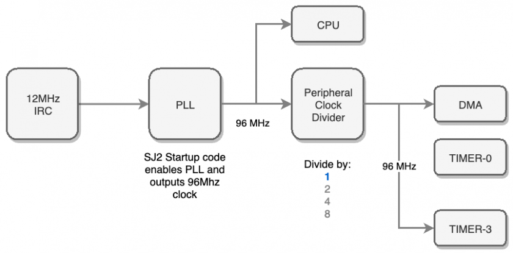
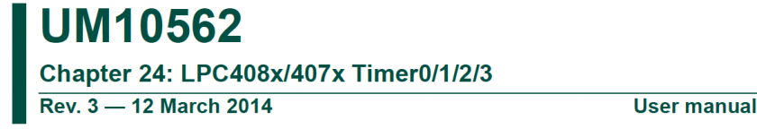
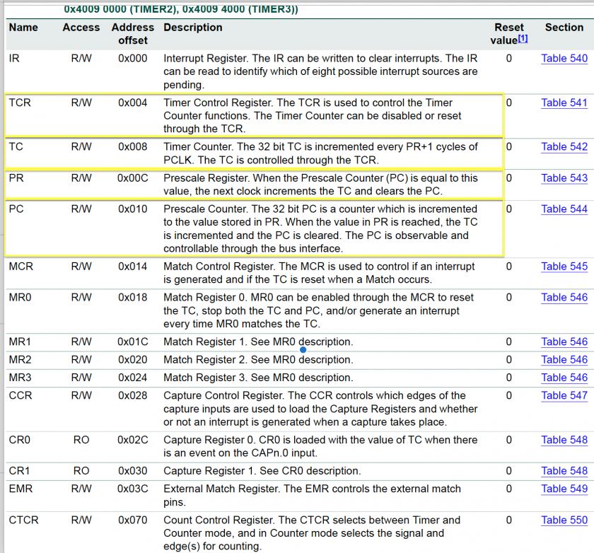

A hardware timer is a time tracking peripheral that runs independent of the foreground CPU instructions. For example, you can start to count the clock cycles using a hardware timer independent of the instructions the CPU is processing. Fundamentally, a hardware timer is a CPU peripheral, but you can consider "CPU peripheral" as an independent CPU, or co-processor.

 

---

#### Part 0: Fundamentals

Objective of this part is to fully understand the clock system, and the registers of the Timer Peripheral.

First thing to recognize is that all peripherals are configured to receive the PLL clock. As a reminder, `12MHz` clock on the SJ2 (NXP chip) is multiplied to `96MHz`, and this clock is then sourced to the hardware timer peripheral. What this means is that you can digitally count the number of clock cycles of the CPU which is `96Mhz`, and each timer register ticking up (or incrementing) is at the rate of about `10.4ns`.



The LPC User manual chapter of interest is:



The register of relevance:

- PC 
  - This register will count the input clock which is the PCLK (peripheral clock) 
  - When it equals to the value of (PR + 1) then it resets back down to zero, and increment TC by 1 
- PR 
  - This register provides means to divide the clock, and increment the TC register slower than the input clock of 96Mhz. So for example, `if (PR == 95)`, then input clock of 96Mhz will increment the PC register, and when that equals to 95, the TC will increment by 1. So in this example, we will configure such that TC register will increment at 1Mhz rather than 96MHz 
- Match Registers 
  - When TC matches one of the four registers, you can generate events such as resetting the timer 
- Capture Registers 
  - These allow you to capture events such as an external GPIO (switch or a sensor) giving data by means of signal pulses. The capture registers can capture the time when a GPIO goes low, or it goes high, and in the end you can use this peripheral to read pulse width modulation signals 




 

---

#### Part 1: Bring up the Timer

In this part, we will configure the Timer peripheral to make sure that it is incrementing as expected.

There are four HW timers on the NXP LPC40xx. We will use the Timer-3 peripheral for this assignment; we could theoretically use any HW timer peripheral, but the Timer-0 is already utilized by the sample project specifically to support the delay APIs, and to get system uptime.

```c
#include "lpc40xx.h"
#include "lpc_peripherals.h"

void hw_timer3__initialize(void) {
  // 1. Power on TIMER peripheral as per the timer_num argument; @see "lpc_peripherals.h"
  lpc_peripheral__turn_on_power_to(...); // Fill in the arguments
}

void hw_timer3__enable_timer(void) {
  // 2. Configure the PR register
  
  // 3. Configure the PC register

  // 4. Configure the TCR register

}

uint32_t hw_timer3__get_timer_counter(void) {
  // Return the TC register value
}

int main(void) {  
  hw_timer3__initialize(....); // fill in the arguments
  hw_timer3__enable_timer();

  printf("Timer3 MR0 value: %u\n", LPC_TIM3->MR0);
  // TODO: Print other registers:
  // TCR
  // PR
  // PC
  
  while (true) {
   	  delay__ms(1000);
      printf("TC value: %u\n",hw_timer3__get_timer_counter());
    }
  }

  return 1; // main() shall never return
}
```

 

---

#### Part 2: Delay API

In this part, we will build an API to delay the CPU execution with precision of within a few tens of nanoseconds.

Reuse code in Part 1 and create a new api called `delay__ns(uint32_t nanos)`. Note that in the sample code below, we use an API (`delay__us`) to estimate that our nanosecond delay API is *roughly *correct. The `delay__us` API is not very precise and may easily be inaccurate by 1-2uS.

```c
#include "lpc40xx.h"
#include "lpc_peripherals.h"

void delay__ns(uint32_t nanos) {
  // Use TC as reference and keep looping inside this function until delay is done
    
}

void hw_timer3__enable_timer(void) {
  // From Part 1
}

int main(void) {
  const uint32_t nanos = ________; //fill in the nanoseconds (Ex. 500)
  
  // Initialize
  hw_timer3__initialize(...);
  hw_timer3__enable_timer();
  
  uint32_t start_time_us = 0;
  uint32_t end_time_us = 0;

  while (true) {
      start_time_us = sys_time__get_uptime_us();
      delay__ns(nanos);
      end_time_us = sys_time__get_uptime_us();
 
      printf("Diff in microsecs: %u\n", (end_time_us - start_time_us));
      delay__ms(1000);
    }
  }

  return 1; // main() shall never return
}
```

  

---

#### Part 3: Make Delay API precise

In this part, we will apply a software instruction cycle compensation to the delay function you built.

- You will inspect the generated `*.lst` file (in your build directory) 
- Assuming average of 2 clock cycles per instruction, you will compensate for this for the delay 
- If the delay API is called with fewer nanoseconds than minimum, you can exit the function immediately 
- Note that in case you cannot find your function in the lst file, please try using GCC "no inline" attribute. 
  - `void delay_ns() __attribute__ ((noinline));` 

```c
void delay__ns(uint32_t nanos) {
  const uint32_t function_invocation_approximate_cycles = 10; // You determine the number
  
  // At 96MHz, it is approximately 10ns per clock cycle
  const uint32_t function_invocation_approximate_nanos = 10 * function_invocation_approximate_cycles;
  
  // Compensate...
  if (nanos > function_invocation_approximate_nanos) {
    nanos -= function_invocation_approximate_nanos;
  }
}
```

 

---

#### Requirements

- [Part 1](#bkmrk-part-1%3A) and [Part 2](#bkmrk-part-2%3A) must be completed and fully functional. 
  - You are encouraged to ask questions on any of the register settings 
- The delay function you build must compensate for software delay ([Part 3](#bkmrk-%C2%A0requirements)) 
- Change seconds/nanos values and check the output prints 
  - Turn in the print screenshots 

##### What to turn in:

- Code snippets 
- Turn in the **screenshots** of terminal output for different seconds/nanoseconds values 

 

---

#### Extra credit: Going above and beyond:

- You can use the PC and the TC registers to form a 64-bit counter 
  - The only trick is that you will have to read them in a way to make sure that you do not read one register value while the other one has overflows 
  - See reference code below for hints 

```c
uint64_t sys_time__get_uptime_us(void) {
  uint32_t before = 0;
  uint32_t after = 0;
  uint32_t tc = 0;

  /**
   * Loop until we can safely read both the rollover value and the timer value.
   * When the timer rolls over, the TC value will start from zero, and the 'after' value will be less than the 'before'
   * value in which case, we will loop again and pick up the new rollover count.
   */
  do {
    before = LPC_TIM3->PC;
    tc = LPC_TIM3->TC;
    after = LPC_TIM3->PC;
  } while (before < after);

  uint64_t bit64 = ((uint64_t)after << 32) | tc;
}
```