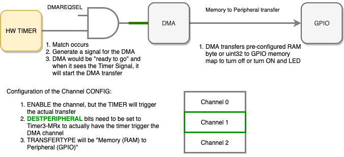

 

In this assignment, we will use multiple CPU peripherals and allow them to talk to each other per the design of the NXP chip. This means that you can only "program" the hardware to do what it is capable of, and we cannot arbitrarily have peripherals talk to each other unless NXP chip provides such capability.

 

---

#### Part 0: Fundamentals

Let us first understand the overall block diagram of various different components we will be programming. The objectives to understand are:

- HW Timer will generate a "trigger" signal for the DMA 
  - We will use a "Match" register to generate the trigger signal 
- DMA channel will be pre-configured to transfer a value from RAM to the GPIO peripheral 
  - The channel `CONFIG` register bits, particularly the `DESTPERIPHERAL` chooses which channel will receive what trigger request 

 



 

---

#### Part 1: Program DMA to write GPIO

In this part, we will configure the DMA and test it **independently of the HW timer** to ensure that it is able to write to our GPIO register correctly. The objective is to program the DMA to turn on or turn off an LED, and we will trigger the DMA manually in software (rather than having the HW timer do that).

We will need to:

1. Choose a persistent (global) RAM variable as source of data (`static` variable) 
  - This is the value we want to write to either the GPIO SET or CLR register. For example, if you are to set or clear led number 13, then you will set the variable's value to `(1 << 13)` 
  - Note that the LEDs are active LOW, so if the LED is lit by default (before the `main()` function), then you would set DMA destination address to write to the GPIO SET register 
2. Set DMA source as Memory (RAM) 
3. Set DMA destination as Peripheral (GPIO) 
  - For this part it may not matter, but once the HW timer is used as a trigger, then you have to set the destination as a peripheral type 
4. Set source size as one non-incrementing byte address 
5. Set destination size as non-incrementing byte address 
6. Transfer type would be memory-to-memory because the destination is set to address of GPIO memory register 

By the end of this portion of the lab, you should prove yourself that you can use the DMA to write the GPIO peripheral to turn off an LED. The register settings may be a bit confusing, so here is a note from a previous student:

When setting the Destination peripheral note that you are not setting the location where the transfer is going to but you are setting the source of the DMA request and in the case where the source is the timer match then you will need to set a the transfer type as a memory to memory.

```c
#include <stdbool.h>
  
#include "lpc40xx.h"
#include "lpc_peripherals.h"

// All DMA related functions and global variables to be re-used from previous DMA lab

void dma__setup_ram_to_peripheral() {
  // Reuse code from previous lab dma__copy() function for register configuration
  // In CControl register, do not increment the destination address
  .
  .
  .
  // In CConfig register 
  // Set TIMER3 MR0 as DESTPERIPHERAL
  // Set Memory-to-peripheral as TRANSFER TYPE

  // Example: We wish to turn on P1.26
  // We are trying to do this: 'LPC_GPIO1->CLR = (1 << 10)'
  // Use 'static' such that source memory never goes out of scope
  static const uint32_t value_from_ram_you_want_to_write = (1 << 26);
  [CH2]->SRC = (uint32_t) &value_from_ram_you_want_to_write;
  [CH2]->DST = &(LPC_GPIO1->CLR);
}

int main(void) {

  LPC_SC->DMAREQSEL = __________; // Set Timer3 Match Compare 0 as DMA request signal

  // DMA initialization to initialize common GPDMA registers
  dma__initialize();
  
  // Use SET register to turn off LED P1.26
  // Startup code should have enabled the LED, so you will disable (turn it off)
  dma__setup_ram_to_peripheral();
  
  while (true) {
  }

  return 1; // main() shall never return
}
```

 

---

#### Part 2: Configure HW Timer to trigger DMA

In this part, we will enable the HW timer to automatically kick the DMA to do the transfer of data from memory to the GPIO peripheral. Since the DMA is already configured to transfer a fixed byte from our RAM to the GPIO peripheral, the only thing to really figure out is how to have the HW timer kick a specific DMA channel.

General steps:

1. HW timer (TC register) starts at value of zero 
2. HW timer is pre-programmed to kick the DMA upon a "match" 
  - Which means that we need to choose our desired value of the "match register" 
3. DMA should be programmed to receive DMA start request from your HW timer 

You can consider a few approaches:

- HW Timer match can stop the TC when it occurs (and it will still generate DMA trigger signal) 
- HW Timer match can reset TC back to zero to make it a periodic DMA request 

By the end of this portion of the lab, you should ensure that your timer is working, and upon the match register value match, that it does what you designed the timer to do (such as reset the TC, and generate DMA)

```c
// Reuse the TIMER3 code from previous lab
// Set MR0 register to peripheral clock frequency
// Set PR register to 95, such that each TC increments every 1uS (good for easy calculations)
void setup_timer3_match0_dma_trigger(void) {
  // TODO: complete this
}

```

 

---

#### Part 3: Integration

In this part, we will ensure that after you prove that the Timer can kick pre-programmed DMA channel, there should be a graceful terminal condition such that the transfer does not happen again unless requested by you as a programmer. The objective is to bring it all together, and use Part 0 - Part 2 to turn off an LED by using the timer and the DMA.

 

---

#### Part 4: Blinky LED

To earn bonus points, create an application that will:

- Setup two channels of DMA 
  - Match 0 triggers DMA Channel 0 
  - March 1 triggers DMA Channel 1 
- Setup HW timer to trigger CH0 every odd second (1, 3, 5, etc.) 
  - Use "Match 0" 
- Setup HW timer to trigger CH1 every even second (2, 4, 6, etc.) 
  - Use "Match 1" 
- Create an application that will blink an LED at 1Hz without writing the GPIO peripheral 

 

---

#### Requirements

- Source code submitted to Canvas 
- Any accompanying screenshots or videos