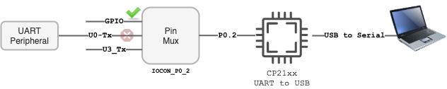
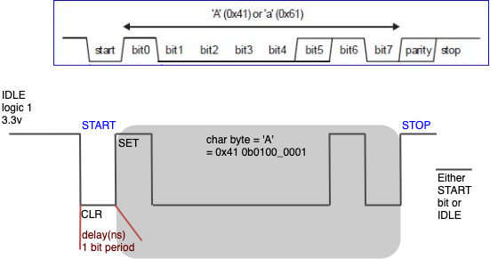

The objective of this assignment is to emulate UART in software. You will use a GPIO pin to transmit data to another UART receiver.

Here is another bookstack page to reference:

- [http://books.socialledge.com/books/sjsu---embedded-drivers-rtos/page/uart](/sjsu---embedded-drivers-rtos/pages/35-uart/) 

---

 

#### Part 0: Fundamentals

In this part, you will understand the fundamentals of what you are trying to accomplish in this assignment. We will disconnect the UART peripheral that transmits data, and take control of the pin using the GPIO peripheral.

Each I/O pin can be selected for a specific function. By default in the SJ2 software code, the `P0.2` is selected for UART transmission. We will disconnect this from the UART peripheral, and take control of this pin using the GPIO peripheral.



Sample code below; please inspect the function calls to figure out what register it may be writing, and correlate this with the LPC user manual. For example, confirm that `gpio__construct_as_output()` is writing to the `DIR` register.

```c
#include "gpio.h"

const uint32_t pin2 = 2;

// See board_io.c for reference
static void disconnect_uart_peripheral(void) 
  gpio__construct_with_function(GPIO__PORT_0, pin2, GPIO__FUNCTION_0); // P0.2 - Uart-0 Tx

  // Construct P0.2 as an output pin and set to logic HIGH to "IDLE" level of the UART signal
  gpio__construct_as_output(GPIO__PORT_0, pin2);
  LPC_GPIO0->SET = (1 << pin2); // Set P0.2 as HIGH (3.3 logic "1")
}
```

---

 

#### Part 1: UART in `main()`

In this part, you will design your software based UART in your main function and transmit a string to your computer. You will use the [HW timer delay](/sjsu---advanced-microcomputer-design/pages/10-dma-and-timer-integration/) you build in one of the previous labs.

Note that since you took over the `P0.2` pin in [Part 0](#bkmrk-part-0%3A-fundamentals), you can control this pin using the GPIO peripheral. UART idles high on startup, so you should design such that the pin is left with logic high when idle. So far, your skeleton of the code should resemble something like the following code snippet below. The one thing you lose is that because we have taken over `P0.2` (UART peripheral is no longer controlling this pin), we can no longer `printf()` or output any data to the serial console anymore, but this is only temporary until the next [Part 2](#bkmrk-part-2%3A-connect-prin).

At the end of this Part, you should be able to convince yourself that you are able to fully emulate the UART using the GPIO. Instead of peripheral doing the work for you, you are using your CPU to do the work, so of course things are not as efficient as they can be.

What we will try to do is send out data by directly controlling the `P0.2`. You may have built your HW timer function which has accuracy of maybe a few tens, or even a couple of hundred nanoseconds. UART can compensate for about 3% error, so what this means is that if you are sending data at 9600bps, the other receiver may be able to read your data even if it is running 9870bps.



```c
static const uint32_t pin2 = (1U << 2);

// Make this function static to make it 'private' to this file only
static void disconnect_uart_peripheral(void) 
  gpio__construct_with_function(GPIO__PORT_0, 2, GPIO__FUNCTION_0); // P0.2 - Uart-0 Tx
  gpio__construct_as_output(GPIO__PORT_0, 2);
  LPC_GPIO0->SET = pin2;
}

// Make this function non static on purpose
// static
void gpio_uart_send_byte(char byte) {
  // Set LOW for the start bit
  LPC_GPIO0->CLR = pin2; your_hw_delay_ns(baud_rate_delay_ns);
  
  // TODO: 
  // Send 1 bit at a time of the 'byte' with LSB first
  // Use a for loop or similar to send all 8 bits using the P0.2 GPIO

  // Set HIGH for the stop bit
  LPC_GPIO0->SET = pin2; your_hw_delay_ns(baud_rate_delay_ns);
}

int main(void) {
  disconnect_uart_peripheral();

  while (1) {
    gpio_uart_send_byte('G');
    gpio_uart_send_byte('O');
    delay_ms(1000);
  }

  return 0;
}
```

---

 

#### Part 2: Connect `printf()` to UART

In this part, you will replace the underlining function that uses hardware based UART peripheral with your software based UART function.

Please note the following:

- `printf()` is invoked before the `main()` function starts to run 
- If you have any dependency on your HW timer initialization before your `main()`, then you may have to perform a workaround 
- The `_write()` function is meant to send multiple bytes according to `const char *ptr, int bytes_to_write`)  

The key is to alter `system_calls.c` file and re-direct its output to our UART function. Check the following for reference.

```c
// file: system_calls.c

// Declare your GPIO based UART output function here so we can invoke it
// The compiler's linker will "find" this function even without an inclusion of a header file
void gpio_uart_send_byte(char byte);

int _write(int file_descriptor, const char *ptr, int bytes_to_write) {
  if (_isatty(file_descriptor)) {
    // ...
    if (rtos_is_running && transmit_queue_enabled && !is_standard_error) {
      //Instead of calling this function, call your GPIO UART based function
      //system_calls__queued_put(ptr, bytes_to_write); // replace with gpio_uart_send_byte()
    } else {
      //system_calls__polled_put(ptr, bytes_to_write); // replace with gpio_uart_send_byte()
    }
  } else {
    system_calls__print_and_halt("ERROR: Call to _write() with an unsupported handle");
  }

  return bytes_to_write;
}
```

Of course, after altering the file, test it out by now using `printf()` in your `main()` function.

 

---

 

#### Extra Credit

To go above and beyond, you can use a timer interrupt to latch one bit at a time and minimize your CPU consumption. The psuedo-algorithm is as follows:

```c
char byte_to_transmit;
size_t bit_number;

void transmit_byte(char byte) {
  while (timer_is_running) {
    ; // Wait for previous transmission to complete
  }

  bit_number = 0;
  byte_to_transmit = byte;

  // Initialize HW timer
  // 1. Set Match register interrupt for 104uS (assuming 9600bps)
  // 2. Enable timer
}

// System interrupt will invoke this function every 104uS
void timer_match_interrupt(void) {
  switch (bit_number) {
    case 0: CLR = ?; break; // start bit

    case 1 ... 8: GPIO = byte_to_transmit & 0x01; byte_to_transmit >>= 1;
      break;
 
    case 9: // stop bit
      GPIO = 1; // SET Register
      // TODO: Disable timer
      break;
  }

  bit_number++;
}
```

For this portion of the assignment, you should use `hw_timer.h` which has existing API to enable timer and an interrupt callback.

```c
// Reference hw_timer.h

// Reference how sys_timer.c generates match interrupt
// Inside the interrupt, you also have to acknowledge and clear interrupt

/**
 * Enables and starts the timer
 * @param prescalar_divider This divider is applied to the clock source into the timer
 *                          This is offset by 1, so 0 means divide by 1, and 1 means divide by 2
 *
 * @param isr_callback      The ISR callback for the timer, including all Match-Register interrupts
 * @note The isr_callback may be NULL if the timer will not be configured for any match interrupts
 */
void hw_timer__enable(lpc_timer_e timer, const uint32_t prescalar_divider, function__void_f isr_callback);
```