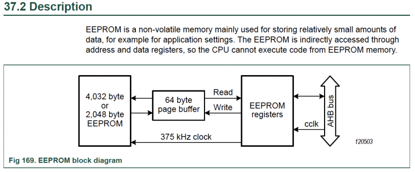

In this assignment, we will build up a driver to write the EEPROM on the NXP processor.

> 

EEPROM is a non-volatile memory mainly used for storing relatively small amounts of data, for example for application settings. The EEPROM is indirectly accessed through address and data registers, so the CPU cannot execute code from EEPROM memory

---

#### Part 0: EEPROM Chapter



 

---

#### Part 1: Driver Skeleton

To simplify the driver interface, we will deal with "pages" and read and write the entire page at a time rather than reading or writing singular bytes.

```c
#include "lpc40xx.h"

typedef struct {
  uint8_t bytes[64];
} eeprom_page_s;

void eeprom__initialize(void) {
  // Configure PWRDWN, CLKDIV, WSTATE registers as per datasheet instructions 
}

uint8_t eeprom__read_page(eeprom_page_s *page, uint8_t page_number) {
    //1) Read data from RDATA register
    //2) Wait for read to finish
}

uint8_t eeprom__write_page(const eeprom_page_s *page, uint8_t page_number) {
    //1) Write byte_data to WDATA register
    //2) Issue another CMD to erase/program and wait for process to finish
}

int main(void) 
{
  // For 4K EEPROM - 64 pages limit and each page can hold 64 bytes of data

  // TODO: Setup your test harness, such as:
  // Write a page of known data
  // Read a page
  // Compare the pages together
  while(1)
  {
  }
  
  return 0;
}
```

 

---

#### Part 2: Implementation with page data read/write

 Reuse the above code and implement writing/reading stream of data with page offset

```c

void eeprom__read_data(uint32_t page_num, uint32_t page_offset, void *buff, size_t bytes_to_read) {
  LPC_EEPROM->ADDR = (page_num << 6) | page_offset;

  //Configure READ operation
  
  uint32_t index = 0;
  for(....) {
    //copy data to buffer
  }
}

void eeprom__write_data(uint32_t page_num, uint32_t page_offset, void *buff, size_t bytes_to_write) {
  //a) Set ADDR with page address. Refer API above
  
  //b) Configure WRITE operation
  
  uint32_t index = 0;
  for(....) {
    //copy buffer to WDATA register
  }
}

int main(void) {
  //For 4K EEPROM - 64 pages limit and each page can hold 64 bytes of data
  
  //1) Create a char buffer with your name
  const char name[] = "_________"; //fill in
  uint32_t name_len = ____________; //fill in
  
  //2) Initialize EEPROM
  
  //3) Copy name buffer to EEPROM page 5 offset 10 and program/flush data to EEPROM
  
  //4) Verify the data on page 5 by reading into a buffer and print
  
  while(1)
  {
  }
  
  return 0;
}
```

 

---

#### Part 3: Extra Credit

To earn bonus points, enhance the READ/WRITE APIs that will:

- Use Interrupt status during read/write/Program/Erase operation 
- Make reads/writes to take in 8-bit/16-bit/32-bit configuration as argument 

 

---

#### Requirements

- Source code and terminal output screenshots submitted to Canvas