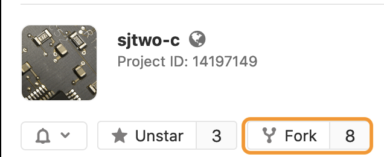

This is definitely not an exhaustive tutorial about learning Git... Google would be better to reveal several great tutorials about Git. What we focus on instead is a simplistic workflow about publishing a "Pull Request" in Git.

#### What is Gitlab?

Gitlab provides services that allow hosting your project on a remote repository and provides additional features that help in continuous integration and deployment. Such as code sharing, code review, and bug tracking.  

---

#### Part 0: Setup Gitlab account

For better or worse, we have decided to use Gitlab.com for the repository. You are also required to use this Gitlab repository because that keeps the entire class aligned to a single server type and reduces fragmentation while increasing the efficiency of the teacher and the ISA team.

For this part, establish your [Gitlab.com](https://gitlab.com/users/sign_in?__cf_chl_jschl_tk__=ed8fca8914c93977c8f260cef7139a3052fe0a59-1612903080-0-AXaW60uR5_sMWPEn3MulZtSx4B-qNsLmFRIHHNnrE-T0fv1qlm_e-cTan9w6Ej-qYHAkF5kWNBBHMGkHw0XegKrOSBMdiFwU_hVWL3oyNfPqVuebPkM80Qa_jmUryWuRXa-uUaiKQKz5Ncgsb5JDVzB_5mSAyEheI58t8hJRL_K7aa_L_S9iePn9-1Kpki83EKxq4fxzKdrTqKzF55k0EgqO-swioKIzPudgEs7D8i2yOe0SFCridRlHb7-i7jMkjvYVm7CBEsbUkP0mwNgkEIsAkgWVo8s_6wHwDRDxosInP3Tpl7x0xUGrFtoRY6M440FXb2MJ9UqJtQIajmY5oTMlNbEVmb0-UUFzYhsOoA5bquWTCa1AvKsP2EdwvtypMQ) account.

##### How to set up a Gitlab account?

1. Go to [GitLab.com](https://gitlab.com/users/sign_in?__cf_chl_jschl_tk__=ed8fca8914c93977c8f260cef7139a3052fe0a59-1612903080-0-AXaW60uR5_sMWPEn3MulZtSx4B-qNsLmFRIHHNnrE-T0fv1qlm_e-cTan9w6Ej-qYHAkF5kWNBBHMGkHw0XegKrOSBMdiFwU_hVWL3oyNfPqVuebPkM80Qa_jmUryWuRXa-uUaiKQKz5Ncgsb5JDVzB_5mSAyEheI58t8hJRL_K7aa_L_S9iePn9-1Kpki83EKxq4fxzKdrTqKzF55k0EgqO-swioKIzPudgEs7D8i2yOe0SFCridRlHb7-i7jMkjvYVm7CBEsbUkP0mwNgkEIsAkgWVo8s_6wHwDRDxosInP3Tpl7x0xUGrFtoRY6M440FXb2MJ9UqJtQIajmY5oTMlNbEVmb0-UUFzYhsOoA5bquWTCa1AvKsP2EdwvtypMQ)and create an account. 
2.  Sign in to GitLab. 

In addition, also install Git to your machine such that you can successfully execute the `git` Commands from a terminal.

1. Download git from [GIT_Install](https://git-scm.com/) and install git. 
2. Check git is installed on your system by using the "git --version" command in the terminal. 

---

#### Part 1: Fork SJ2-C Project

When you fork a project, you essentially create a copy of the original SJ2-C repository. This will be your version of the forked project, and you can use this throughout the semester for your private workspace to do the lab assignments.

Browse to the [SJtwo-c repository,](https://gitlab.com/sjtwo-c-dev/sjtwo-c) and click on the Fork button.



After you fork the repository, make sure you set the permissions to "public". Do this by going into your newly forked repository settings, and look for the "Visibility" setting.

##### How to change project visibility

1. Go to your newly forked project’s **Settings** 
2. Change **Visibility Level** to Public 

---

#### Part 2: Basic Git Commands

*INIT*

The first thing you want to do before you init is to add a project on the Git website to see the “Setting up a new Git repository” section. If you have a folder with code that is not on Git, and you wish to put it on the Git server, then you need to initialize Git into your folder. This creates a .git folder, and the current directory is now a Git repository. The .git folder contains Git information such as branches. Initializing your folder is local to your computer and does not yet upload onto the server.

```bash
# To add your project to the git 
# Initialize current directory
$ git init 

# Initialize selected directory
$ git init <directory>
```

*CLONE*

If you see a repository that you want to work on, you can “clone” it into a directory and start working on it. Cloning it will download the entire repository as well as a .git folder. Note that the clone is different from “pull”. This will be explained later. Just use this command once at the beginning of the project unless you want multiple folders.

```bash
# Downloads entire repository to current directory
$ git clone <repo>

# Downloads entire repository to selected directory
$ git clone <repo> <directory>
```

---

The difference between forking and cloning a GIT project means when you **fork** a repository, you create a copy of the original repository (upstream repository) but the repository remains on your personal Gitlab account. Whereas, when you **clone** a repository, the repository is copied onto your local machine with the help of Git.

---

#### Part 3: Branch Workflow

The process of checking-in new code to your forked repository will involve "Branch Workflow". There are actually a number of ways to contribute code to your repository, and the branch workflow is just one of them that we will choose to use.

We are not going to discuss that in detail because it is already captured well in **[this awesome article](https://www.atlassian.com/git/tutorials/comparing-workflows/feature-branch-workflow)**. We will summarize the process that you will use to do this. The `$` indicates the commands you should try.

```bash
# See what is going on
$ git status
On branch master

# Create a new "branch" of code to work on
# You can use any name, and feature/foo is just a convention
$ git checkout -b feature/gpio_blinky_in_periodics
Switched to a new branch 'feature/gpio_blinky_in_periodics'

# Add or modify a file we want
$ touch file.txt

# Tell git to add it to be committed
$ git add file.txt

# Check what is going on
$ git status
On branch feature/gpio_blinky_in_periodics
Changes to be committed:
(use "git reset HEAD <file>..." to unstage)

new file: file.txt

# Commit the change with a message
$ git commit -m "added file.txt"
[feature/gpio_blinky_in_periodics 5f76839] added file.txt
1 file changed, 0 insertions(+), 0 deletions(-)
create mode 100644 file.txt

# Check what is going on
$ git status
On branch feature/gpio_blinky_in_periodics
nothing to commit, working tree clean
```

 

---

#### Part 4: Merge Request (MR)

The typical name of a request to merge code is called a "Pull Request" or a "Merge Request". This is the chance to review the code and merge the code. In the end, `Part 3` you have a branch that only exists on your computer. In case you lose your computer or your storage device dies, then you **will lose** any work even though you have "committed" a change.

The distinction is that a commit only commits to your storage device, but does not send the data or the branch to the Git server. To actually push the code to the Git server, simply type `git push origin head`.

```bash
$ git push origin head
Enumerating objects: 3, done.
Counting objects: 100% (3/3), done.
Delta compression using up to 12 threads
Compressing objects: 100% (2/2), done.
Writing objects: 100% (2/2), 262 bytes | 262.00 KiB/s, done.
Total 2 (delta 1), reused 0 (delta 0)
remote: 
remote: To create a merge request for feature/gpio_blinky_in_periodics, visit:
remote:   https://gitlab.com/sjtwo-c-dev/sjtwo-c/-/merge_requests/new?merge_request%5Bsource_branch%5D=feature%2Fgpio_blinky_in_periodics
remote: 
To gitlab.com:sjtwo-c-dev/sjtwo-c.git
 * [new branch]      head -> feature/gpio_blinky_in_periodics
```

This command will generate a URL for you, so copy and paste this URL to your web browser. For example, the URL above is: `https://gitlab.com/sjtwo-c-dev/sjtwo-c/-/merge_requests/new?merge_request%5Bsource_branch%5D=feature%2Fgpio_blinky_in_periodics`

**This will lead you to generate your "Merge Request"**. At the end of the web page that loads, click on "Submit Merge Request". At this point, you can view the changes, get feedback from others, and if the code looks good, you can then merge the code. But wait ... rarely will you be able to merge code without iterating and revising it, and that is what Part 5 is for. 

---

#### Part 5: Revise an MR

Granted that you have an MR already out there, and you have got feedback from others, this section will teach you how to revise or amend your code.

```bash
# Modify any code
# In this case, we will dump 'hello' to our previously committed file: file.txt
$ echo "hello" >> file.txt

# Check what is going on
$ git status
On branch feature/gpio_blinky_in_periodics
Changes not staged for commit:
  (use "git add <file>..." to update what will be committed)
  (use "git checkout -- <file>..." to discard changes in working directory)

	modified:   file.txt

# Add the file we want to re-commit (another commit on top of previous)
$ git add file.txt
$ git commit -m "Added hello to file.txt"

# Update the remote branch and the Merge Request
$ git push origin head
```

After the `git push` command, your MR will be updated on the browser. This way, you can continue to revise your MR per the suggestions of other people. When you are satisfied with your MR, you can seek approval and officially hit the Merge button on the Gitlab.com webpage.

---

#### Part 6: Final Step

After you have merged your MR, it is time to go back to the master branch and grab the latest changes. Other users may have merged their code also, so pulling the latest master branch is going to get you the latest and greatest code.

```bash
# Go to the master branch
$ git checkout master

# Pull the latest master
$ git pull origin master
```

---

#### Part 7: Going beyond . . .

There is of course A LOT more to Git, but once you master the basics, you can then Google your way through the rest of the world you will face such as:

- Handling merge conflicts 
- Check out other people's branches 

Rebase on the latest master branch.

```bash
$ git status 
# Assume that you are on your feature branch

$ git checkout master
$ git pull origin master

# Go back to the previous branch you were working with (feature)
$ git checkout -

# Apply our commits to the latest master
$ git rebase master
```

---

#### Part 8: Steps to create MR for Lab Submissions

The process of checking-in new code to your forked repository will involve "Branch Workflow" as explained in **PART 3**. The following steps will help you to add new code/files for each of your lab submissions.

- Goto cmd OR terminal OR git bash. CD to the location of the cloned project(cd sjtwo-c/projects/lpc40xx_freertos/l5_application) and run the following commands. 

```bash
 # You can use any name, it's better to use lab with the number as a branch name.
 # such as lab1,lab2
$ git checkout -b lab1
Switched to a new branch 'lab1'

# Add or modify files as per the given lab assignment
# for example lab 1 requires two files
$ touch lab_multitasks.c
$ touch lab_multitasks.h 

# Check what is going on
$ git status
On branch lab1
Untracked files:
  (use "git add <file>..." to include in what will be committed)

	lab_multitask.c
	lab_multitask.h
    
# Tell git to add it to be committed
$ git add .

# Check what is going on
$ git status
On branch lab1
Changes to be committed:
  (use "git reset HEAD <file>..." to unstage)
	new file:   lab_multitask.c
	new file:   lab_multitask.h

# Commit the change with a message
$ git commit -m "added lab1 files"
[lab1 e88f23d] added lab1 files
 2 files changed, 0 insertions(+), 0 deletions(-)
 create mode 100644 projects/lpc40xx_freertos/l5_application/lab_multitask.c
 create mode 100644 projects/lpc40xx_freertos/l5_application/lab_multitask.h

# Check what is going on
$ git status
On branch lab1
nothing to commit, working tree clean

# Update the remote branch and the Merge Request
$ git push origin head
Enumerating objects: 3, done.
Counting objects: 100% (3/3), done.
Delta compression using up to 12 threads
Compressing objects: 100% (2/2), done.
Writing objects: 100% (2/2), 262 bytes | 262.00 KiB/s, done.
Total 2 (delta 1), reused 0 (delta 0)
remote: 
remote: To create a merge request for lab1, visit:
remote:   https://gitlab.com/sjtwo-c-dev/sjtwo-c/-/merge_requests/new?merge_request%5Bsource_branch%5D=lab1
remote: 
To gitlab.com:sjtwo-c-dev/sjtwo-c.git
 * [new branch]      head -> lab1
 
 
 # Assume that you are on your lab branch
 # To comeback to master branch
$ git checkout master
```

- Create a merge request for each lab and use the merge request URL for your lab submissions.  
  - Please follow **PART 4** to generate and submit "Merge Request" on Git. 
  - After submitting a merge request you will receive a new URL on the browser. Use that URL for your canvas submission. 
- Follow the same steps for creating the next lab branch(such as lab2), add new files to the lab2 branch(such as lab_gpio.c and lab_gpio.h), and create a merge request for the submission after completing your GPIO driver.    

for appropriate to; intended for More (Definitions, Synonyms, Translation)

Note make mention of More (Definitions, Synonyms, Translation)