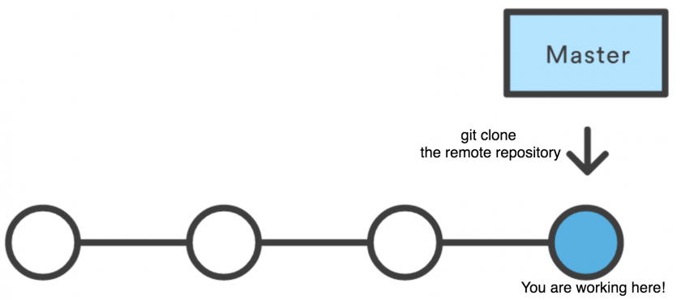
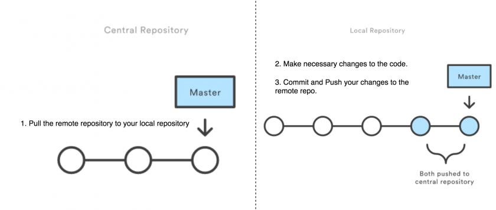
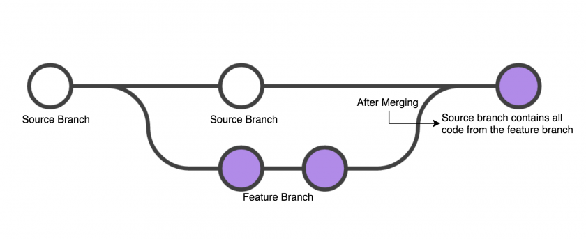
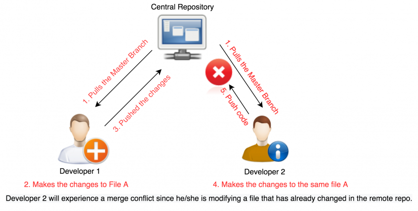

#### What is Gitlab?

Gitlab provides services that allow hosting your project on a remote repository and provides additional features that help in continuous integration and deployment. Such as code sharing, code review, and bug tracking. 

---

#### GIT Workflow

In Git there is the notion of a "Master" code base which contains the work of all contributing members in a project.

There are two basic workflows that you may follow when using Git for version control.

1. Committing directly to the "Master" branch. 
2. Creating branches from the "Master" branch and merging them back in when ready. 

This section of the guide will walk you through these two workflow strategies.

---

### 1. Working off the "Master" Branch

Working directly off the "Master" branch can be advantageous to smaller groups who rarely (if ever) work on the same portions of the code at a time.

                             .png)

The basic workflow for this method is as follows:

1. "Pull" from the Master branch to ensure the local copy contains the latest version of the code. 
2. Make necessary changes to the code in your local repository. 
3. Commit your changes. 
4. "Push" your changes to the remote repository. 

  

In git commands this would look like this:

```bash
# Make sure you are on master branch
git checkout master

# Make sure you have the latest code
git pull origin master

# Make your changes to your code
# Add files you may have changed to your commit
git add <file1> <file2> ...
# Add all untracked files to your commit
git add . 

# Commit your changes
git commit -m "<commit message here>"

# Push your changes
git push origin HEAD
```

---

### 2. Working with feature branches

The second workflow takes advantage of the branching system in git. To protect your Master branch from code that may break your build or introduce bugs we can create what is called a "feature branch." These branches contain your development code and isolate it from the main code until you are ready to merge them together.

The workflow is as follows:

1. Do a "git fetch" to obtain the latest version of your source branch. 
2. Check out a new branch. 
3. Perform your work on your new branch (be sure to make regular commits to avoid losing any of your work.)  
4. Merge the two branches. 

 Here is the general workflow in git commands: 

```bash
# Checkout your "source" branch (the branch you want to base your code off of)
git checkout master

# Obtain the latest code
git fetch origin

# Create a new branch from your source branch
git checkout -b <new branch name>

# Make your code changes and commit them regularly
git add <file1> <file2> ...
git commit -m "<commit message>"

# Push your changes to your FEATURE branch
# GIT server knows this branch after the push and other people can also check-out your branch
# But this branch is not yet merged to the master branch
git push origin HEAD
```

When you are ready to merge your branch back into the source branch there are two routes you may take:

1. Merge your feature branch directly into the source branch. 
2. Open a pull request for peer code review prior to merging your branch. 

---

To merge your feature branch into the source uses the following workflow:

1. Check out the source branch. 
2. Ensure your source branch contains the most updated code from the remote repo. 
3. Merge your feature branch into the source branch. 
4. Push the newly merged source branch back to the remote repo. 

The git commands for this workflow looks like this:

```bash
# Checkout the source branch that you want to merge your branch into (assuming your source was 'master')
git checkout master

# Ensure your source branch is up-to-date
git pull origin master

# Merge your feature branch INTO the source branch
git merge <feature branch>

# At this point, you might need to resolve merge conflicts

# Push your changes to the remote repo
git push origin master
```

---

## 3. Merge Conflicts

When working in a team it will be inevitable that the same file will be touched by multiple developers. If multiple make changes in the same part of the file, then it will result in a merge conflict when attempting to merge the files together. These conflicts can be resolved in your IDE directly or in any text editor.

##### What is Git Merge Conflict?

A merge conflict is an event that takes place when Git is unable to automatically resolve differences in code between two commits. Git can merge the changes automatically only if the commits are on different lines or branches.

.png)Let’s assume there are two developers: Two developers pull the same code file from the remote repository and try to make various amendments to the same file. After making the changes, Developer 1 pushes the file back to the remote repository from his local repository. Now, when Developer 2 tries to push that file after making the changes from his end, he is unable to do so, as the file has already been changed in the remote repository.

To prevent such conflicts, developers work in separate isolated branches. The Git merge command combines separate branches and resolves any conflicting edits.

The git commands for this workflow looks like this:

```bash
# The status command will provide you with the current status of your branch. It provides information
# such as files changed or whether or not you are up-to-date with the remote branch.
$ git status
On branch merge_branch
Your branch is up to date with 'origin/merge_branch'.

Changes not staged for commit:
  (use "git add <file>..." to update what will be committed)
  (use "git checkout -- <file>..." to discard changes in working directory)

        modified:   merge_demo.c

no changes added to commit (use "git add" and/or "git commit -a")

# Make your code changes and commit them
$ git add .
$ git commit -m "chnages in the c file"
[merge_branch d2d4473] chnages in the c file
 1 file changed, 1 insertion(+), 1 deletion(-)

# Push your changes to the remote repo
$ git push
To https://gitlab.com/Jain_Vidushi/sjtwo-c.git
 ! [rejected]        merge_branch -> merge_branch (fetch first)
error: failed to push some refs to 'https://gitlab.com/Jain_Vidushi/sjtwo-c.git'
hint: Updates were rejected because the remote contains work that you do
hint: not have locally. This is usually caused by another repository pushing
hint: to the same ref. You may want to first integrate the remote changes
hint: (e.g., 'git pull ...') before pushing again.

# Ran into the MERGE CONFLICT

# Ensure your source branch is up-to-date
$ git pull
remote: Enumerating objects: 2, done.
remote: Counting objects: 100% (2/2), done.
remote: Compressing objects: 100% (2/2), done.
remote: Total 2 (delta 0), reused 0 (delta 0), pack-reused 0
Unpacking objects: 100% (2/2), done.
From https://gitlab.com/Jain_Vidushi/sjtwo-c
   0d0ac2a..139b80d  merge_branch -> origin/merge_branch
Auto-merging merge_demo.c
CONFLICT (content): Merge conflict in merge_demo.c
Automatic merge failed; fix conflicts and then commit the result.
Users-MBP-2:sjtwo-c Macbook$ git status
On branch merge_branch
Your branch and 'origin/merge_branch' have diverged,
and have 1 and 1 different commits each, respectively.
  (use "git pull" to merge the remote branch into yours)

You have unmerged paths.
  (fix conflicts and run "git commit")
  (use "git merge --abort" to abort the merge)

Unmerged paths:
  (use "git add <file>..." to mark resolution)

        both modified:   merge_demo.c

no changes added to commit (use "git add" and/or "git commit -a")
# At this point, you might need to resolve merge conflicts on your local machine

# Make your code changes as per the conflict and commit them again
$ git add .
$ git commit -m "conflict resolved"
[merge_branch 2f261aa] conflict resolved

# Push your changes to the remote repo
$ git push
Counting objects: 4, done.
Delta compression using up to 8 threads.
Compressing objects: 100% (4/4), done.
Writing objects: 100% (4/4), 537 bytes | 537.00 KiB/s, done.
Total 4 (delta 1), reused 0 (delta 0)
remote: 
remote: View merge request for merge_branch:
remote:   https://gitlab.com/sjtwo-c-dev/sjtwo-c/-/merge_requests/157
remote: 
To https://gitlab.com/Jain_Vidushi/sjtwo-c.git
   139b80d..2f261aa  merge_branch -> merge_branch
   

```

 

Synonyms for "fetch" fetch the action of fetching More (Definitions, Synonyms, Translation)