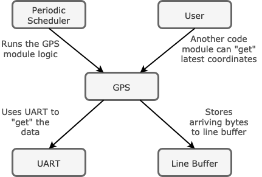

#### Objective

- Use existing drivers to communicate over UART (GPS module will utilize it). 
- For this assignment, refer `uart3_init.h` api's available here:  `sjtwo-c/projects/lpc40xx_freertos/l4_io/uart3_init.h` 
- Design a line buffer library that may be useful with the GPS module 
- Reinforce how to design software structured around the periodic callbacks 

---

##### Background

A GPS typically operates by sending "NMEA" strings over UART in plain ASCII text that is readable by humans. Here is a [good reference article](http://aprs.gids.nl/nmea/#gsa). What you will do is use one of the SJ2 boards to send a "fake" GPS string, and have another board parse the input and extract latitude and longitude.

.png)

---

##### Overall Software Design

What we are designing is a GPS code module that exposes a simple API for the periodic scheduler to run its logic, and another API for a user to query GPS coordinates.

```c
// @file gps.h
#pragma once
  
// Notice the simplicity of this module. This module is easily mockable and provides a very
// simple API interface UART driver and line buffer module will be hidden inside of gps.c
  
void gps__run_once(void);
float gps__get_latitude(void);
```

This module internally (at its `gps.c` file) has other module dependencies, but it does not introduce these dependencies to the user and in fact, keeps them hidden. **This is useful because any code module that `#includes` the GPS module should not need to know or mock the UART or the line buffer code module.**



```c
// @file gps.c
#include "gps.h"
  
// Our 'private' modules: We hide and abstract away these details from the user
// Whoever #includes "Mockgps.h" will not need to deal with these because
// these are included in this source file rather than the header file
#include "uart.h"
#include "line_buffer.h"

void gps__run_once(void) {
  // ...
}
```

 

---

#### Lab

##### Part 0: Familiarize with MCU Pins

The LPC (SJ2) microcontroller has dedicated pins that can be used for serial communication such as UART. The `uart3_init()` or `uart__init()` code did not explicitly choose the UART pins to initialize the RX/TX. The first thing to do is identify the pins that you will be using (or compromising) for UART communication.

Please reference:

- [This article for SJ2 board I/O pins](/sjsu---embedded-drivers-rtos/pages/08-sj2-board/) 

After selecting the UART pins from the article, you can use `gpio__construct_with_function()` API for initializing UART pins:

```c
// UART1 is on P0.15, P0.16
gpio__construct_with_function(GPIO__PORT_0, 15, GPIO__FUNCTION_1); // P0.15 - Uart-1 Tx
gpio__construct_with_function(GPIO__PORT_0, 16, GPIO__FUNCTION_1); // P0.16 - Uart-1 Rx

// UART2 is on P0.10, P0.11
gpio__construct_with_function(GPIO__PORT_0, 10, GPIO__FUNCTION_1); // P0.10 - Uart-2 Tx
gpio__construct_with_function(GPIO__PORT_0, 11, GPIO__FUNCTION_1); // P0.11 - Uart-2 RX

// UART3 is on P4.28, P4.29
gpio__construct_with_function(GPIO__PORT_4, 28, GPIO__FUNCTION_2); // P4.28 - Uart-3 Tx
gpio__construct_with_function(GPIO__PORT_4, 29, GPIO__FUNCTION_2); // P4.29 - Uart-3 Rx
```

At this point, **put your SJ2 board away,** and perform test-driven development of the code modules and we will test it on the board at the last step of this lab. You can use the following sample code in conjunction by shorting the UART3 RX/TX pins to ensure that you can send and receive data correctly.

```c
static char output_data = 'a';

void periodic_callbacks__1Hz(uint32_t callback_count) {
  uart__put(UART__3, output_data, 0);
 
  char input = 0;
  if (uart__get(UART__3, &input, 2)) {
    printf("Tx %c vs. Rx %c\n", output_data, input);
  }
  
  ++output_data;
  if (output_data > 'z') {
    output_data = 'a';
  }
}

```

 

---

##### Part 1: Create `line_buffer` code module

In this part of the lab, you will create a new code module that will remove data from the UART driver, and buffer it inside of this code module. Collaboration is encouraged so please **pair the program** and **do not work on this code module alone. **Notice the minimal API because according to our tests below, we simply will not need anything further than this.

```c
#pragma once

#include <stdint.h>
#include <stdbool.h>

// Do not access this struct directly in your production code or in unit tests
// These are "internal" details of the code module
typedef struct {
  void * memory;
  size_t max_size;
  size_t write_index;
} line_buffer_s;

/**
 * Initialize *line_buffer_s with the user provided buffer space and size
 * Use should initialize the buffer with whatever memory they need
 * @code
 *  char memory[256];
 *  line_buffer_s line_buffer = { };
 *  line_buffer__init(&line_buffer, memory, sizeof(memory));
 * @endcode
 */
void line_buffer__init(line_buffer_s *buffer, void *memory, size_t size);

// Adds a byte to the buffer, and returns true if the buffer had enough space to add the byte
bool line_buffer__add_byte(line_buffer_s *buffer, char byte);

/**
 * If the line buffer has a complete line, it will remove that contents and save it to "char * line"
 * Note that the buffer may have multiple lines already in the buffer, so it will require multiple
 * calls to this function to empty out those lines
 *
 * The one corner case is that if the buffer is FULL, and there is no '\n' character, then you should
 * empty out the line to the user buffer even though there is no newline character
 *
 * @param line_max_size This is the max size of 'char * line' memory pointer
 */
bool line_buffer__remove_line(line_buffer_s *buffer, char * line, size_t line_max_size);
```

Here are the unit-tests that are already designed for you. You should use this to ensure that the line buffer code module is working correctly. These unit-tests are pre-written because we wanted to ensure that your line buffer module is functional even in the corner cases; **feel free to also add more tests **to these minimal set of tests.

```c
#include "unity.h"

// Include the source we wish to test
#include "line_buffer.h"

// Most unit-tests focus on nominal cases, but you should also have
// tests that use larger line buffers etc.
static line_buffer_s line_buffer;
static char memory[8];

// This method re-initializes the line_buffer for the rest of the tests
void setUp(void) { line_buffer__init(&line_buffer, memory, sizeof(memory)); }

void tearDown(void) {}

static void add_bytes_to_buffer(const char *string) {
  for (size_t index = 0; index < strlen(string); index++) {
    TEST_ASSERT_TRUE(line_buffer__add_byte(&line_buffer, string[index]);
  }
}

void test_line_buffer__nominal_case(void) {
  add_bytes_to_buffer("abc\n");

  char line[8];
  TEST_ASSERT_TRUE(line_buffer__remove_line(&line_buffer, line, sizeof(line)));
  TEST_ASSERT_EQUAL_STRING(line, "abc");
}

void test_incomplete_line(void) {
  add_bytes_to_buffer("xy");

  char line[8];
  // Line buffer doesn't contain entire line yet (defined by \n)
  TEST_ASSERT_FALSE(line_buffer__remove_line(&line_buffer, line, sizeof(line)));
  
  // Line buffer receives \n
  line_buffer__add_byte(&line_buffer, '\n');
  TEST_ASSERT_TRUE(line_buffer__remove_line(&line_buffer, line, sizeof(line)));
  TEST_ASSERT_EQUAL_STRING(line, "xy");
}

void test_line_buffer__slash_r_slash_n_case(void) {
  add_bytes_to_buffer("ab\r\n");

  char line[8];
  TEST_ASSERT_TRUE(line_buffer__remove_line(&line_buffer, line, sizeof(line)));
  TEST_ASSERT_EQUAL_STRING(line, "ab\r");
}

// Line buffer should be able to add multiple lines and we should be able to remove them one at a time
void test_line_buffer__multiple_lines(void) {
  add_bytes_to_buffer("ab\ncd\n");

  char line[8];
  TEST_ASSERT_TRUE(line_buffer__remove_line(&line_buffer, line, sizeof(line)));
  TEST_ASSERT_EQUAL_STRING(line, "ab");
  
  TEST_ASSERT_TRUE(line_buffer__remove_line(&line_buffer, line, sizeof(line)));
  TEST_ASSERT_EQUAL_STRING(line, "cd");
}

void test_line_buffer__overflow_case(void) {
  // Add chars until full capacity
  for (size_t i = 0; i < sizeof(memory); i++) {
    TEST_ASSERT_TRUE(line_buffer__add_byte(&line_buffer, 'a' + i));
  }

  // Buffer should be full now
  TEST_ASSERT_FALSE(line_buffer__add_byte(&line_buffer, 'b'));

  // Retreive truncated output (without the newline char)
  // Do not modify this test; instead, change your API to make this test pass
  // Note that line buffer was full with "abcdefgh" but we should only
  // retreive "abcdefg" because we need to write NULL char to line[8]
  char line[8] = { 0 };
  TEST_ASSERT_TRUE(line_buffer__remove_line(&line_buffer, line, sizeof(line)));
  TEST_ASSERT_EQUAL_STRING(line, "abcdefg");
}
```

 

---

##### Part 2: Create `gps` code module

The GPS code module will glue the UART driver, and the `line_buffer` module and this will be the single module that needs to be integrated with the periodic callbacks.

The starter code for `gps.h` and `gps.c` is given below, but there are some missing pieces. This is not to spoil your fun, but to provide a guideline of how the GPS code module should be structured. You need to build the unit-tests for the GPS module: `test_gps.c`

```c
// gps.h
#pragma once

// Note:
// South means negative latittude
// West means negative longitutde
typedef struct {
  float latitude;
  float longitude;
} gps_coordinates_t;

void gps__init(void);
void gps__run_once(void);

gps_coordinates_t gps__get_coordinates(void);
```

```c
// gps.c
#include "gps.h"

// GPS module dependency
#include "uart.h"
#include "line_buffer.h"

#include "clock.h" // needed for UART initialization

// Change this according to which UART you plan to use
static const uart_e gps_uart = UART__2;

// Space for the line buffer, and the line buffer data structure instance
static char line_buffer[200];
static line_buffer_s line;

static gps_coordinates_t parsed_coordinates;

static void gps__transfer_data_from_uart_driver_to_line_buffer(void) {
  char byte;
  const uint32_t zero_timeout = 0;
  
  while (uart__get(gps_uart, &byte, zero_timeout)) {
    line_buffer__add_byte(&line, byte);
  }
}

static void gps__parse_coordinates_from_line(void) {
  char gps_line[200];
  if (line_buffer__remove_line(&line, gps_line, sizeof(gps_line))) {
    // TODO: Parse the line to store GPS coordinates etc.
    // TODO: parse and store to parsed_coordinates
  }
}

void gps__init(void) {
  line_buffer__init(&line, line_buffer, sizeof(line_buffer));
  uart__init(gps_uart, clock__get_peripheral_clock_hz(), 38400);
  
  // RX queue should be sized such that can buffer data in UART driver until gps__run_once() is called
  // Note: Assuming 38400bps, we can get 4 chars per ms, and 40 chars per 10ms (100Hz)
  QueueHandle_t rxq_handle = xQueueCreate(50, sizeof(char));
  QueueHandle_t txq_handle = xQueueCreate(8, sizeof(char));  // We don't send anything to the GPS
  uart__enable_queues(gps_uart, rxq_handle, txq_handle);
}

void gps__run_once(void) {
  gps__transfer_data_from_uart_driver_to_line_buffer();
  gps__parse_coordinates_from_line();
}

gps_coordinates_t gps__get_coordinates(void) {
  // TODO return parsed_coordinates
}
```

```c
// @file test_gps.c
#include "unity.h"

// Mocks
#include "Mockclock.h"
#include "Mockuart.h"

#include "Mockqueue.h"

// We can choose to use real implementation (not Mock) for line_buffer.h
// because this is a relatively trivial module
#include "line_buffer.h"

// Include the source we wish to test
#include "gps.h"

void setUp(void) {}
void tearDown(void) {}

void test_init(void) {}

void test_GPGLL_line_is_ignored(void) {}

void test_GPGGA_coordinates_are_parsed(void) {
  const char *uart_driver_returned_data = "$GPGGA,hhmmss.ss,llll.ll,a,yyyyy.yy,a,x,xx,x.x,x.x,M,x.x,M,x.x,xxxx*hh\r\n";
  for(size_t index = 0; index <= strlen(uart_driver_returned_data); index++) {
    const char the_char_to_return = uart_driver_returned_data[index];
    
    const bool last_char = (index < strlen(uart_driver_returned_data));
    uart__get_ExpectAndReturn(UART__3, ptr, 0, last_char);
    // TODO: Research on ReturnThruPtr() to make it return the char 'the_char_to_return'
  }
 
  gps__run_once();
  
  // TODO: Test gps__get_coordinates():
}

void test_GPGGA_incomplete_line(void) {}

void test_more_that_you_think_you_need(void) {}

```

 

---

##### Part 3: Integrate and test

Once you have your GPS and line buffer code module fully tested, this part might be the simplest part because your code may simply work the first time (which usually never happens). This is of course only possible because you have already unit-tested your code.

**Also note** that when you integrate the GPS code modules to `periodic_callbacks.c`, you will need to also update the unit-tests for `test_periodic_callbacks.c` by adding the mock of `gps.c`

```json
void periodic_callbacks__initialize(void) {
  // This method is invoked once when the periodic tasks are created
  gps__init();
}

/**
 * Depending on the size of your UART queues, you can probably 
 * run your GPS logic either in 10Hz or 100Hz
 */
void periodic_callbacks__100Hz(uint32_t callback_count) {
  gpio__toggle(board_io__get_led2());
  gps__run_once();
}
```

One assumption is that the second SJ2 board is already interfaced to your primary SJ2 board and is sending fake GPS data (see the sample code below). You can alternatively loopback your own board's UART pins and send GPS string data while simultaneously receive your own data back to test the implementation.

```c
// @file: fake_gps.c
#include "fake_gps.h" // TODO: You need to create this module, unit-tests for this are optional

#include "uart.h"
#include "uart_printf.h"
  
#include "clock.h" // needed for UART initialization

// Change this according to which UART you plan to use
static uart_e gps_uart = UART__1;

void fake_gps__init(void) {
  uart__init(gps_uart, clock__get_peripheral_clock_hz(), 38400);
  
  QueueHandle_t rxq_handle = xQueueCreate(4,   sizeof(char)); // Nothing to receive
  QueueHandle_t txq_handle = xQueueCreate(100, sizeof(char)); // We send a lot of data
  uart__enable_queues(gps_uart, rxq_handle, txq_handle);
}

/// TODO: You may want to be somewhat random about the coordinates that you send here
void fake_gps__run_once(void) {
   static float longitude = 0;
   uart_printf(gps_uart, "$GPGGA,230612.015,%4.4f,N,12102.4634,W,0,04,5.7,508.3,M,,,,0000*13\r\n", longitude);
   longitude += 1.15; // random incrementing value
}

```

 

---

##### Advanced Hints:

1. You can use `queue` module you built in the previous lab inside of your `line_buffer.h` module 
  - This means, that enqueue and dequeue logic would not have to be re-invented 
2. You can choose to decouple the GPS module from the UART 
  - The advantage would be to de-couple GPS code module from UART 
  - This would provide greater flexibility while unit-testing 
  - The glue logic of UART and GPS can occur at another code module. This can be tested separately and it would be easy to test because this module's job is simply to read data from UART and pass it on to the `gps__run_periodic()` function 

```c
// GPS API modification
// run_periodic() can be designed to not read data over a concrete UART API
// Instead, we can choose to receive accumulated data as a parameter
void gps__run_periodic(const char *accumulated_data);

// At a different code module, you can "glue" GPS and UART
void gps_uart_glue__run_once(void) {
  char accumulated_data[200] = { 0 };
  get_accumulated_data_from_uart(accumulated_data, sizeof(accumulated_data));
  gps__run_periodic(accumulated_data);
}

```