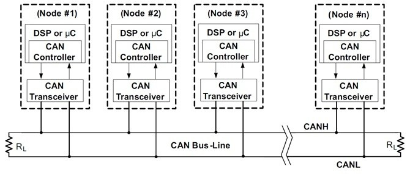

##### Objective

- Get a practical experience with CAN bus communication 
- Create hardware circuitry necessary for the CAN bus 

You need to work with your lab partner in this lab. Be sure to** pair the program,** and not work independently on this lab. 

---

##### Part 0: Interface two boards over CAN transceiver

CAN bus requires additional hardware that will be interfaced to your board. Your CAN controller has Rx and Tx wires, and these are interfaces to a "CAN Transceiver" which translates the Tx wire to the CAN bus line. Note that when this translation is performed, the CANH and CANL represent the state of the single Tx wire, and you are basically at half-duplex CAN bus. At any time, you are either transmitting or receiving, but you cannot be transmitting and receiving at the same time because **CAN bus is a half-duplex bus**. If you are actively transmitting, the Rx wire represents your own transmission that is read back from CANH and CANL.

 

---

##### Part 1: Configure the CAN driver

Reference the following starter code for details. To initialize the CAN driver, the easiest approach is to invoke the `init()` function and then bypass the CAN message acceptance filter and receive all CAN frames that arrive on the bus.

One thing you should do is that created a new code module such as `can_bus_initializer.h` Such that at the `periodic_callbacks__initialize()`, you invoke a single function to initialize the CAN bus. This would make it easier to add the unit-test for the periodic callbacks, and furthermore not create a blob software anti-pattern.

```c
#include "can_bus.h"

void periodic_callbacks__initialize(void) {
  // TODO: You should refactor this initialization code to dedicated "can_bus_initializer.h" code module
  // Read can_bus.h for more details
  can__init(...);
  can_bypass_filter_accept_all_msgs(...);
  can_reset_bus(...);
}
```

---

##### Part 2: Send and Receive messages

Setup your code in a 10 or 100Hz task:

- Transmit a test message 
- Receive all messages enqueued by your CAN driver  

  - This would empty out all messages you received, not including the message you transmitted 

Reference the following starter code for details. Once again, you should actually create a new code module called `can_bus_message_handler.h`. This file is definitely expected to grow because you will be handling **a lot more** CAN message in your RC car's production code.

```c
#include "can_bus.h"

// DONT
void periodic_callbacks__100Hz(uint32_t callback_count) {
  // TODO: Send a message periodically
  can__tx(...);

  // Empty all messages received in a 100Hz slot
  while (can__rx(...)) {

  }
}

// DO
void periodic_callbacks__100Hz(uint32_t callback_count) {
  can_handler__run_once();
}
```

 Be careful of the following:

- Since your periodic callback of 100Hz expects your function to return within 10 ms, you cannot block while receiving data from the CAN bus  

---

##### Part 3: Simple CAN bus application

- Build a meaningful communications' application 
  - For example, if Board=A senses a switch pressed, then send a 1-byte message with 0xAA, otherwise, send 0x00 if a button is not pressed 
- On Board-B, simply light up an LED (or otherwise turn it off) based on the CAN message data 
- For robustness, if the CAN Bus turns off, simply turn it back on at 1Hz (every 1000 ms) 
- You can be more creative here by sending tilt sensor readings from one board to another board and should have the mindset to go "above and beyond"  

---

##### Conclusion

This assignment gives you an overview of the practical use of the CAN Bus, and later, by utilizing the DBC file and auto-generation of code, sending and receiving data becomes very easy.

While this provides bare-bones knowledge of how communication works, the future lectures will focus on the application layer while abstracting away the details of CAN messages' data encoding and decoding.

Be sure to submit a Merge Request of your Git repository to get credit for the assignment.