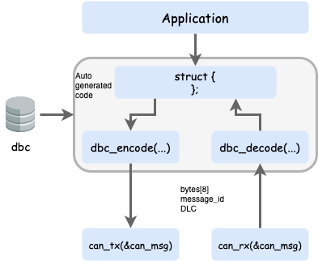
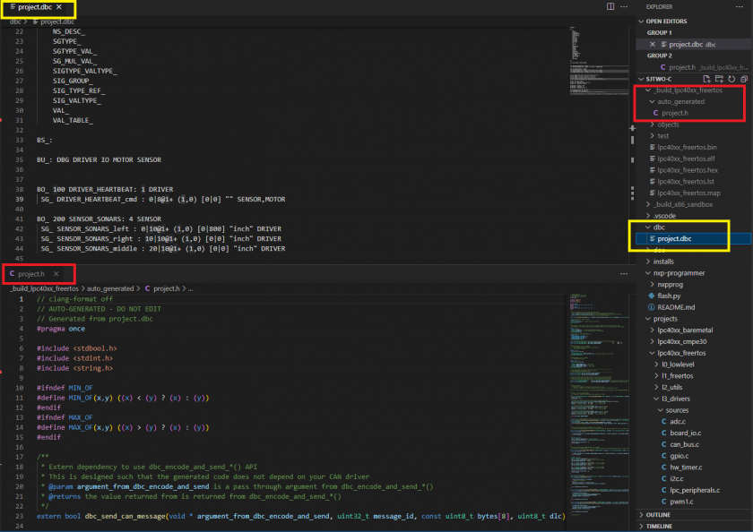

---

Objective of this lab is to:

- Define CAN message types in a DBC file 
- Auto-generate code based on the DBC file 
- Use two SJ2 boards interfaced over the CAN bus to communicate using generated code 



 

---

---

#### Part 0: DBC File

In this part, we will give meaning to various different bits and bytes that will be sent over the CAN bus. We are giving you a reference of `MOTOR_CMD` message, and in the sample dbc file located in your project folder, there is also `project.dbc`. These are reference points only, and you should be creating your own DBC message and not use these references word by word.

The snippet below dictates the following and you can read about DBC files in [detail here](http://socialledge.com/sjsu/index.php/DBC_Format). Documentation about the code generation can be [referenced here](https://gitlab.com/sjtwo-c-dev/sjtwo-c/-/tree/master/projects%2Flpc40xx_freertos).

- A message with ID `100` (decimal) will be sent and the name is `MOTOR_CMD` 
- This message will only be composed of a `1` data byte 
- It is sent by a CAN bus node called the `DRIVER` 
- First data field is `MOTOR_CMD_steer` and it is a 4-bit field starting with bit 0 
  - Intention is to send data in the range of -5 to +5 
- Second data field is `MOTOR_CMD_drive` 
  - We designed this field to represent numbers between 0-9 as in 0 for stop, and 9 for highest speed 
- The two data fields are received by a CAN bus node called the `MOTOR` 
  - There can be multiple receives separated by a comma, such as `MOTOR,IO` 

```c
BO_ 101 MOTOR_CMD: 1 DRIVER
 SG_ MOTOR_CMD_steer : 0|4@1+ (1,-5) [-5|5] "" MOTOR
 SG_ MOTOR_CMD_drive : 4|4@1+ (1,0) [0|9] "" MOTOR
```

Use the references and create your own message composed of "signals" that you wish to send from one microcontroller to another. We recommend that you create signals such as acceleration sensor value, or a button press value that you will send from one board to another.

##### Create your DBC

- Reference [Part 4](#bkmrk-part-4%3A-can-applicat) and think about messages you will send between microcontrollers interfaced over the CAN bus. This could be acceleration sensor readings, or light sensor values. 
- After you decide what data to transfer between controllers, think about the node names and add them to the BU line: `BU_: DBG DRIVER IO MOTOR SENSOR` at your DBC file 

 

---

---

#### Part 1: Code Generation

In this part, we will auto-generate C code based on the DBC file. The significance is that we want to minimize code development that is responsible to send correct data set on the CAN bus. This not only removes the tedious work and allows the developers to focus on the CAN application, but also minimizes common bugs related to transmission of data on the CAN bus.

An important aspect of code generation is that you should not have an API that is not relevant for your CAN node. So if you are the DRIVER CAN node, then you should not have functions that are related to sending sensor values of the SENSOR CAN node. To accomplish this, from now on, you should be using the following to compile your code

- `scons --dbc-node-name=<node name>` 
  - Example: `scons --dbc-node-name=MOTOR` 
  - The node name should be one of the ones defined in your DBC file:  
`BU_: DBG DRIVER IO MOTOR SENSOR` 
- This ensures that you will not generate any code that is not relevant for your CAN node 
- The default behavior is that code is generated for "ALL" nodes, **which is not something you should do** and it should be used for purely test purposes only. Another positive side effect is that when the DBC gets bigger, you want to read the code that is only relevant for yourself. 

##### Study Generated Code

Please read the `README.md` file located in your project directory ([or click here](https://gitlab.com/sjtwo-c-dev/sjtwo-c/-/tree/master/projects%2Flpc40xx_freertos)) to better understand the code generation aspect. Stop here, and spend 1-2 hours to understand the generated code that was created from your dbc file. We really mean it... spend time understanding the code because on the exams you will be asked to write this "encode" and "decode" code by yourself.



##### Unit Testing

For the code modules that use auto-generated code, you **should not mock** the generated code header file. This is because this is trivial code that does not involve any other code dependencies, and it is better to unit-test your code modules that use the auto-generated code without mocking. That means that in your unit-test file, simply `#include` the generated code, and let it encode and decode messages like it normally would.

 

---

---

#### Part 2: MIA Integration

In this part, we will provide instances of two key data types:

1. MIA counter threshold to replace data structure instance 
2. MIA data structure instance itself 

Well of course, we have to understand what is "MIA". MIA is Missing-In-Action, and the idea is that when an expected periodic message has not arrived, we replace it with safe values. For instance, when a temperature reading has not arrived, we can set the ambient temperature as a replacement value. This way, we do not have to repeatedly check if we can trust data values. In other words, if your RC car is controlling motors, we want to avoid this type of code:

```c
void drive_motors(void) {
  if (!sensor_values_are_valid()) {
    motor_speed_percent = 0;
  } else {
    if (sensor > 40) {
      motor_speed_percent = 10;
    } else {
      motor_speed_percent = 0;
    }
  }
}
```

 The code snippet above demonstrates that our code will be cluttered if we have to check for its validity everywhere. Instead, when periodic data goes missing, we just replace with zero, and therefore we can just retain this logic without checking for data validity upon each access of CAN network data.

```c
void drive_motors(void) {
  if (sensor > 40) {
    motor_speed_percent = 10;
  } else {
    motor_speed_percent = 0;
  }
}
```

Take a note of the following auto-generated code which is asking for `extern` definitions from you:

```c
// -----------------------------------------------------------------------------
// When a message's MIA counter reaches this value
// corresponding MIA replacements occur
// -----------------------------------------------------------------------------
extern const uint32_t dbc_mia_threshold_MOTOR_STATUS;

// -----------------------------------------------------------------------------
// User must define these externed instances in their code to use MIA functions
// These are copied during dbc_decode_*() when message MIA timeout occurs
// -----------------------------------------------------------------------------
extern const dbc_MOTOR_STATUS_s         dbc_mia_replacement_MOTOR_STATUS;
```

You will have to define the extern data values in a code module such as `can_mia_configurations.c` You can choose your own MIA replacement values, but if you leave it un-initialized they may be assumed as zero due to ANSI C standards.

```c
// @file can_mia_configurations.c

const uint32_t dbc_mia_threshold_MOTOR_STATUS = 500; // 500ms

// Leave uninitialized if we wish to accept zero values as sane MIA replacement
const dbc_MOTOR_STATUS_s dbc_mia_replacement_MOTOR_STATUS;
```

##### Handle your MIA

After defining the data above in a file such as `can_mia_configurations.c`, invoke the MIA management in one of your periodic functions like so:

```c
// @file periodic_callbacks.c
void periodic_callbacks_10hz(void) {
  can_handler__manage_mia_10hz();
}

// @file can_handler.c
void can_handler__manage_mia_10hz(void) {
  // We are in 10hz slot, so increment MIA counter by 100ms
  const uint32_t mia_increment_value = 100;

  if (dbc_service_mia_MOTOR_STATUS(&can_msg__motor_status, mia_increment_value))) {
    // Take action when a message has gone MIA?
    // Maybe light up an LED?
  }
}
```

 

---

---

#### Part 3: Encode and Decode

Encoding is used when you wish to transmit a data structure to the CAN bus. Obviously, this should only be used for a message that you are a transmitter of. Remember that **no two nodes shall transmit the same message** on a CAN bus. For more details about the auto-generated DBC API, see the following examples: [Exploring DBC Autogenerated API](/sjsu---cmpe243--industrial-applications-with-can-bus/pages/22-exploring-dbc-autogenerated-api/).

```c
// @file can_handler.c

// We are assuming that we have a 10hz function in which we wish
// to transmit all messages that should be sent at 10x per second
void can_handler__transmit_messages_10hz(void) {
  // Realistically, this message should be populated by a dedicated code module
  // TODO: Populate dbc_SENSOR_SONARS_s struct members
  dbc_SENSOR_SONARS_s sensor_struct = {};

  // Encode struct to bytes of the CAN message
  can__msg_t can_msg = {};
  const dbc_message_header_t header = dbc_encode_SENSOR_SONARS(can_msg.data.bytes, &sensor_struct);

  can_msg.msg_id = header.message_id;
  can_msg.frame_fields.data_len = header.message_dlc;
  can__tx(can1, &can_msg, 0);
}
```

On the receiving side, you should empty out all CAN frames received from the CAN driver, and then handle it in sort of a brute force approach.

```c
// @file can_handler.c

void can_handler__handle_all_incoming_messages(void) {
  can_msg_t can_msg = {};
  dbc_MOTOR_CMD_s decoded_motor_cmd = {};

  while (can__rx(can__1, &can_msg, 0)) {
    // Construct "message header" that we need for the decode_*() API
    const dbc_message_header_t header = {
      .message_id = can_msg.msg_id,
      .message_dlc = can_msg.frame_fields.data_len,
    }
    
    // Even if incoming message is NOT motor cmd, our decode functions
    // will gracefully handle it because we provide valid "message header"
    dbc_decode_MOTOR_CMD(&decoded_motor_cmd, header, can_msg.data.bytes);
  }
}
```

And, don't forget MIA management of the message as mentioned in [the section above](#bkmrk-part-2%3A-can-applicat).  
  

---

---

#### Part 4: CAN Application

In this part, we will focus on the CAN based application. In particular, a controller will send sensor data information on the CAN bus, and another controller will receive the data, interpret it, and print it out.

Summary of your overall tasks:

1. Define a DBC message for some data you wish to send 
2. Use Board #1 to encode and transmit the data periodically 
3. Use Board #2 to decode the received frame and do something with the received data 
4. And of course, be creative 

 

---

---

#### Part 5: BusMaster

In this part, you will connect your CAN bus over a PCAN dongle, and view your data on "Bus Master" which is an open source program to view CAN bus messages. You will connect the PCAN dongle over to a DB9 connector that is connected to your CAN bus.

[Follow this link](http://socialledge.com/sjsu/index.php/BusMaster) and setup your Bus Master, and follow the steps to install, configure, and explore the program.

 

---

---

#### Final Requirements

- New message added in DBC 
- Encode and Decode use the generated code based on the DBC 
- Demonstration of the MIA (light up LED when message is missing) 
- Unit-tests of the new code modules 
- Demonstration of your CAN messages also appearing in the BusMaster 

##### Unit Test Hints

TODO