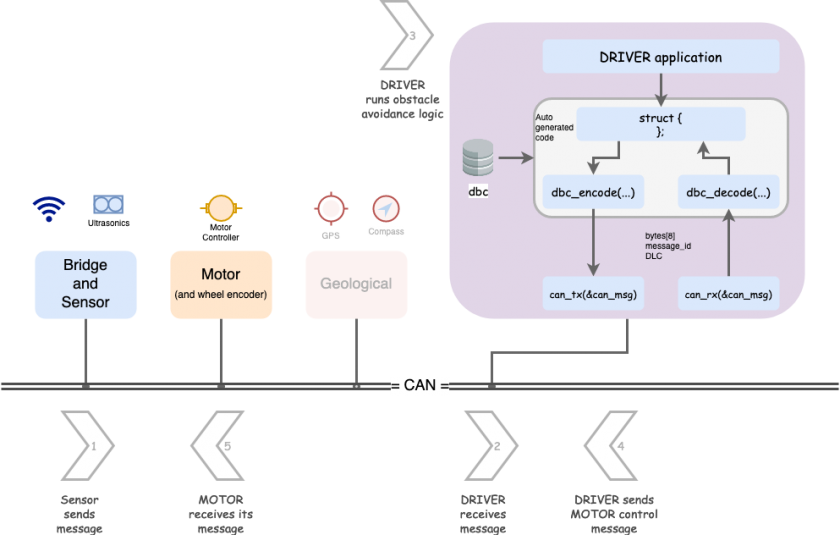

We are now on a roll . . . we are now going to work with multiple controllers that are interfaced to the CAN bus and react to each other's data. Please be sure to [read this article](/useful-knowledge/pages/09-code-modularity/).



In this lab, we are going to setup basic building blocks of your autonomous RC car. [Here is a required article](/sjsu---cmpe243--industrial-applications-with-can-bus/pages/17-project-introduction-and-guidelines/) you **should read first**. The outcome of the assignment is potentially multiple Gitlab Merge Requests MR - one for each controller. You will not only be setting up controllers that are communicating and reacting to data, but will also use BusMaster to demonstrate your data graphs of the CAN messages.

- Driver node 
  - Handles received CAN messages from the Sensor node 
  - Sends commands to the Motor Controller node 
- Sensor node sends out sensor messages 
  - Optional to add real sensors, otherwise we suggest an incremeting distance sensor value sent on the CAN bus  

  - Feel free to add debug counters, something as simple as the 1Hz callback count 
- Motor Controller node that receives commands 
  - Optional to add real servo (or motor) controller 
  - Feel free to add debug counters, something as simple as the 1Hz callback count 

This will be a RC car GROUP assignment, meaning multiple MRs for your larger RC car team.

- Driver node will have most of the code, which will intercept Sensor node messages and send Motor controller commands 
- Sensor node will at minimum send some kind of sensor values (could be fake ones) 
- The Motor Controller code is simple and doesn't need to do much other than receive its motor commands CAN message from the Driver node. 

---

##### Part 0: DBC

In this part, you should define the following CAN messages in the DBC file:

1. Sensor node messages 
  - Transmit: At minimum, front, left, and right sensor reading (usually ultrasonic distance sensor) 
2. Motor Controller node messages 
  - Receive: Steer and wheel control messages (transmitter will be Driver node) 
3. Driver node messages 
  - Transmit: Steer and wheel control messages 
  - Potentially debug information because you will receive Sensor node message(s) and transmit to Motor Controller node 

Remember [YAGNI](https://sibros.atlassian.net/wiki/spaces/SP/pages/101777636/Embedded+C+Coding+Standards#YAGNI), do not over-engineer things. Invent minimal DBC and code because there will be less code to write, less code to test. Do not solve for theoretical problems until you really see them. We would encourage you to have your steering values between `-2 to +2` and wheel speed as kph with fraction of `0.1`

---

##### Part 1: Driver Obstacle Avoidance Code Module

Design your code modules with simple input, and output as your first preference. Simple I/O modules are easier to code and test for. For example, the driver code module should be like the following:

```c
// @file driver_logic.h

// Assuming this data structure as input from the DBC
struct dbc_SENSOR_data_s;

// Assuming this data structure as output from the DBC
struct dbc_MOTOR_command_s;

// This should copy the sensor data to its internal "static" struct instance of dbc_SENSOR_data_s
void driver__process_input(dbc_SENSOR_data_s sensor_data);

// This should operate on the "static" struct instance of dbc_SENSOR_data_s to run the obstacle avoidance logic
dbc_MOTOR_command_s driver__get_motor_commands(void);

/**
 * Wow...
 * Is our Driver really going to be that simple? --> Yes, you should at least try to keep it that way.
 *
 * It takes a lot of effort to solve problems with minimal code
 * It is easy to write more code, and appear to be busy solving nasty intertwined bugs
 *
 * Yes, it is true that when you add GPS heading, your driver logic will change,
 * but we can work on that after this stage
 */
```

[Part 2](#bkmrk-part-2%3A-handle-can-m) gives suggestion regarding which code module should be invoking the `driver__process_input()` function.

---

##### Part 2: Handle CAN

Code modules like `driver_logic.h` should not be dealing with the CAN driver. All this code module should say is that "give me sensor values and I will give you back motor commands". This is part of modularizing code, and the path to not create [The Blob](https://sourcemaking.com/antipatterns/the-blob).

Let us create a dedicated code module to handle arriving CAN messages

```c
// @file msg_bank.h
#include "can_bus.h"

// Invoke this method in your periodic callbacks
void msg_bank__handle_msg(const can_msg_t *message);

// MIA management:
void msg_bank__service_mia_10hz(void);

// "GET" APIs to obtain latest data
dbc_SENSOR_data_s msg_bank__get_sensor_data(void);
dbc_some_data_s msg_bank__get_other_data(void);
```

```c
// @file msb_bank.c

// Include code modules that should receive their decoded CAN messages
#include "driver_logic.h"
#include "another_code_module.h"
  
static dbc_SENSOR_data_s sensor_data = {};
static dbc_some_data_s some_data = {};

void can_bus_handler__process_all_received_messages(void) {
  can_msg_t can_msg = {};
  
  // Receive all messages
  while (can_rx(can1, &can_msg)) {
    const dbc_message_header_t header = {
      .message_id = can_msg.msg_id,
      .message_dlc = can_msg.frame_fields.data_len,
    }
    
    if (dbc_decode_sensor_data(&sensor_data, header, can_msg.data.bytes)) {
    }
    
    if (dbc_decode_some_data(&some_data, header, can_msg.data.bytes)) {
    }
  }
}
```

The testing of the `can_bus_handler.c` should be easy because all it does is decodes messages, and routes the data to the code module owners. You can either have `can_rx_StubWithCallback()` or use `can_rx_ReturnThruPtr()` variants to carry out your unit-tests. 

---

##### Part 3: Handle CAN transmit

The `driver_logic.h` processed incoming data, and ran its algorithm to compute the motor and wheel commands. we also need to send the CAN messages out.

The following approach is suggested and [please reference this article](/sjsu---cmpe243--industrial-applications-with-can-bus/pages/22-exploring-dbc-autogenerated-api/) on the `encode_and_send()` API variant.

```c
// @file can_bus_handler.h
#include "can_bus.h"

// Maybe at 10Hz, send the motor commands
void periodic_callbacks_10Hz(void) {
  // TODO Fix this
  const dbc_MOTOR_command_s command = driver__get_motor_commands();
  
  // Encode and send the CAN message
  dbc_encode_and_send(&command);
}
```

 If you define `dbc_send_can_message()` then it can provide convenience of sending the CAN messages:

```c
void can_bus_handler__transmit_messages(void) {
  // TODO Get struct to send from driver_logic.h
  
  // This function will put everything together and invoke dbc_send_can_message() internally
  // This avoids us having to re-construct CAN message data structure repetitively
  dbc_encode_and_send_DBC_TEST2(NULL, &dbc_MOTOR_commands);
}

// define this at maybe dbc_to_can_driver_glue.c
bool dbc_send_can_message(void * argument, uint32_t message_id, const uint8_t bytes[8], uint8_t dlc) {
  can_msg_t msg = {};

  msg.frame_fields.dlc = dlc;
  msg.message_id = message_id;
  memcpy(msg.data.bytes, bytes, 8);

  return can_tx(can1, &msg, 0);
}

```

---

---

##### Part 4: BusMaster Debugging

In this part, you will use [BusMaster](http://socialledge.com/sjsu/index.php/BusMaster) to demonstrate:

- Graphical view of the sensor message 
- A common graph where you can plot motor command with respect to sensor messages 

 

---

---

##### Conclusion

For the Merge Requests, we expect that you:

- Demonstrate code modules, with unit tests 
- Build the DRIVER node logic that receives messages, and transmits motor controller message 
- Build the SENSOR node that sends sensor data 

For the BusMaster portion, we expect that you:

- Open DBC file in BusMaster 
- Design a simple GUI or graphs in BusMaster that demonstrates that as the SENSOR node distance data slowly increments, the motor controller commands make reasonable decision 
- Impress the ISA team