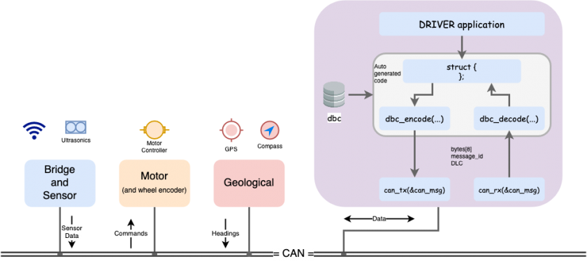

In this lab, we will add the Geological Controller to your RC car. Please [review this article](/sjsu---cmpe243--industrial-applications-with-can-bus/pages/17-project-introduction-and-guidelines/) to figure out the roles and responsibilities of different controllers in your RC car.

The high-level idea is that:

- Geo Controller receives a destination in the form of latitude and longitude 
- Geo Controller also has a link to the GPS module 
- You can more or less use the Pythagorean theorem to compute the heading degree for the Driver Controller 

This will take some research but the earth is not flat (it is really not flat), and so if you use the Pythagorean theorem, your heading degree may not be fully accurate, but it will work on the scale of your RC car unless you are sending it long distance such as US to Canada.

Another research item is that you will have to eventually align your GPS degree to the Compass degree. For example, your compass degree may have 90 degrees as North, whereas your GPS may or may not agree, but for this lab, we can assume fake values of the compass and focus only on the GPS portion. When you eventually fix this logic, no other controller would need to know because they are abstracted away as they only focus on the destination and current heading, and how you compute these numbers is not a concern for other controllers as long as you do it right.

  

---

---

##### Part 0: DBC

In this part, you should define the following CAN messages in the DBC file:

1. GPS destination message  

  - The *Bridge Controller* should send the destination to *Geo Controller* 
  - This should include longitude(float) and latitude (float). 
  - Assign the number of bytes and change the range as per your requirement. 

DBC Example 1 for GPS destination message: 

```c
BO_ ID GPS_DESTINATION_LOCATION: 8 TX_NAME
 SG_ GPS_DEST_LATITUDE : 0|28@1+ (0.000001,-90.000000) [-90|90] "Degrees" RX_NAMES
 SG_ GPS_DEST_LONGITUDE : 28|28@1+ (0.000001,-180.000000) [-180|180] "Degrees" RX_NAMES
```

DBC Example 2 for GPS destination message:

In this example, it would help you get around the fact that a "float" is only a 32-bit imprecise number. More particularly, it cannot host a decimal precision past 6 decimals. Furthermore, if the significant number increases (such as `0.123` to `123.123`), then the decimal precision may be reduced below 6 decimals.

In order to effectively send high precision numbers, you can scale them manually. So if you wanted to send `123.012345`, then you can manually send the number as `123012345`.

```c
BO_ ID GPS_DESTINATION_LOCATION: 8 MOBILE_APP
 SG_ GPS_DEST_LATITUDE_SCALED_100000 : 0|32@1- (1,0) [0|0] "Degrees" RX_NAMES
 SG_ GPS_DEST_LONGITUDE_SCALED_100000 : 32|32@1- (1,0) [0|0] "Degrees" RX_NAMES
```

 

2. Compass heading and distance message

- The *Geo Controller* should send this message to the LCD or Bridge Controller 
- Include 0-360 degrees of current heading(after using haversine formula) and the bearing angle(optional) (from the Compass) 
- Include the distance to the destination in meters in order to update the real-time remaining distance on the mobile application. 
- Assign the number of bytes and change the range as per your requirement.  

DBC Example for the compass heading and distance message: 

```c
BO_ 100 GEO_STATUS: 8 TX_NAME
  SG_ GEO_STATUS_COMPASS_HEADING : 0|12@1+ (1,0) [0|359] "Degrees" RX_NAMES
  SG_ GEO_STATUS_COMPASS_BEARING : 12|12@1+ (1,0) [0|359] "Degrees" RX_NAMES
  SG_ GEO_STATUS_DISTANCE_TO_DESTINATION : 24|16@1+ (0.1,0) [0|0] "Meters" RX_NAMES
```

---

---

##### Part 1: Driver Obstacle Avoidance Code Module

Remember our last code module for the driver? We will extend it to also absorb the Geo Controller message, and then we will use this information to figure out the motor controller commands.

```c
// @file driver_logic.h

// Assuming these data structures from the generated DBC
struct dbc_SENSOR_data_s;
struct dbc_MOTOR_command_s;
struct dbc_GEO_status_s;

// This should copy the sensor data to its internal "static" struct instance of dbc_SENSOR_data_s
void driver__process_input(dbc_SENSOR_data_s sensor_data);
void driver__process_geo_controller_directions(dbc_GEO_status_s geo_status);

// This should operate on the "static" struct instance of dbc_SENSOR_data_s to run the obstacle avoidance logic
dbc_MOTOR_command_s driver__get_motor_commands(void);

```

 

---

---

##### Part 2: The power of TDD

The beauty of unit-tests is that when we add additional logic, we can still ensure that our previously written code is not going to break or malfunction. The Geo Controller message should have no impact on the output of the motor controller commands if there is an obstacle avoidance actively being used. Only if all sensors show that there is no obstacle should your RC car obey the Geo Controller commands, and steer the car in the right direction.

Please ensure that your existing unit tests pass, and then add the additional logic necessary to handle the steering angle based on the Geological controller's status message (compass headings).

 

---

---

##### Part 3: Extras

You should invest in easy diagnostic functionality, so slap on a couple of bright LED indicators (driven by a higher current transistor or MOSFET) to indicate things such as:

- An obstacle is in the near vicinity and GPS heading is not being followed 
  - This will tell you if the RC car is following the GPS or avoiding an obstacle 
- A [ring LED device](https://www.sparkfun.com/products/12664) that indicates where the RC car is trying to go 
  - Sparkfun device link may be non-trivial to drive this LED device but should be worth the effort 

While this part is technically "extra credit", implementing these kinds of easy features will save you a ton of time later in the project.