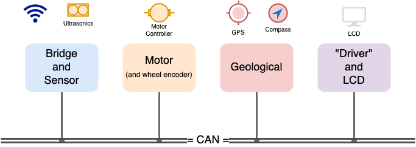

## Shopping List

1. Four SJtwo Development Kits + 4 CAN Transceivers 
2. Bridge and Sensors Accessories - Bluetooth or Wifi Breakout Board and Ultrasonic Sensors 
3. Motor Controller Accessories - RPM Sensors 
4. GEO Controller Accessories: GPS Breakout Board, Compass, GPS Antenna 
5. Extra LCD and LEDs for visual effects.   
6. Mechanical - RC Car, RC CAR Battery charger, Lithium-Ion Battery 
7. PCB parts and other Miscellaneous parts for Hardware.  

## Controllers

Various different controllers are used and each should have limited and exclusive responsibilities. Use this article as a reference to derive your project schedule and individual team member tasks.

 

An example of how GPS coordinates are sent from the Mobile phone:

1. Mobile phone sends data as ASCII text to the Bridge 
2. The bridge controller receives information over UART 
3. The bridge controller sends data using DBC/CAN to the Geological 
4. No other controller should need to know the destination coordinates because the Geological controller will guide the Driver controller with its compass heading, and tell it to stop when necessary 

##### Suggested Roles

- Mobile application development 
- 3+ General developers (could be dedicated developer per controller or just collaborative effort) 
- Testing and Integration person (2 people who can work together) 

---

##### 1: Bridge and Sensor Controller

Requirements

- Shall be interfaced to all of the distance sensors  

  - Note that your board only has 3 ADC channels if you choose to use this interface 
  - Note that ultrasonic sensors can collide in their sound waves and interfere with each other. It may be better to use different frequency based sensors (maybe different vendor or models) to minimize the interference. 
- Shall output all sensor information with a minimum refresh rate of 20Hz 
- Shall provide the interface (such as Bluetooth serial) to a mobile application running on a phone 
  - The typical interface to a Bluetooth or Wifi is UART 
  - Bluetooth requires pairing and is usually stable after that 
  - Wifi would require your wi-fi to act as an access point for your mobile phone to 
  - Both interfaces should work, and you can pick one based on past semesters' reports 
  - A recommendation is that a Mobile phone sends a line of command terminated by a newline, and then the Bridge controller can parse the information (such as using scanf) 
- Required but low priority: 
  - Provide battery voltage reading to Mobile Application and possibly to the DRIVER to output on the LCD 

---

##### 2: Motor Controller

Requirements

- Shall be interfaced with speed sensors or wheel encoders to provide speed information 
  - This should be transmitted on the CAN bus as either kph or mph; usually, the units will be small and you could use DBC scale of `0.001` or `0.01` 
- Shall be interfaced to motor controllers (or servo controller) to control steering and speed 
  - Recommend hobby grade RC car (such as Traxxas), and not a $20 RC car from Amazon 
- Provide self-test capability button 
  - Self-Test pressed, so Driver controller should be commanded to a 5 seconds wheel test mode 
  - This should include forward, backward motion, and steering test 
- Shall process the speed command, and compensate for the grade of the ground (uphill or downhill) 
  - For example, the DRIVER may command 0.5 kph, and the motor controller should process the wheel encoder and use a simple PID control loop to match the command regardless of the grade or battery power  

---

##### 3: Geological Controller

Requirements

- Shall be interfaced to a magnetometer 
- Shall be interfaced with a GPS 
- Shall provide raw GPS and compass readings 
- Shall have the ability to "set destination" and then provide heading degree towards destination 
  - The driver controller should not need to get involved in GPS data. It should simply receive a compass destination heading, and an actual compass heading. When there is no obstacle, it should simply try to take its current heading towards the destination, heading (which is just a compass degree) 
- Shall have the waypoints algorithm 

 

---

##### 4: Driver and LCD Controller

Requirements

- Shall be interfaced to an LCD display to output meaningful and diagnostic information 
  - Sensor values commanded motor values etc. 
  - A Recommendation is to use a simple UART or I2C based LCD 
  - [Something like this](https://www.sparkfun.com/products/9568) 
- Shall receive all relevant sensor messages and process them for obstacle avoidance 
- Shall receive compass actual degree, and heading degree (towards the destination) 
- Shall have the obstacle avoidance algorithm 
  - In the absence of any obstacles, it shall use the compass to follow the GPS destination 
- Shall send output drive commands to the Motor Controller  

---

##### 5: Mobile Application

Requirements

- Minimize the buttons (and hence the code) 
  - If there is no Bluetooth connection, automatically display a list of Bluetooth devices 
  - Once connected, automatically show the Google Maps page 
- Shall have Google Maps or similar for a user to pick the destination 
- Shall transmit the destination to the Bridge Controller as necessary 
- The Optional requirement to display car data, such as speed, compass, and anything else useful to you during debugging. Definitely, some extra credit opportunity, here based on how well you accomplish your Mobile Application. 

The definite article More (Definitions, Synonyms, Translation)

---

## Focus

There are different domains in your project that we need to ensure are working very robustly.

1. Distance Sensors

One person should focus solely on ensuring that VERY reliable values are being output from the sensor controller at least at 20Hz. Consider the following test case scenarios:

- Smoke tests: Test values while stationary 
- Interference tests: With a known test scenario (such as blocking one side), are the sensor values stable? For example, if we are blocking only the right side, is the left sensor value still stable? 
- Test on a moving car: Are the sensor mounts stable? Are the sensors pivoted downwards such that the floor is appearing to be an obstacle? 
- There are many more test scenarios but the overall objective is to ensure that sensors are very reliable. 

2. Compass

- Test in stationary vehicle 
- Test while vehicle is moving 
  - Does the tilt of the vehicle make a big difference? 
- Test while moving the front motor 
- Test while moving the rear motor 
- Test while moving both motors 
  - Is there magnetic interference? 

3. Motor and wheel encoder

- Test with varying battery voltage 
- Test with different speed command and ensure RPM consistency 

The rest is mainly more and more testing, but there should be a systematic approach to this.