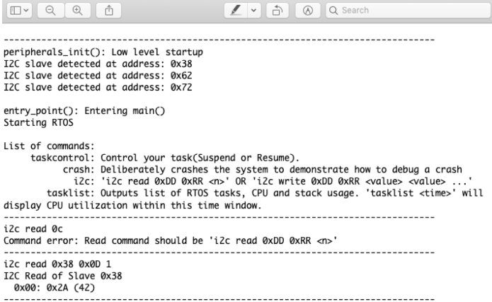
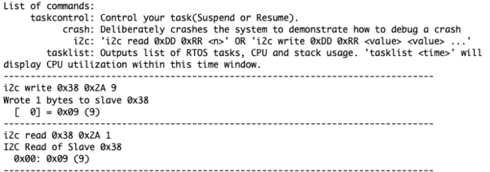
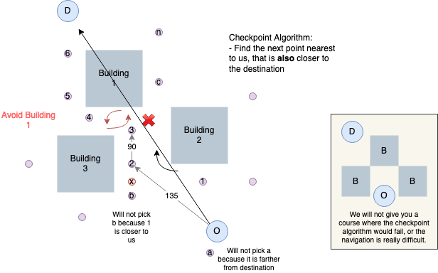

#### Git strategy to share common DBC file

A common issue for everyone is how to have separate projects in your Git repo.

1. One option is to create a different folder, one for each project 
  - Maybe have a top-level DBC file, and manually copy to all other folders upon update 
  - Maybe infrastructure code can find the DBC file at the root level directory itself? This might be a simple modification in the Python-based scons script 
2. Another option is to use different Git branches 
  - Single folder for your project, such as lpc40xx_freertos but different "virtual" master branches 
  - `git checkout master_driver` 
  - `git checkout master_sensor` 
  - The "master" branch is where the DBC is at, so when people want to get the latest, what they do is: 
    - `git checkout master_driver` 
    - `git checkout master` 
    - `git pull origin master` 
    - `git checkout master_driver` 
    - `git rebase master` 
    - `git push origin head` 

How can you nest an external repository's DBC file in your project repository.

- Git submodule 
  - Your DBC can live in a completely separate repo, maybe this repository is nothing but a single DBC file 
  - You can nest this external git submodule as a folder inside your lpc40xx_freertos directory 
  - So if someone changes the DBC file at the dedicated dbc repo, then everyone needs to update it 
    - git checkout master 
    - cd dbc_directory (nested git submodule) 
    - git pull origin master (of the external dbc repo, this will pull in the latest changes from there) 
    - cd - (step outside of the nested git submodule) 
    - git add dbc_directory (you update the githash that are pointing to the external repo's commit) 
    - git commit -m "update dbc" 
    - git push origin head 

---

---

#### Motor Control

It is advised to have a state machine to move your car, such as forward, forward to reverse and reverse to forward.

```c
void motor__run_state_machine_10hz(int call_counter) {
 switch (current_state) {
  case forward:
    if (desired_movement == reverse) {
      current_state = transient_state;
    }
    break;
 
  case transient_state:
    if (entry_to_this_state) {
      transient_state_entry_counter = call_counter;
    }

    if (call_counter >= (transient_state_entry_counter + 5) { // 500ms elapsed
      if (desired_movement == reverse) {
        current_state = reverse;
      } else {
        // ...
      }
    }
    break;
 
  case reverse:
    // ...
 }
}
```

##### Simple PID

The motor controller should use a simple PID to control the motors.

```c
// return percentage 0-100 which then may need to be translated to the Servo PWM
float motor_pwm_1hz(float actual_speed_kph, float target_speed_kph) {
  // Also handle the case of deceleration or a complete stop
  if (0 == target_speed_kph) {
    return 0;
  }
  
  // Handle other cases
}

```

 

---

---

#### Receive CAN in only one function

Students oftentimes tend to try to handle CAN frame reception in multiple functions. The problem is that this creates a non-deterministic operation as some frames may be dropped in one place in code, and may not be handled where you really mean to handle them.

Note the following properties:

- A while loop to empty out the CAN receive queue 
  - Handling just one frame per function call will accumulate CAN frames leading to data loss 
- After creating a message header, call all decode functions 
  - Only one decode function will decode at most since the message header will match only once 
  - This reduces your testing effort as you do not need manual switch/case statements 

```c
void can_handle_all_frames(void) {
    while (can_rx(...)) {
      msg_hdr = create_msg_header();
      
      dbc_decode_...();
      dbc_decode_...();
    }
}
```

---

---

#### Test I2C Sensor

If you have a sensor such as a compass that operates using I2C, then it is advised to use the built-in I2C CLI command on your SJ2 board to test out the sensor registers. Make sure you run the CLI task in your main.c and then simply type "help i2c" to explore the CLI command and trial the sensor data. 

If the compass is interfaced on I2C and the slave address of the compass is 0x38. Then you can read a particular register using the CLI command `i2c read SLAVE_ADDRESS REGISTER_ADDRESS <n>`



Similarly, you can directly use the CLI to write the value to a particular register address of Compass by using `i2c write SLAVE_ADDRESS REGISTER_ADDRESS VALUE`



---

---

#### Transmit GPS coordinates in between controllers

Use the following DBC design:

```js
BO_ 201 GPS_DESTINATION: 4 BRIDGE_CONTROLLER
 SG_ GPS_DESTINATION_LONGITUDE : 0|32@1+ (0.000001,0) [0|0] "" GEO_CONTROLLER
```

Be sure to keep in mind:

- A GPS coordinate is usually only sent with six decimal places maximum 
- A `float`, is always a 32-bit float (IEEE standard) 
- A `float` can only store up to 6 decimal points 
  - However, if your number changes from `0.123456` to `456.123456`, then the precision is actually lost, and the number may actually be truncated to this: `456.123444` 

More things to keep in mind:

- float is supported by HW on the ARM CM-4 
- But a "double" uses software floating-point instructions 

---

---

#### Checkpoints Algorithm

The algorithm should not be overcomplicated, and the checkpoints can just be static const array in your code.



Keep in mind:

- Mobile application should only send the destination, and not these checkpoints 
- The Geo controller has the pre-mapped, constant points in the compiled ARM CPU code 

```c
// Probably already defined in your *.h file
typedef struct {
  float long;
  float lat;
} gps_coordinates_t;

// Define in your *.c file
static const gps_coordinates_t locations_we_can_travel[] = {
  {a, b},
  {c, d},
  {e, f},
  {g, h},
}

/**
 * Algorithm should iterate through all locations_we_can_travel[] and find:
 *  - Another point that is closest to origin
 *  - while also simultaneously closer to the destination at the same time
 *
 * Corner case: If next point is the destination itself, which is also possible
 *.             and in this case, you should flag that destination has been reached
 */
gps_coordinates_t find_next_point(gps_coordinates_t origin, gps_coordinates_t destination);
```