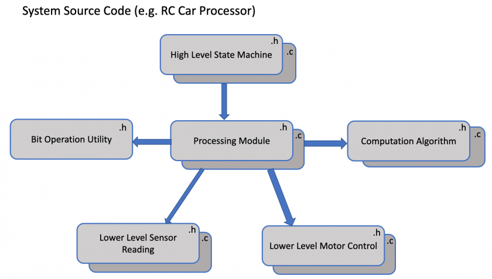
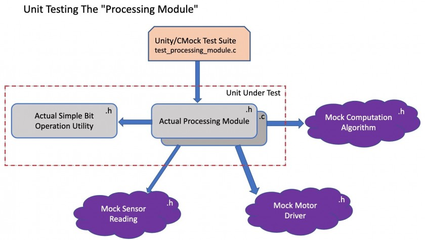

#### Overview

Here is a mental model for how to think about unit tests. We are focusing on understanding what exactly we are “testing” and why. Most importantly, we are clarifying what needs to be actually included in a unit test, and what instead gets mocked.

#### An Example Software System

Figure 1 below shows a layout of an example system, a hypothetical RC car project. There are multiple code modules with dependencies between them. Any time a module `#include "xxx"`’s another module, that creates the dependency. Here, the processing module depends on the sensor module to read data, the algorithm module for calculating motor commands, the motor module for actually executing the commands, and the bit manipulation utility for packing custom data formats when it gets called by the higher level state machine module. The state machine module has a dependency on the processing module.

Figure 1: Example software system exhibiting dependencies between code modules.

 

Additionally, any non-trivial system will have many more code modules and dependencies that this single diagram. In order for us to develop the system efficiently and reliably, we need to isolate functionality as much as possible between modules. Then we can work on one part of the system without worrying about the rest of the system’s behavior. For example, in the RC car, when we modify my GPS string processing algorithm, we do not want to waste time worrying if a code change breaks the motor control code. Therefore, the main goals are **functional isolation** between modules and a **guarantee of functional correctness **for each module.

We achieve **functional isolation** by breaking the code up into many modules with clean interfaces. Unit tests help us do that by forcing clean interfaces which can be called from the tests, minimizing large “hidden static helpers”. Unit tests also help us achieve the **guarantee of functional correctness** for each code module. The more robust unit tests we have that are passing for that module, the more confident we can be that the module is behaving as required.

#### Mocking Dependencies for Unit Tests

Figure 2 shows this idea for the Processing Module. We need to provide a “guarantee” to the State Machine module that the Processing Module behaves as required in all the conditions we can think of. Therefore, we want to isolate the Processing Module as the “Unit Under Test” (UUT) and write unit tests for it. Similarly, we don’t want the behavior of the module to be tied to internal details of its dependencies (Sensor, Motor, algorithm modules, etc...), so we “mock” them to achieve this isolation. We can then control the behavior of the mocks so that for arbitrary input conditions from the dependencies, we can test the expected behavior of the Processing Module through the unit tests written in the Unity/CMock test suite.

Figure 2: Visualizing the mocked dependencies of the Unit-Under-Test module.

A subtle example from class is the case where we don’t mock ALL dependencies. In this case, the Bit Operation Utility is a simple header class with no dependencies. We don’t mind to include the actual implementation so that the unit tests can also verify its correctness directly. There would not be much value in creating separate unit tests for that module because its behavior is so trivial.

#### Summary

We want to isolate each of our code modules to test it, and we mock all of its dependencies to achieve this isolation. The mocked dependencies then give us control over their behavior in order to achieve desired UUT behavior scenarios, similar to a “testbench” in electronics.