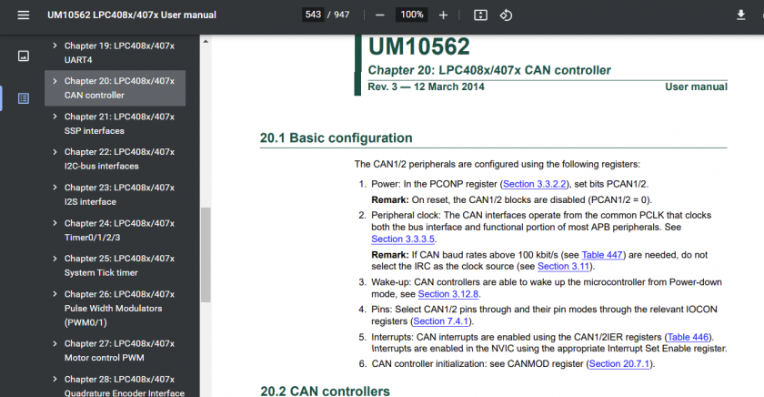
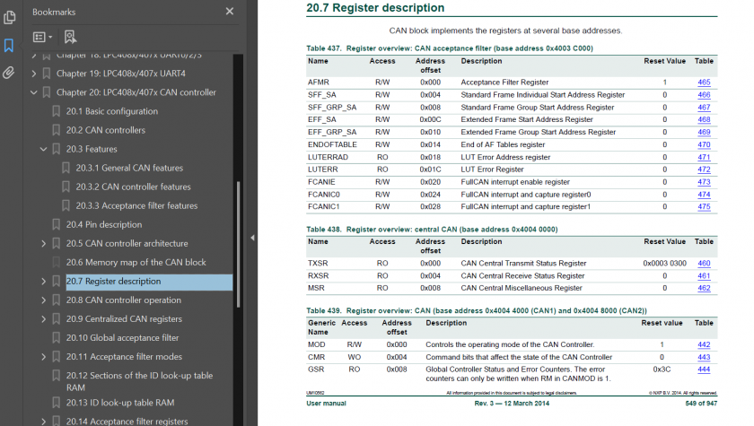
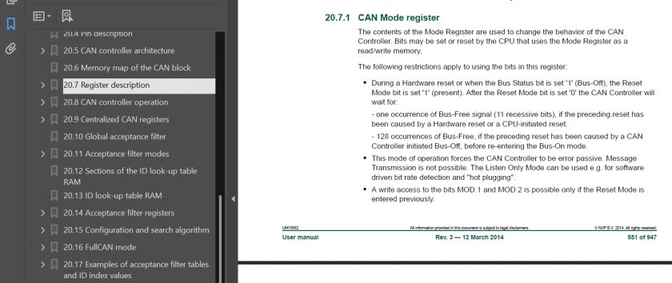
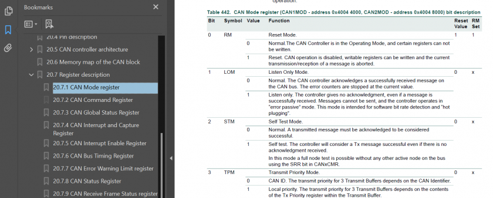
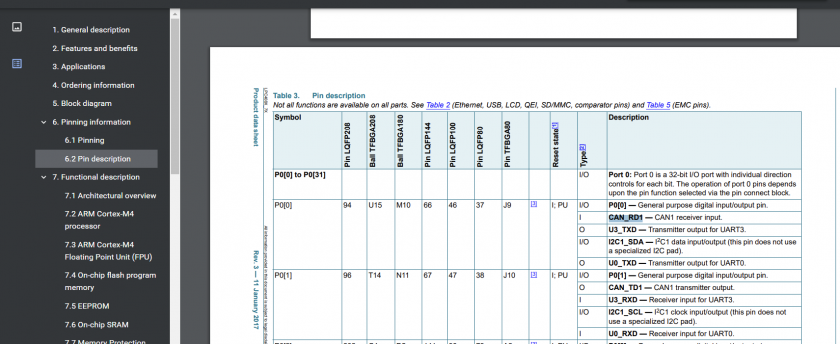
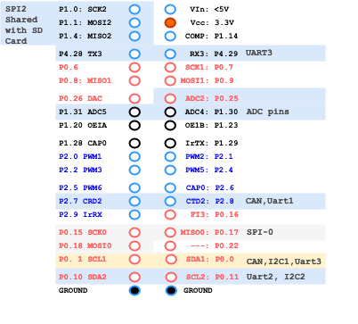

 

#### Overview

Even though our project mostly utilizes pre-developed drivers for ADC, GPIO, CAN, etc... peripherals for our RC car project, we still need to have a good understanding of their underlying usage. This is even more important if we need to debug any integration issues when connecting new sensors or components as we build the car. If we end up using a new peripheral for a component, we need to know how to write our own driver for it. At that point, we need to navigate our processor's reference manual to learn the peripheral's functionality and configuration.

#### Reference Manual vs Datasheet

LPC408x Reference Manual: [Reference Manual](https://gitlab.com/sjtwo-c-dev/sjtwo-c/-/blob/master/doc/LPC40xx/LPC408X_7X%20User%20Manual.pdf)

The Reference Manual contains all functional and usage descriptions of the processor series and its peripherals. The Datasheet describes the mechanical and electrical characteristics of the specific processor model. For our purposes, we can think of using the Reference Manual to learn about a certain peripheral (UART, CAN, etc...) and how to configure it, while using the Datasheet to figure out what external pins we can use to connect to the peripheral.

#### How to Find the Details of a Peripheral You Are Working With

The reference manual is a huge document, so we always need to have a specific peripheral in mind and start with the **table of contents**. For our example, we will use the CAN peripheral. We look for the chapter that contains the "CAN Controller". This same process works for any other peripheral like UART, PWM, etc...

Figure 1: Using the Table of Contents to find the specific peripheral

The Peripheral chapter contains its own informal table of contents with links to each section for configuration, functional description, and register details. We should read the functional description sections to get an understanding of how the peripheral could be used and any special functionalities. After understanding the peripheral, the next step is to learn about its registers and their configuration. Each peripheral chapter has a section for "Register description" which lists all registers.

Figure 2: The Register list section of the CAN peripheral chapter

From this list, we can link directly to a specific register you need to use. There will be a description of the controls contained within that specific register.

Figure 3: Description of the CAN1MOD register and any relevant considerations

After the description, we will find the list of all control bits inside that specific register, along with their usage description.

Figure 4: Control bit descriptions for the entire CAN1MOD register

#### Using the Datasheet to Find Pin Outputs

LPC408x Datasheet: [Datasheet](https://gitlab.com/sjtwo-c-dev/sjtwo-c/-/blob/master/doc/LPC40xx/LPC408X_7X%20Datasheet.pdf)

The last step when using a peripheral is to determine which GPIO pins can be used to connect to an external circuit or component. The datasheet (separate document) describes each pin connection and its available usages on our specific processor model. In this example, we see that the CAN1 receiver input signal is connected to the P0[0] (labeled P0.0 on the SJTwo board) GPIO pin.

Figure 5: Processor Datasheet pin descriptions for all physical pin connections

This matches the exposed breakout pin P0.0 on our SJ-Two board for the CAN1 peripheral:

