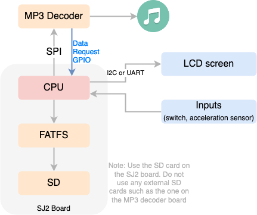
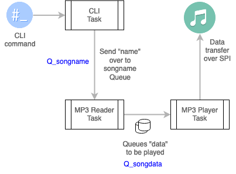

### Project Summary

The goal of this project is to create a fully functional MP3 music player using SJOne/SJ2 Microcontroller board as the source for music and control. MP3 files will be present on an SD card. SJOne board reads these files and transfers data to a audio decoding peripheral for generating music. User would be able to use player controls (start/stop/pause) for playing MP3 songs and view the track information on a display.

### Block Diagram

  
  

### Design

Split your project into manageable RTOS tasks. There should be dedicated tasks for:

- Reading an MP3 file 
- Playing an MP3 file 



Here is the psuedocode:

```cpp
typedef char songname_t[16];

QueueHandle_t Q_songname;
QueueHandle_t Q_songdata;

void main(void) {
  Q_songname = xQueueCreate(1, sizeof(songname));
  Q_songdata = xQueueCreate(1, 512);
}

// Reader tasks receives song-name over Q_songname to start reading it
void mp3_reader_task(void *p) {
  songname name;
  char bytes_512[512];
 
  while(1) {
    xQueueReceive(Q_songname, &name[0], portMAX_DELAY);
    printf("Received song to play: %s\n", name);
    
    open_file();
    while (!file.end()) {
      read_from_file(bytes_512);
      xQueueSend(Q_songdata, &bytes_512[0], portMAX_DELAY);
    }
    close_file();
  }
}

// Player task receives song data over Q_songdata to send it to the MP3 decoder
void mp3_player_task(void *p) {
  char bytes_512[512];
  
  while (1) {
    xQueueReceive(Q_songdata,  &bytes_512[0], portMAX_DELAY);
    for (int i = 0; i < sizeof(bytes_512); i++) {
      while (!mp3_decoder_needs_data()) {
        vTaskDelay(1);
      }
      
      spi_send_to_mp3_decoder(bytes_512[i]);
    }
  }
}

```

```c
// CLI needs access to the QueueHandle_t where you can queue the song name
// One way to do this is to declare 'QueueHandle_t' in main() that is NOT static
// and then extern it here
extern QueueHandle_t Q_songname;

app_cli_status_e cli__mp3_play(app_cli__argument_t argument,
                               sl_string_t user_input_minus_command_name,
                               app_cli__print_string_function cli_output) {
  // user_input_minus_command_name is actually a 'char *' pointer type
  // We tell the Queue to copy 32 bytes of songname from this location
  xQueueSend(Q_songname, user_input_minus_command_name, portMAX_DELAY);
  
  printf("Sent %s over to the Q_songname\n", user_input_minus_command_name);
  return APP_CLI_STATUS__SUCCESS;
}
```

### Project Requirements

#### Non-Functional Requirements:

- Should be dynamic. 
  - As in, you should be able to add more songs and play them 
- Should be accurate. 
  - Audio should not sound distorted, 
  - Audio should not sound slower or faster when running on your system. 
- Should be user friendly. 
  - User should be able to figure out how to use the device without a user manual. 
  - Product must be packaged in some enclosure. No wires can be vision for the project. 

#### Functional Requirements

1. System must use the SJOne/SJ2 on board SD card to read MP3 audio files. 
2. System must communicate to an external MP3 decoder 
3. System must allow users to control the MP3 player (You may use the onboard buttons for this) 
  1. User must be able to play and pause of song 
  2. user must be able to select a song 
4. System must use an external display to show a menu providing the following information: 
  1. Current playing song 
  2. Information about current playing song 
  3. Menu showing how to select a different song 
  4. (Not all of the above need to be shown on the same display) 
5. System software must separated into tasks. EX: Display task, MP3 Read Task, Controller Task etc... 
6. System software must be thread safe always. 
7. System software must use OS structures and primitives where applicable. 
8. System software may only utilize 50% or less CPU 
  - You must have an LCD screen for "diagnostics" where you print the CPU utilization and update it at least every 1 second 

#### Prohibited Actions:

1. System MAY NOT use an external SD card reader embedded into MP3 device. YOU MAY use an external SD card reader if your SD card reader is broken 
2. You must interface to **external LCD screen** (not the on-board LCD screen) 
  - On-board screen is too small 
  - The goal is to interface to external components (practice with HW design) 
3. Use of any external libraries (specifically Arduino) that drive the hardware you intent to use. You must make the drivers from scratch for every part you make. 

#### Permitted Action:

1. You may use the internal buttons for controlling the MP3 player. 
2. You may use the 7-segment display and LEDs above buttons for debugging but not as the main menu.