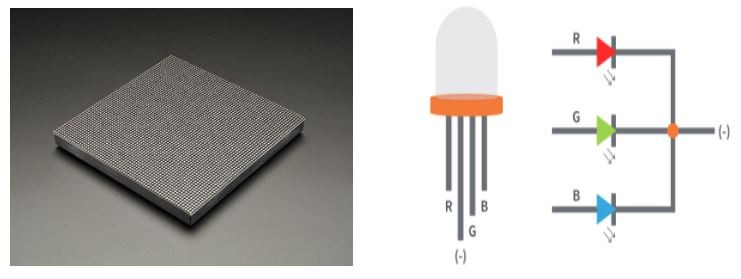
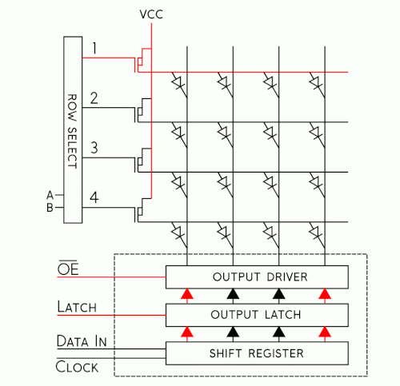
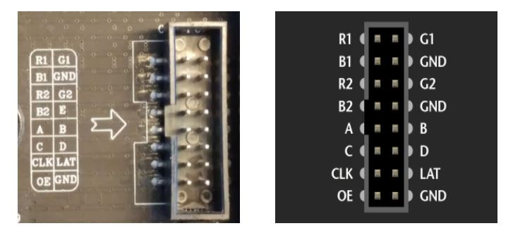

Introduction

An LED matrix is different from most panel displays. The LEDs are standard tri-color RGB LEDs. Each color on each LED is driven by one bit of a 3-bit shift register. These shift registers are then connected to one another with one shift registers output to the next registers input in a process known as a **Daisy Chaining.**

 



Figure1. 4 x 4 LED Matrix Latching Data ([Provided by Sparkfun](https://www.sparkfun.com/news/2650))

In the above figure, an example 4 by 4 matrix is used to show the steps of how data is clocked into the board. 

1. Starting from the first Row, select what color you want for each LED in the Row 
2. Now Enter the 3 bits of data that creates that color into DataIn and Clock it into the Shift Register. Repeat this process for every LED in the Row 
3. Pull both Output Enable And Latch High, which disables your display and moves the data within the shift registers to the output Latch respectively. 
4. Using Address Lines A and B, select the next row you want to alter 
5. Set the Latch and Output Enable Low, which enables your display and lets you write Data to the next Row. 

With this method of driving your matrix keep in mind that:

- If you want to alter one LED within a row, you need to enter the data for every LED before it in the row. If you want to clock the color data for say the 27th LED in a particular row you also need to include the data of the 26 other LEDs behind it as well. It is like climbing a ladder, you cannot just start climbing at the tenth rung, you have to climb the first nine first. 
- Due to the nature of the shift register their is **no native PWM support although you can achieve more colors through Binary code Modulation and Image Planes** 

** **

**LED matrix Parameters & Pins**

Most of you will end up buying from SparkFun and Adafruit and most likely pick matrices with the following dimensions with the following **scan rates**. 

- 32 by 32 with a scan rate of 1:16 
- 32 by 64 with a scan rate of 1:16 
- 64 by 64 with a scan rate of 1:32 

**It's fairly obvious that the bigger the matrix the more resolution you have to work with for your game. However you will also need to potentially provide more current for your board. A 5V 4A power supply is usually preferred in the absolute worst case where all LEDs are lit up at once, but for many of you a 5V 3A power supply will be sufficient. The pins for the board will typically be as follows:**



Figure 2. To the Left, a 64 by 64 Matrix Input Pin, To the Right a 32 by 32 or 32 by 64 version 

| **Matrix LED pins** | **Function** |
| --- | --- |
| R1 | High R data |
| G1 | High G data |
| B1 | High B data |
| R2 | Low R data |
| G2 | Low G data |
| B2 | Low B data |
| A | Row select A |
| B | Row select B |
| C | Row select C |
| D | Row select D |
| E (Potentially Another GND ) | Row select E (Or GND) |
| CLK | Clock signal. |
| OE | Active Low Output Enables LED panel Cascade |
| LAT | Latch denotes the end of data. |
| GND | GND |

** **

Taking a 64 by 64 matrix as an example you will note that there are only 5 address pins A,B,C,D, and E which would only let you access 25 = 32 rows so how would you write data to the other 32?

The scan rates listed above are technical specs for a Matrix board that simply describes how many LEDs are lit up on it at a time. For example a 64 by 64 matrix has 4096 LEDs total. With a scan rate of 1:32 that means that at any given time 4096/32 = 128 LEDs are lit up at a time. Notice that number is exactly two rows of your example 64 by 64 matrix. The matrix displays the data you supplied to the rows via a scanning method starting from the first row of the top half of the board and the first row of the second half of the board. This method divides the 64 by 64 matrix into two 32 row chunks that can be easily addressed with 5 address pins, but how do you decide WHICH of the chunks you talk to?

Notice that there are 6 data pins R1,G1,B1,R2,G2 and B2. As you expect, the RGB1 pins will provide the data to the row you are selecting in the top half of the board and the RGB2 pins will provide the data to the row you are selecting in the bottom half of the board. This scanning is visualized below. 


Figure 3. Scan Rate visualized ([Provided by Sparkfun](https://www.sparkfun.com/news/2650))

So if only two rows are being displayed at a time, how can it appear like all the LEDs are lit up? LED matrices use the same persistence of vision explored in your PWM lab to display full images by “scanning” your image at a high enough frequency that your eye can’t keep up with. Most of your matrices should have included a **refresh frequency** as part of the technical specs. This frequency is the target your Sjtwo board must provide to the LED board to display your image. For this 64 by 64 example, 400Hz is the refresh frequency so your board would need to provide a clock frequency at or above this number. If the frequency is low enough you will be able to see the pattern above. The clock speed you provide to your board will be the speed your game runs at. Most modern day games run at **30 frames per second (fps) or** **60 fps **which translated to frequency is **30 Hz and 60Hz respectively**. Your matrices will most likely be operating at much higher hertz so take this into account when designing animation and game logic that relies on time

 

We can finally summarize how our LED driver must be written  
  

1. Starting from the first Row of you matrix, Select what color you want to clock in to the LED 
2. Determine if that LED is in the upper or lower portion of your LED and clock that data in using either the RGB1 pins or RGB2 pins 
3. Set the bits and Clock them in and repeat this process for all the LEDs in the row 
4. Once a full row has been entered, disable the Output and set Latch High 
5. Using A,B,C,D,E pins, specify the next row to write to  
6. Set Latch back down to low and re-enable the Output 
7. Repeat this process until your entire Matrix has been written to 

 **led_driver.h**

```c
#pragma once
 
#include <stdio.h>
 
typedef enum {//Color combinations of a RGB LED, experiment with the values
 Black, 
 Blue,   
 Green, 
 Cyan,
 Red,        
 Purple, 
 Yellow, 
 White   
} color_code;
 
//Should set up all your matrix Pins
void led_driver__matrixInit(void);
 
//Should set the color of an LED anywhere on board
void led_driver__setPixel(uint8_t row, uint8_t col, color_code color);
 
//Should draw out a row on your board
void led_driver__drawRow(uint8_t row);
 
//Should draw the whole LED matrix
void led_driver__drawBoard(void);
```