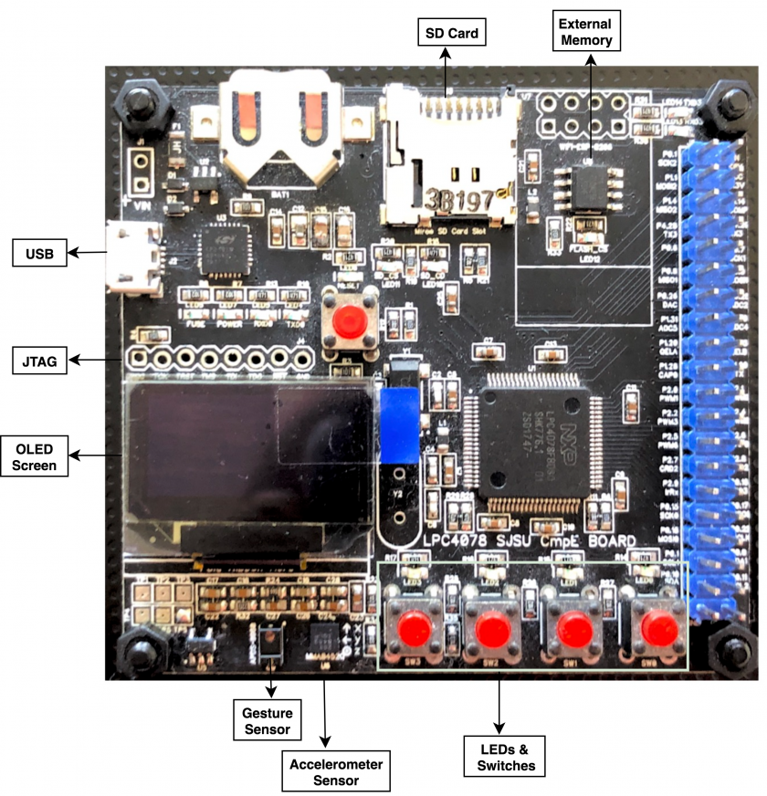
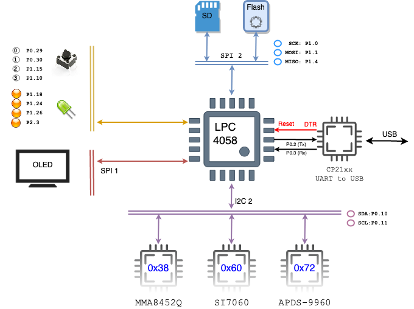
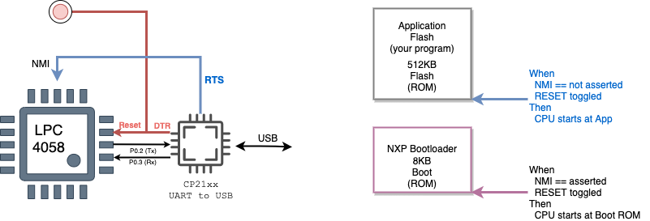
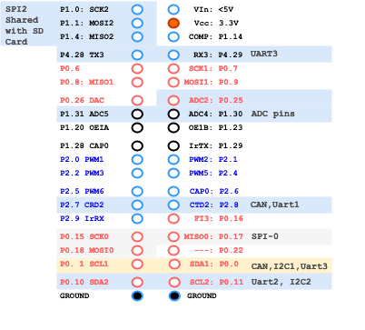
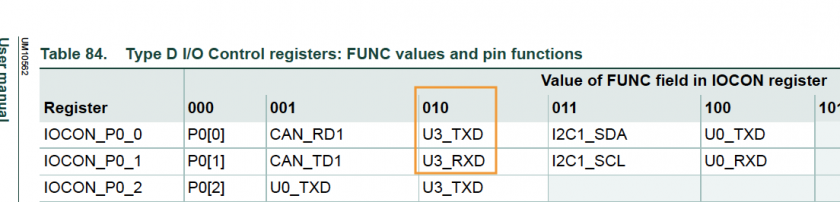

SJ2 board has lots of in-built sensors and a 128*64 OLED. It has 96kb of RAM and 120MHZ CPU.

#### .png)

#### Board Layout



---

#### Board Reset and Boot System

Normally, the NMI pin is not asserted, and when the board is powered on, it will boot straight to your application space which is where you flashed your program.

When the NMI pin is asserted (through the RTS signal of the USB to the serial port), and Reset is toggled, then the board will boot to a separate 8KB flash memory where NXP wrote their own bootloader. This program communicates with `flash.py` script to load your program to the application memory space.



 

---

#### SJ2 Board Pins



1. UART Pin Mapping for SJ-2 Board

| **SJ2 UART's** | **TXD** | **RXD** | **Multiplexed** |
| --- | --- | --- | --- |
| **UART 0** | P0.2 | P0.3 | Bootloader, Serial Debug Output |
|  | P0.0 | P0.1 | CAN1,I2C1 |
| **UART 1** | P0.15 | P0.16 | SSP0 |
|  | P2.0 | P2.1 | PWM1 |
| **UART 2** | P0.10 | P0.11 | I2C2 |
|  | P2.8 | P2.9 | Wi-Fi |
| **UART 3** | P0.0 | P0.1 | CAN1,I2C1 |
|  | P0.25 | P0.26 | ADCx |
|  | P4.28 | P4.29 | Wi-Fi |
| **UART 4** | P0.22 | P2.9 |  |
|  | P1.29 | P2.9 |  |

2. SSP/SPI Pin Mapping for SJ-2 Board

| **SJ2 SPI's** | **SCK** | **MISO** | **MOSI** |
| --- | --- | --- | --- |
| **SSP0** | P0.15 | P0.17 | P0.18 |
|  | P1.20 | P1.23 | P1.24 |
| **SSP1** | P0.7 | P0.8 | P0.9 |
| **SSP2** | P1.19 | P1.18 | P1.22 |
|  | P1.31 | P1.18 | P1.22 |

3. I2C Pin Mapping for SJ-2 Board

| **SJ2 I2C's** | **SDA** | **SCL** | **Multiplexed** |
| --- | --- | --- | --- |
| **I2C 0** | P1.30 | P1.31 | ADCx |
| **I2C 1** | P0.0 | P0.1 | UART0, UART3, CAN1 |
| **I2C 2** | P0.10 | P0.11 | UART2 |
|  | P1.15 | P4.29 |  |

4. CAN Pin Mapping for SJ-2 Board

| **SJ2 CAN's** | **RD** | **TD** | **Multiplexed** |
| --- | --- | --- | --- |
| **CAN1** | P0.0 | P0.1 | UART0, I2C1, UART3 |
|  | P0.0 | P0.22 |  |
| **CAN2** | P2.7 | P2.8 |  |

---

##### Pin functionality Selection

A pin's functionality may be selected based on your system design. Here are a few examples:

Select UART3 on `P4.28` and `P4.29`:

```c
#include "gpio.h"

void select_uart3_on_port4(void) {
  // Reference "Table 84" at "LPC408x_7x User Manual.pdf"
  gpio__construct_with_function(GPIO__PORT_4, 28, GPIO__FUNCTION_2); // P4.28 as TXD3
  gpio__construct_with_function(GPIO__PORT_4, 29, GPIO__FUNCTION_2); // P4.29 as RXD3
}
```

A pin function should be set based on one of the 8 possibilities. Here is an example again that sets `P0.0` and `P0.1` to UART3 (note that the `010` corresponds to `GPIO__FUNCTION_2`). Of course you can also configure`P0.0` and `P0.1` as UART0 pins by using `GPIO__FUNCTION_4`



```c
#include "gpio.h"

void select_uart3_on_port0(void) {
  gpio__construct_with_function(GPIO__PORT_0, 0, GPIO__FUNCTION_2); // P0.0 as TXD3
  gpio__construct_with_function(GPIO__PORT_0, 1, GPIO__FUNCTION_2); // P0.1 as RXD3
}
```

---

#### Software Reference

This section focuses on the [C software framework](https://gitlab.com/sjtwo-c-dev/sjtwo-c), and not the C++ sample project.

---

##### CLI Commands

CLI stands for Command Line Interface. The SJ2 C framework includes a way to interact with the board through a CLI command utilizing a CLI task. You can and should add more commands as needed to provide debugging and interaction capability with your board.

You can add your own CLI command by following the steps below:

**Step 1**: Declare your CLI handler function, the parameters of this function are:

- `app_cli__argument_t`: This is not utilized in the SJ2 project, and will be `NULL` 
- `sl_string_s`: There is a powerful string library type. The string is set to parameters of a CLI command, so if the command name is `taskcontrol` and user inputs `taskcontrol suspend led`, then the string value will be set to `suspend led` with the command name removed, see `sl_string.h` for more information 
- `cli_output`: This is a function pointer that you should use to output the data back to the CLI 

```cpp
// TODO: Add your CLI handler function declaration to 'cli_handlers.h'
app_cli_status_e cli__your_handler(app_cli__argument_t argument, sl_string_s user_input_minus_command_name,
                                   app_cli__print_string_function cli_output);
```

**Step 2**: Add your CLI handler

```cpp
// TODO: Declare your CLI handler struct, and add it at 'sj2_cli.c' inside the sj2_cli__init() function
void sj2_cli__init(void) {
  // ...
  static app_cli__command_s your_cli_struct = {.command_name = "taskcontrol",
                                               .help_message_for_command = "help message",
                                               .app_cli_handler = cli__your_handler};
  
  // TODO: Add the CLI handler:
  app_cli__add_command_handler(&sj2_cli_struct, &your_cli_struct);
}

```

**Step 3**: Handle your CLI command

```cpp
// TODO: Add your CLI handler function definition to 'handlers_general.c' (You can also create a new *.c file)
app_cli_status_e cli__your_handler(app_cli__argument_t argument, sl_string_s user_input_minus_command_name,
                                   app_cli__print_string_function cli_output) {
  void *unused_cli_param = NULL;
  // sl_string is a powerful string library, and you can utilize the sl_string.h API to parse parameters of a command
  
  // Sample code to output data back to the CLI
  sl_string_s s = user_input_minus_command_name; // Re-use a string to save memory
  sl_string__printf(s, "Hello back to the CLI\n");
  cli_output(unused_cli_param, sl_string__c_str(s));
  
  return APP_CLI_STATUS__SUCCESS;
}

// TODO: Now, when you flash your board, you will see your 'taskcontrol' as a CLI command

```

---

##### Platform Glue

TODO

---

##### Newlib and floating point `printf` and `scanf`

At the env_arm file, there are a couple of lines you can comment out to save about 18K of flash space. This space is not significant enough when you realize the fact that the LPC controller has 512K of flash ROM space, but it increases a few seconds of programming time each and every time you program.

```
    LINKFLAGS=[
        # Use hash sign to comment out the line
        # This will disable ability to do printf and scanf of %f (float)
        # "-u", "_printf_float",
        # "-u", "_scanf_float",
```

---

 

Layout a plan or design of something that is laid out More (Definitions, Synonyms, Translation)