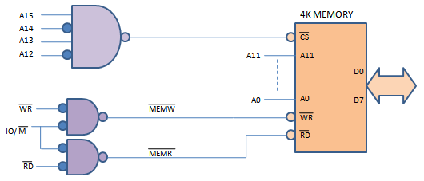
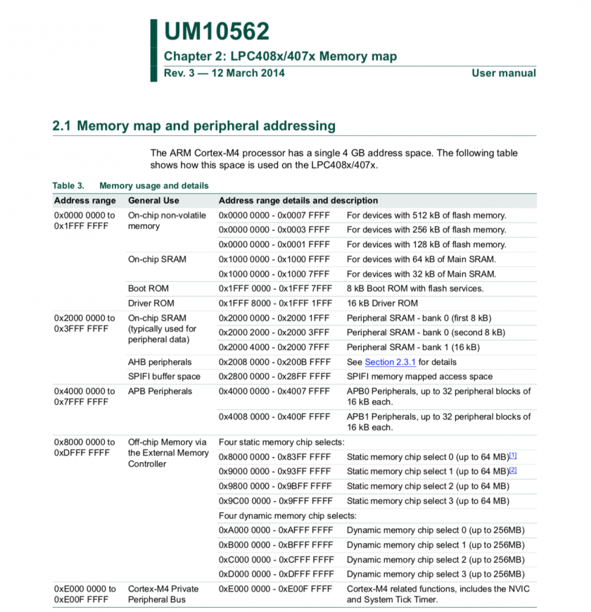

### What is a Memory Map

A **memory map** is a layout of how the memory maps to some set of information. With respect to embedded systems, the memory map we are concerned about maps out where the Flash (ROM), peripherals, interrupt vector table, SRAM, etc are located in address space.

### Memory mapped IO

Memory mapped IO is a means of mapping memory address space to devices external (**IO**) to the CPU, that is not memory. 

##### For example (assuming a 32-bit system)

- Flash could be mapped to address **0x00000000** to **0x00100000 **(1 Mbyte range) 
- GPIO port could be located at address **0x1000000** (1 byte) 
- Interrupt vector table could start from **0xFFFFFFFF** and run backwards through the memory space 
- SRAM gets the rest of the usable space (provided you have enough SRAM to fill that area) 

It all depends on the CPU and the system designed around it.

##### Port Mapped IO

Port mapped IO uses additional signals from the CPU to qualify which signals are for memory and which are for IO. On Intel products, there is a **(~M/IO) **pin that is **LOW** when selecting **MEMORY** and **HIGH** when it is selecting **IO**.

The neat thing about using port mapped IO, is that you don't need to sacrifice memory space for IO, nor do you need to decode all 32-address lines. You can limit yourself to just using 8-bits of address space, which limits you to 256 device addresses, but that may be more than enough for your purposes.

 

*Figure 2. Address Decoding with port map *

*([http://www.dgtal-sysworld.co.in/2012/04/memory-intercaing-to-8085.html](http://www.dgtal-sysworld.co.in/2012/04/memory-intercaing-to-8085.html))*

### LPC40xx memory map



*Figure 3. LPC40xx Memory Map*

From this you can get an idea of which section of memory space is used for what. This can be found in the UM10562 LPC40xx user manual. If you take a closer look you will see that very little of the address space is actually taken up. With up to 4 billion+ address spaces (because 2^32 is a big number) to use you have a lot of free space to spread out your IO and peripherals.

#### Reducing the number of lines needed to decode IO

The LPC40xx chips, to reduce bus line count, make all the peripherals 32-bit word aligned. Which means you must grab 4-bytes at a time. You cannot grab a single byte (8-bits) or a half-byte (16-bits) from memory. This eliminates the 2 least significant bits of address space.

### Accessing IO using Memory Map in C

Please read the following code snippet. This is runnable on your system now. Just copy and paste it into your **main.c** file.

```cpp
/*
    The goal of this software is to set the GPIO pin P1.0 to
    low then high after some time. Pin P1.0 is connected to an LED.

    The address to set the direction for port 1 GPIOs is below:

        DIR1 = 0x20098020

    The address to set a pin in port 1 is below:

        PIN1 = 0x20098034
*/

#include <stdint.h>

volatile uint32_t * const DIR1 = (uint32_t *)(0x20098020);
volatile uint32_t * const PIN1 = (uint32_t *)(0x20098034);

int main(void)
{
    // Set 0th bit, setting Pin 0 of Port 1 to an output pin
    (*DIR1) |= (1 << 0);
    // Set 0th bit, setting Pin 0 of Port 1 to high
    (*PIN1) |= (1 << 0);
    // Loop for a while (volatile is needed!)
    for(volatile uint32_t i = 0; i < 0x01000000; i++);
    // Clear 0th bit, setting Pin 0 of Port 1 to low
    (*PIN1) &= ~(1 << 0);

    // Loop forever
    while(1);
    
  return 0;
}
```

***volatile*** keyword tells the compiler not to optimize this variable out, even if it seems useless

***const ***keyword tells the compiler that this variable cannot be modified

Notice **"const" placement** and how it is placed after the **uint32_t *.** This is because we want to make sure the pointer address never changes and remains constant, but the value that it references should be modifiable. 

### Using the LPC40xx.h

The above is nice and it works, but it's a lot of work. You have to go back to the user manual to see which addresses are for what register. There must be some better way!!

Take a look at the **lpc40xx.h** file, which It is located in the `sjtwo-c/projects/lpc40xx_freertos/lpc40xx.h`. Here you will find definitions for each peripheral memory address in the system.

Let's say you wanted to port the above code to something a bit more structured:

- Open up "**lpc40xx.h**"  
- Search for "**GPIO**" 
  - You will find a struct with the name **LPC_GPIO_TypeDef**. 
- Now search for "**LPC_GPIO_TypeDef**" with a **#define** in the same line. 
- You will see that **LPC_GPIO_TypeDef** is a pointer of these structs 
    - `#define LPC_GPIO0 ((LPC_GPIO_TypeDef *) LPC_GPIO0_BASE )` 
    - `#define LPC_GPIO1 ((LPC_GPIO_TypeDef *) LPC_GPIO1_BASE )` 
    - `#define LPC_GPIO2 ((LPC_GPIO_TypeDef *) LPC_GPIO2_BASE )` 
    - `#define LPC_GPIO3 ((LPC_GPIO_TypeDef *) LPC_GPIO3_BASE )` 
    - `#define LPC_GPIO4 ((LPC_GPIO_TypeDef *) LPC_GPIO4_BASE )` 
- We want to use **LPC_GPIO1 **since that corresponds to the GPIO port 1. 
- If you inspect **LPC_GPIO_TypeDef**, you can see the members that represent register DIR and PIN 
- You can now access **DIR and PIN registers in the following way:** 

```cpp
#include "lpc40xx.h"

int main(void)
{
    // Set 0th bit, setting Pin 0 of Port 1 to an output pin
    LPC_GPIO1->DIR |= (1 << 0);
    //// Set 0th bit, setting Pin 0 of Port 1 to high
    LPC_GPIO1->PIN |= (1 << 0);
    //// Loop for a while (volatile is needed!)
    for(volatile uint32_t i = 0; i < 0x01000000; i++);
    //// Clear 0th bit, setting Pin 1.0 to low
    LPC_GPIO1->PIN &= ~(1 << 0);
    //// Loop forever
    while(1);
    return 0;
}
```

At first this may get tedious, but once you get more experience, you won't open the **lpc40xx.h** file very often. This is the preferred way to access registers in this course and in industry.

On occasions, the names of registers in the user manual are not exactly the same in this file.