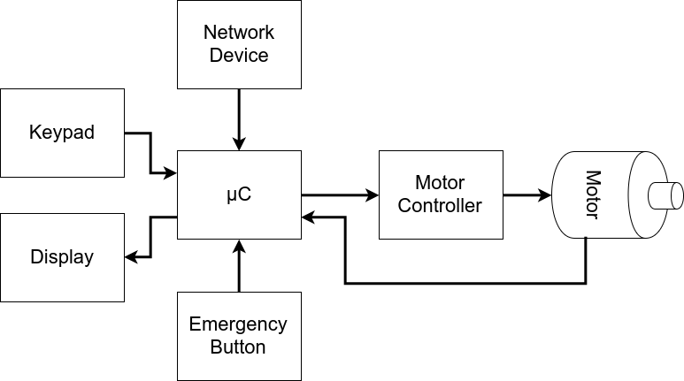
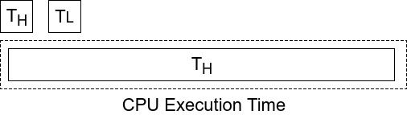
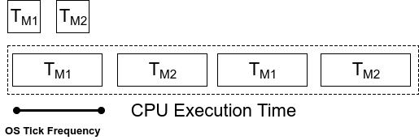

## Introduction to FreeRTOS

### Objective

  
To introduce what, why, when, and how to use Real Time Operating Systems (RTOS) as well as get you  
started using it with the sjtwo-c environment.  
I would like to note that this page is mostly an aggregation of information from Wikipedia and the FreeRTOS  
Website.

### What is an OS?

> 

Operating system (OS) is system software that manages computer hardware and software resources and provides common services for computer programs. - Wikipedia

#### Operating systems like Linux or Windows

They have services to make communicating with Networking devices and files systems possible without having  
to understand how the hardware works. Operating systems may also have a means to multitasking by allow  
multiple processes to share the CPU at a time. They may also have means for allowing processes to  
communicate together.

### What is an RTOS?

An RTOS is an operating system that meant for real time applications. They typically have fewer services such  
as the following:

- **Parallel Task Scheduler** 
- **Task communication** (Queues or Mailboxes) 
- **Task synchronization** (Semaphores) 

### Why use an RTOS?

> 

  
You do not need to use an RTOS to write good embedded software. At some point  
though, as your application grows in size or complexity, the services of an RTOS might  
become beneficial for one or more of the reasons listed below. These are not absolutes,  
but opinion. As with everything else, selecting the right tools for the job in hand is an  
important first step in any project.  
In brief:

- **Abstract out timing information** 

The real time scheduler is effectively a piece of code that allows you to specify the  
timing characteristics of your application - permitting greatly simplified, smaller (and  
therefore easier to understand) application code.

- **Maintainability/Extensibility** 

Not having the timing information within your code allows for greater maintainability  
and extensibility as there will be fewer interdependencies between your software  
modules. Changing one module should not effect the temporal behavior of another  
module (depending on the prioritization of your tasks). The software will also be less  
susceptible to changes in the hardware. For example, code can be written such that it  
is temporally unaffected by a change in the processor frequency (within reasonable  
limits).

- **Modularity** 

Organizing your application as a set of autonomous tasks permits more effective  
modularity. Tasks should be loosely coupled and functionally cohesive units that within  
themselves execute in a sequential manner. For example, there will be no need to  
break functions up into mini state machines to prevent them taking too long to execute  
to completion.

- **Cleaner interfaces** 

Well defined inter task communication interfaces facilitates design and team  
development.

- **Easier testing (in some cases)** 

Task interfaces can be exercised without the need to add instrumentation that may  
have changed the behavior of the module under test.

- **Code reuse ** 

Greater modularity and less module interdependencies facilitates code reuse across  
projects. The tasks themselves facilitate code reuse within a project. For an example  
of the latter, consider an application that receives connections from a TCP/IP stack -  
the same task code can be spawned to handle each connection - one task per  
connection.

- **Improved efficiency?** 

Using FreeRTOS permits a task to block on events - be they temporal or external to  
the system. This means that no time is wasted polling or checking timers when there  
are actually no events that require processing. This can result in huge savings in  
processor utilization. Code only executes when it needs to. Counter to that however is  
the need to run the RTOS tick and the time taken to switch between tasks. Whether  
the saving outweighs the overhead or vice versa is dependent of the application. Most  
applications will run some form of tick anyway, so making use of this with a tick hook  
function removes any additional overhead.

- **Idle time** 

It is easy to measure the processor loading when using FreeRTOS.org. Whenever the  
idle task is running you know that the processor has nothing else to do. The idle task  
also provides a very simple and automatic method of placing the processor into a low  
power mode.

- **Flexible interrupt handling** 

Deferring the processing triggered by an interrupt to the task level permits the interrupt  
handler itself to be very short - and for interrupts to remain enabled while the task level  
processing completes. Also, processing at the task level permits flexible prioritization -  
more so than might be achievable by using the priority assigned to each peripheral by  
the hardware itself (depending on the architecture being used).

- **Mixed processing requirements** 

Simple design patterns can be used to achieve a mix of periodic, continuous and  
event driven processing within your application. In addition, hard and soft real time  
requirements can be met though the use of interrupt and task prioritisation.

- **Easier control over peripherals** 

Gatekeeper tasks facilitate serialization of access to peripherals - and provide a good  
mutual exclusion mechanism.

- Etcetera 

- FreeRTOS Website (https://www.freertos.org/FAQWhat.html)

### Design Scenario

#### Building a controllable assembly conveyor belt



Think about the following system. Reasonable complex, right?

##### Without a scheduler

 ✓  Small code size.  
 ✓  No reliance on third party source code.  
 ✓  No RTOS RAM, ROM or processing overhead.  
 ✗  Difficult to cater for complex timing requirements.  
 ✗  Does not scale well without a large increase in complexity.  
 ✗  Timing hard to evaluate or maintain due to the inter-dependencies between the different functions.

##### With a scheduler

 ✓  Simple, segmented, flexible, maintainable design with few inter-dependencies.  
 ✓  Processor utilization is automatically switched from task to task on a most urgent need basis with no  
explicit action required within the application source code.  
 ✓  The event driven structure ensures that no CPU time is wasted polling for events that have not occurred.  
Processing is only performed when there is work needing to be done.  
  *   Power consumption can be reduced if the idle task places the processor into power save (sleep) mode,  
but may also be wasted as the tick interrupt will sometimes wake the processor unnecessarily.  
  *   The kernel functionality will use processing resources. The extent of this will depend on the chosen  
kernel tick frequency.  
 ✗  This solution requires a lot of tasks, each of which require their own stack, and many of which require a  
queue on which events can be received. This solution therefore uses a lot of RAM.  
 ✗  Frequent context switching between tasks of the same priority will waste processor cycles.

## FreeRTOS Tasks

### What is an FreeRTOS Task?

A FreeRTOS task is a function that is added to the FreeRTOS scheduler using the `xTaskCreate()` API call.

A task will have the following:

1. **A Priority level** 
2. **Memory allocation** 
3. Singular input parameter (optional) 
4. A Task name 
5. A Task handler (optional): A data structure that can be used to reference the task later.  

A FreeRTOS task declaration and definition looks like the following:

```cpp
void vTaskCode( void * pvParameters )
{
    /* Grab Parameter */
    uint32_t c = (uint32_t)(pvParameters);
    /* Define Constants Here */
    const uint32_t COUNT_INCREMENT = 20;
    /* Define Local Variables */
    uint32_t counter = 0;
    /* Initialization Code */
    initTIMER();
    /* Code Loop */
    while(1)
    {
        /* Insert Loop Code */
    }
    /* Only necessary if above loop has a condition */
    xTaskDelete(NULL);
}
```

### Rules for an RTOS Task

- The highest priority ready tasks **ALWAYS** runs  

  - If two or more have equal priority, then they are **time sliced** 
- Low priority tasks only get CPU allocation when: 
  - All higher priority tasks are **sleeping, blocked, or suspended.**  
- Tasks can sleep in various ways, a few are the following:  

  - Explicit "task sleep" using API call **vTaskDelay();** 
  - Sleeping on a semaphore 
  - Sleeping on an empty queue (reading) 
  - Sleeping on a full queue (writing) 

### Adding a Task to the Scheduler and Starting the Scheduler

The following code example shows how to use `**xTaskCreate()**` and how to start the scheduler using `**vTaskStartScheduler()**`

```cpp
int main(int argc, char const *argv[])
{
    //// You may need to change this value.
    const uint32_t STACK_SIZE = 128;
    xReturned = xTaskCreate(
                    vTaskCode,       /* Function that implements the task. */
                    "NAME",          /* Text name for the task. */
                    STACK_SIZE,      /* Stack size in words, not bytes. */
                    ( void * ) 1,    /* Parameter passed into the task. */
                    tskIDLE_PRIORITY,/* Priority at which the task is created. */
                    &xHandle );      /* Used to pass out the created task's handle. */

    /* Start Scheduler */
    vTaskStartScheduler();

    return 0;
}
```

### Task Priorities

#### High Priority and Low Priority tasks



In the above situation, the high priority task never sleeps, so it is always running. In this situation where the low priority task never gets CPU time, we consider that task to be **starved**. 

#### Tasks of the same priority

 

In the above situation, the two tasks have the same priority, thus they share the CPU. The time each task is allowed to run depends on the **OS tick frequency**. The **OS Tick Frequency** is the frequency that the FreeRTOS scheduler is called in order to decide which task should run next. The **OS Tick is a hardware interrupt** that calls the RTOS scheduler. Such a call to the scheduler is called a **preemptive context switch**.

### Context Switching

When the RTOS scheduler switches from one task to another task, this is called a **Context Switch**. 

#### What needs to be stored for a Context switch to happen

In order for a task, or really any executable, to run, the following need to exist and be accessible and storable:

- **Program Counter (PC)** 
  - This holds the position for which line in your executable the CPU is currently executing. 
  - Adding to it moves you one more instruction. 
  - Changing it jumps you to another section of code. 
- **Stack Pointer (SP)** 
  - This register holds the current position of the call stack, with regard to the currently executing program. The stack holds information such as local variables for functions, return addresses and [sometimes] function return values. 
- **General Purpose Registers** 
  - These registers are to do computation. 
    - **In ARM**: 
      - R0 - R15 
    - **In MIPS**:  
      - $v0, $v1 
      - $a0 - $a3 
      - $t0 - $t7 
      - $s0 - $s7 
      - $t8 - $t9 
    - **Intel 8086** 
      - AX 
      - BX 
      - CX 
      - DX 
      - SI 
      - DI 
      - BP 

#### How does Preemptive Context Switch work?

1. A hardware timer interrupt or repetitive interrupt is required for this preemptive context switch. 
  1. This is independent of an RTOS. 
  2. Typically, 1ms or 10ms. 
2. The OS needs hardware capability to have a chance to STOP synchronous software flow and enter the OS “tick” interrupt.  

  1. This is called the "Operating System Kernel Interrupt" 
  2. We will refer to this as the OS Tick ISR (interrupt service routine) 
3. Timer interrupt calls RTOS Scheduler 
  1. RTOS will store the previous **PC**, **SP**, and **registers** for that task. 
  2. The scheduler picks the highest priority task that is ready to run. 
  3. Scheduler places that task's **PC**, **SP**, and **registers** into the CPU. 
  4. Scheduler interrupt returns, and the newly chosen task runs as if it never stopped. 

#### Tick Rate

Most industrial applications use an RTOS tick rate of 1ms or 10ms (1000Hz, or 100Hz). In the 2000s, probably 100Hz was more common, but as processors got faster, 1000Hz became the norm. One could choose any tick rate, such as 1.5ms per tick, but using such non-standard rates makes API timing non-intuitive, as `vTaskDelay(10)` would result in sleep time of approximately `15ms`. This is yet another reason why 1000Hz is a good tick rate as `vTaskDelay(10)` would sleep for approximately `10ms`, which is intuitive to the developer because the tick times adopt the **units of milliseconds**.

With a far assumed that the RTOS tick ISR (preemptive scheduling) consumes 200 clock cycles, then on a 20Mhz processor, it would only consume 10uS of overhead per scheduling event. When cooperative scheduling triggers a context switch, it would result in a similar overhead as a "software interrupt" is issued to the CPU to perform the context switch. So this means that each scheduling event has an overhead of 20uS on a 20Mhz processor (assuming 200 clocks for RTOS interrupt). Based on these numbers, here is the overhead ratio of using different tick rates.

|  | 100Hz | 1000Hz | 10,000Hz (100uS per tick) |
| --- | --- | --- | --- |
| Scheduling Overhead per second | 2,000uS | 20,000uS | 200,000uS |
| CPU consumption for RTOS scheduling | 0.2% | 2% | 20% |

Why OS Ticks are 1ms or 1KHz?   
1. **Shorter Ticks** means that there is less time for your code to run. Ex: if OS ticks = 150us instead of 1ms and the context switching takes 100us then you are only left with 50us to complete your task. Hence,  RTOS will be only busy with context switching nothing else.  
2. **Big Ticks **such as 4ms, the CPU will remain in the wait state. For example, the context switching takes 100us then you have 3900us to complete your task. However, the task will only take 900us to complete. Then 3000us will be unnecessary overhead on CPU wait time. 

Based on the numbers above, 1000Hz is a great balance, while the 10,000Hz tick rate would provide more frequent time slices at the expense of more frequent scheduling overhead.

only and nothing more More (Definitions, Synonyms, Translation)