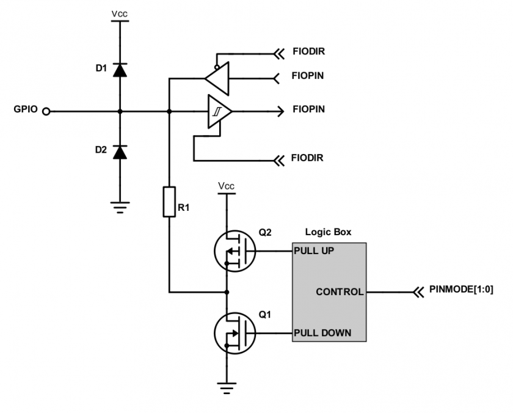
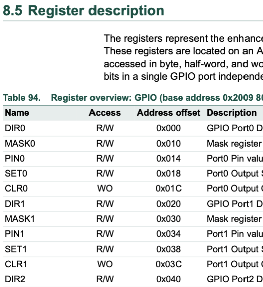
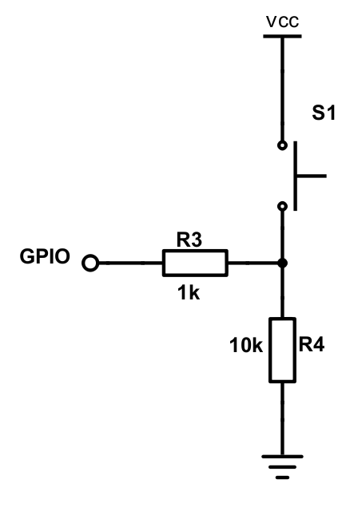
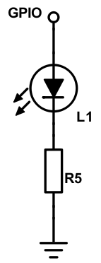
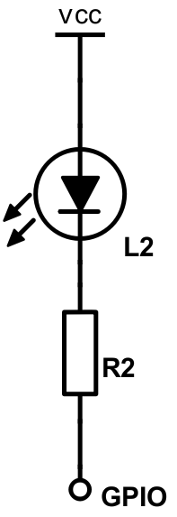

#### Objective

To be able to General Purpose Input Output (GPIO), to generate digital output signals, and to read input signals. Digital outputs can be used as control signals to other hardware, to transmit information, to signal another computer/controller, to activate a switch or, with sufficient current, to turn on or off LEDs, or to make a buzzer sound.

Below will be a discussion on using GPIO to drive an LED.

Although the interface may seem simple, you do need to consider hardware design and know some of the fundamentals of electricity. There are a couple of goals for us:

- No hardware damage if faulty firmware is written 
- The circuit should prevent an excess amount of current to avoid processor damage. 

---

#### Required Background

You should know the following:

- [bit-masking in C](/sjsu---embedded-drivers-rtos/pages/15-bitmasking/) 
- Wire-wrapping or use of a breadboard 
- Fundamentals of electricity, such as Ohm's law (**V = IR**) and how diodes work. 

##### GPIO

   

*Figure 1. Internal Design of a GPIO*

GPIO stands for "General Purpose Input Output". Each pin can at least be used as an output or input. In an output  configuration, the pin voltage is either 0v or 3.3v. In input mode, we can read whether the voltage is 0v or 3.3v.

You can locate a GPIO that you wish to use for a switch or an LED by first starting with the schematic of the board. The schematic will show which pins are "available" because some of the microcontroller pins may be used internally by your development board. After you locate a free pin, such as P2.0, then you can look-up the microcontroller user manual to locate the memory that you can manipulate.

##### Hardware Registers Coding

The hardware registers map to physical pins. If we want to attach our switch and the LED to our microcontroller's PORT0, then reference the relevant registers and their functionality.



Note that in the LPC17xx, the registers had the words `FIO` preceding the `LPC_GPIO` data structure members. In the LPC40xx, the word `FIO` has been dropped. `FIO` was a bit historic and it stood for "Fast Input Output", but in the LPC40xx, this historic term was deprecated.

| **LPC40xx Port0 Registers** |  |
| --- | --- |
| **LPC_GPIO0->DIR** | The direction of the port pins, 1 = output |
| **LPC_GPIO0->PIN** | *Read:* Sensed inputs of the port pins, 1 = HIGH *Write:* Control voltage level of the pin, 1 = 3.3v |
| **LPC_GPIO0->SET** | *Write only:* Any bits written 1 are OR'd with PIN |
| **LPC_GPIO0->CLR** | *Write only:* Any bits written 1 are AND'd with PIN |

##### Switch

We will interface our switch to PORT0.2, or port zero's 3rd pin (counting from 0).

Note that the "inline" resistor is used such that if your GPIO is misconfigured as an OUTPUT pin, hardware damage will not occur from badly written software.

 

*Figure 2. Button Switch Circuit Schematic*

```cpp
/* Make direction of PORT0.2 as input */
LPC_GPIO0->DIR &= ~(1 << 2);

/* Now, simply read the 32-bit PIN register, which corresponds to
 * 32 physical pins of PORT0.  We use AND logic to test if JUST the
 * pin number 2 is set
 */
if (LPC_GPIO0->PIN & (1 << 2)) {
    // Switch is logical HIGH
} else {
    // Switch is logical LOW
}
```

##### LED

We will interface our LED to PORT0.3, or port zero's 4th pin (counting from 0).

Given below are two configurations of an LED. Usually, the "sink" current is higher than "source", hence the active-low configuration is used more often.

|  *Figure 3. Active High LED circuit schematic* |  *Figure 4. Active low LED circuit schematic* |
| --- | --- |

 

```cpp
const uint32_t led3 = (1U << 3);

/* Make direction of PORT0.3 as OUTPUT */
LPC_GPIO0->DIR |= led3;

/* Setting bit 3 to 1 of IOPIN will turn ON LED
 * and resetting to 0 will turn OFF LED.
 */
LPC_GPIO0->PIN |= led3;

/* Faster, better way to set bit 3 (no OR logic needed) */
LPC_GPIO0->SET = led3;

/* Likewise, reset to 0 */
LPC_GPIO0->CLR = led3;
```