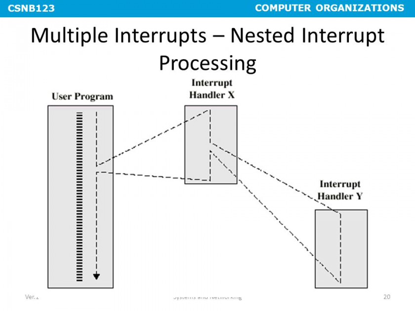
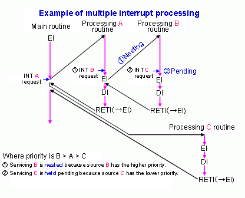
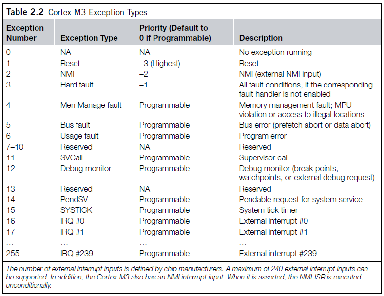

### Objective

This tutorial demonstrates how to use interrupts on a processor. In general, you will understand the concept behind interrupts on any processor, but we will use the SJ2 board as an example.

### What is an interrupt?

An interrupt is the hardware capability of a CPU to break the normal flow of software to attend an urgent request.

The science behind interrupts lies in the hardware that allows the CPU to be interrupted. Each peripheral in a micro-controller *may be* able to assert an interrupt to the CPU core, and then the CPU core would jump to the corresponding interrupt service routine (**ISR**) to service the interrupt.

```c
void main_loop(void) {
  while (forever) {
    logic();
    another_function();
    // ...
  }
}

// Interrupt on button-press
void button_press_interrupt(void) {
}
```

### ISR Procedure

The following steps demonstrate what happens when an interrupt occurs :

- CPU manipulates the PC (program counter) to jump to the ISR 
- **IMPORTANT**: CPU will disable interrupts (or that priority level's interrupts until the end of ISR) 
- Registers are saved before running the ISR (pushed onto the stack) 
- ISR is run 
- Registers are restored (popped from stack) 
- Interrupts are re-enabled (or that priority level's interrupt is re-enabled) 

On some processors, the savings and restoring of registers is a manual step and the compiler would help you do it. You can google the "GCC interrupt attribute" to study this topic further. On the SJ2 board, which uses LPC40xx (ARM Cortex M4), this step is automatically taken care of by the CPU hardware.

 

Figure 1. [Nested Interrupt Processing](http://slideplayer.com/slide/7479262/24/images/20/Multiple+Interrupts+%E2%80%93+Nested+Interrupt+Processing.jpg)

 

### Nested Vector Interrupt Controller

Nested Vector Interrupt Controllers or NVIC for short, have two properties:

- Can handle multiple interrupts. 
  - The number of interrupts implemented is device-dependent. 
- A programmable priority level for each interrupt. 
  - A higher level corresponds to a lower priority, so level 0 is the highest interrupt priority. 
- Level and pulse detection of interrupt signals. 
- Grouping of priority values into group priority and sub-priority fields.  

  - This means that interrupts of the same priority are grouped together and do not preempt each other. 
  - Each interrupt also has a sub-priority field which is used to figure out the run order of pending interrupts of the same priority. 
- Interrupt tail-chaining.  

  - This enables back-to-back interrupt processing without the overhead of state saving and restoration between interrupts. 
  - This saves us from the step of having to restore and then save the registers again. 
- An external Non-maskable interrupt (NMI) 

#### NVIC Interrupt Example

 

Figure 2. [Multiple Interrupt Processing](https://en-us.knowledgebase.renesas.com/@api/deki/files/1365/int2.gif?revision=1&size=bestfit&width=416&height=336) 

### The SW to HW Connection

Now that we understand how the CPU hardware services interrupts, we need to define how we inform the CPU WHERE our ISR function is located at.

#### Interrupt Vector Table

This table is nothing but addresses of functions that correspond to the microcontroller interrupts. Specific interrupts use specific "slots" in this table, and we have to populate these spots with our software functions that service the interrupts.

[](http://www.socialledge.com/sjsu/index.php?title=File:Tutorial_interrupts_vec_table.png) *Figure 3. HW Interrupt Vector Table* 

### SJTwo (LPC40xx) Example

Using a linker script and compiler directives (commands for the compiler), the compiler is able to place the software interrupt vector table at a specific location that the CPU expects the interrupt vector table to be located at. This connects the dots about how the CPU is able to determine WHERE your interrupt service routines are located at. From there on, anytime a specific interrupt occurs, the CPU is able to fetch the address and make the JUMP.

```cpp
static void halt(void);

typedef void (*void_func_ptr_t)(void);

__attribute__((section(".interrupt_vector_table"))) void_func_ptr_t interrupt_vector_table[] = {
    /**
     * Core interrupt vectors - Mandated by Cortex-M4 core
     */
    (void_func_ptr_t)&_estack, // 0 ARM: Initial stack pointer
    cpu_startup_entry_point,   // 1 ARM: Initial program counter
    halt,                      // 2 ARM: Non-maskable interrupt
    halt,                      // 3 ARM: Hard fault
    halt,                      // 4 ARM: Memory management fault
    halt,                      // 5 ARM: Bus fault
    halt,                      // 6 ARM: Usage fault
    halt,                      // 7 ARM: Reserved
    halt,                      // 8 ARM: Reserved
    halt,                      // 9 ARM: Reserved
    halt,                      // 10 ARM: Reserved
    vPortSVCHandler,           // 11 ARM: Supervisor call (SVCall)
    halt,                      // 12 ARM: Debug monitor
    halt,                      // 13 ARM: Reserved
    xPortPendSVHandler,        // 14 ARM: Pendable request for system service (PendableSrvReq)
    xPortSysTickHandler,       // 15 ARM: System Tick Timer (SysTick)

    /**
     * Device interrupt vectors - routed to a 'dispatcher' that allows users to register their ISR at this vector
     * You can 'hijack' this vector and directly install your interrupt service routine
     */
    lpc_peripheral__interrupt_dispatcher, // 16 WDT
    lpc_peripheral__interrupt_dispatcher, // 17 Timer 0
    lpc_peripheral__interrupt_dispatcher, // 18 Timer 1
    lpc_peripheral__interrupt_dispatcher, // 19 Timer 2
    lpc_peripheral__interrupt_dispatcher, // 20 Timer 3
    lpc_peripheral__interrupt_dispatcher, // 21 UART 0
    lpc_peripheral__interrupt_dispatcher, // 22 UART 1
    lpc_peripheral__interrupt_dispatcher, // 23 UART 2
    lpc_peripheral__interrupt_dispatcher, // 24 UART 3
    lpc_peripheral__interrupt_dispatcher, // 25 PWM 1
    lpc_peripheral__interrupt_dispatcher, // 26 I2C 0
    lpc_peripheral__interrupt_dispatcher, // 27 I2C 1
    lpc_peripheral__interrupt_dispatcher, // 28 I2C 2
    lpc_peripheral__interrupt_dispatcher, // 29 UNUSED
    lpc_peripheral__interrupt_dispatcher, // 30 SSP 0
    lpc_peripheral__interrupt_dispatcher, // 31 SSP 1
    lpc_peripheral__interrupt_dispatcher, // 32 PLL 0
    lpc_peripheral__interrupt_dispatcher, // 33 RTC and Event Monitor/Recorder
    lpc_peripheral__interrupt_dispatcher, // 34 External Interrupt 0 (EINT 0)
    lpc_peripheral__interrupt_dispatcher, // 35 External Interrupt 1 (EINT 1)
    lpc_peripheral__interrupt_dispatcher, // 36 External Interrupt 2 (EINT 2)
    lpc_peripheral__interrupt_dispatcher, // 37 External Interrupt 3 (EINT 3)
    lpc_peripheral__interrupt_dispatcher, // 38 ADC
    lpc_peripheral__interrupt_dispatcher, // 39 BOD
    lpc_peripheral__interrupt_dispatcher, // 40 USB
    lpc_peripheral__interrupt_dispatcher, // 41 CAN
    lpc_peripheral__interrupt_dispatcher, // 42 DMA Controller
    lpc_peripheral__interrupt_dispatcher, // 43 I2S
    lpc_peripheral__interrupt_dispatcher, // 44 Ethernet
    lpc_peripheral__interrupt_dispatcher, // 45 SD Card Interface
    lpc_peripheral__interrupt_dispatcher, // 46 Motor Control PWM
    lpc_peripheral__interrupt_dispatcher, // 47 PLL 1
    lpc_peripheral__interrupt_dispatcher, // 48 Quadrature Encoder
    lpc_peripheral__interrupt_dispatcher, // 49 USB Activity
    lpc_peripheral__interrupt_dispatcher, // 50 CAN Activity
    lpc_peripheral__interrupt_dispatcher, // 51 UART 4
    lpc_peripheral__interrupt_dispatcher, // 52 SSP 2
    lpc_peripheral__interrupt_dispatcher, // 53 LCD
    lpc_peripheral__interrupt_dispatcher, // 54 GPIO Interrupt
    lpc_peripheral__interrupt_dispatcher, // 55 PWM 0
    lpc_peripheral__interrupt_dispatcher, // 56 EEPROM
};

static void halt(void) {
  // This statement resolves compiler warning: variable define but not used
  (void)interrupt_vector_table;

  while (true) {
  }
}
```

*Code Block 1. Software **Interrupt Vector Table*

**NOTE:** that a vector table is really just a lookup table that hardware utilizes.

### Two Methods to set up an ISR on the SJ2

All of the methods require that you run this function to allow the NVIC to accept a particular interrupt request.  
  
**NVIC_EnableIRQ(EINT3_IRQn);**  
  
Where the input is the IRQ number. This can be found in the LCP40xx.h file. Search for **enum IRQn**.  

#### Method 1. Modify IVT

We discourage modifying the `interrupt_vector_table.c` (or `startup.cpp` for SJ2) vector tables directly.

##### IVT modify

```cpp

__attribute__((section(".interrupt_vector_table"))) void_func_ptr_t interrupt_vector_table[] = {
    /**
     * Core interrupt vectors
     */
    (void_func_ptr_t)&_estack, // 0 ARM: Initial stack pointer
    cpu_startup_entry_point,   // 1 ARM: Initial program counter
    halt,                      // 2 ARM: Non-maskable interrupt
    halt,                      // 3 ARM: Hard fault
    halt,                      // 4 ARM: Memory management fault
    halt,                      // 5 ARM: Bus fault
    halt,                      // 6 ARM: Usage fault
    halt,                      // 7 ARM: Reserved
    halt,                      // 8 ARM: Reserved
    halt,                      // 9 ARM: Reserved
    halt,                      // 10 ARM: Reserved
    vPortSVCHandler,           // 11 ARM: Supervisor call (SVCall)
    halt,                      // 12 ARM: Debug monitor
    halt,                      // 13 ARM: Reserved
    xPortPendSVHandler,        // 14 ARM: Pendable request for system service (PendableSrvReq)
    xPortSysTickHandler,       // 15 ARM: System Tick Timer (SysTick)

    /**
     * Device interrupt vectors
     */
    lpc_peripheral__interrupt_dispatcher, // 16 WDT
    lpc_peripheral__interrupt_dispatcher, // 17 Timer 0
    lpc_peripheral__interrupt_dispatcher, // 18 Timer 1
    lpc_peripheral__interrupt_dispatcher, // 19 Timer 2
    lpc_peripheral__interrupt_dispatcher, // 20 Timer 3
    lpc_peripheral__interrupt_dispatcher, // 21 UART 0
    lpc_peripheral__interrupt_dispatcher, // 22 UART 1
    lpc_peripheral__interrupt_dispatcher, // 23 UART 2
    my_own_uart3_interrupt, // 24 UART 3  <-------------------- Install your function to the ISR vector directly
    // ...
};
```

*Code Block 3. Weak Function Override Template*

#### Method 2. ISR Register Function

There is a simple API defined at `lpc_peripherals.h` that you can use. Be sure to check the implementation of this code module to actually understand what it is doing.  

This is the best option! Please use this option almost always!

```cpp
// Just your run-of-the-mill function
void my_uart3_isr(void) {
    do_something();
    clear_uart3_interrupt();
}

#include "lpc_peripherals.h"
int main() {
    lpc_peripheral__enable_interrupt(LPC_PERIPHERAL__UART3, my_uart3_isr);
  
    // ... rest of the code
}
```

*Code Block  5. Weak Function Override Template*

| **PROS** | **CONS** |
| --- | --- |
| - Can dynamically change ISR during runtime. - Does not disturb core library files in the process of adding/changing ISRs. - Always try to prevent changes to the core libraries. - Does not cause compiler errors. - Your ISR cpu utilization is tracked. | - Must wait until **main** is called before ISR is registered - Interrupt events could happen before main begins. |

### What to do inside an ISR

Do very little inside an ISR. When you are inside an ISR, the whole system is blocked (other than higher priority interrupts). If you spend too much time inside the ISR, then you are destroying the real-time operating system principle and everything gets clogged.

With that said, here is the general guideline:

#### Short as possible

DO NOT POLL FOR ANYTHING! Try to keep loops as small as possible.  Note that printing data over UART can freeze the entire system, including the RTOS for that duration.  For instance, printing 4 chars may take 1ms at 38400bps.

#### FreeRTOS API calls

If you are using FreeRTOS API, you must use **FromISR** functions only! If a FromISR function does not exist, then don't use that API.

#### Clear Interrupt Sources

Clear the source of the interrupt. For example, if interrupt was for rising edge of a pin, clear the "rising edge" bit such that you will not re-enter into the same interrupt function. 

If you don't do this, your interrupt will get stuck in an infinite ISR call loop.  For the Port interrupts, this can be done by writing to the IntClr registers.

### ISR processing inside a FreeRTOS Task

It is a popular scheme to have an ISR quickly exit, and then resume a task or thread to process the event. For example, if we wanted to write a file upon a button press, we don't want to do that inside an ISR because it would take too long and block the system. What we can utilize a **wait on semaphore** design pattern.

What you may argue with the example below is that we do not process the ISR immediately, and therefore delay the processing. But you can tackle this scenario by resuming a HIGHEST priority task. Immediately, after the ISR exits, due to the ISR "yield", FreeRTOS will resume the high priority task immediately rather than servicing another task

```cpp
/* Create the semaphore in main() */
SemaphoreHandle_t button_press_semaphore = NULL;

void my_button_press_isr(void) {
    long yield = 0;
    xSemaphoreGiveFromISR(button_press_semaphore, &yield);
    portYIELD_FROM_ISR(yield);
}

void button_task(void *pvParameter)
{
    while(1) {
        if (xSemaphoreTake(button_press_semaphore, portMAX_DELAY)) {
            /* Process the interrupt */
        }
    }
}

void main(void)
{
    button_press_semaphore = xSemaphoreCreateBinary();
    /* TODO: Hook up my_button_press_isr() as an interrupt */
    /* TODO: Create button_task() and start FreeRTOS scheduler */
}
```

*Code Block 6. Wait on Semaphore ISR design pattern example *

### Resources

[http://infocenter.arm.com/help/index.jsp?topic=/com.arm.doc.ddi0489b/CACDDJHB.html](http://infocenter.arm.com/help/index.jsp?topic=/com.arm.doc.ddi0489b/CACDDJHB.html)