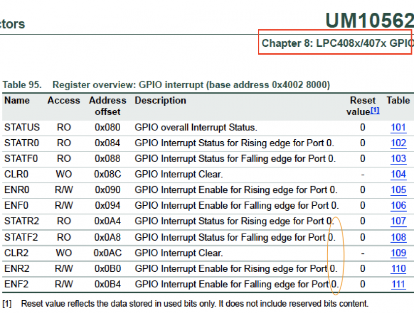
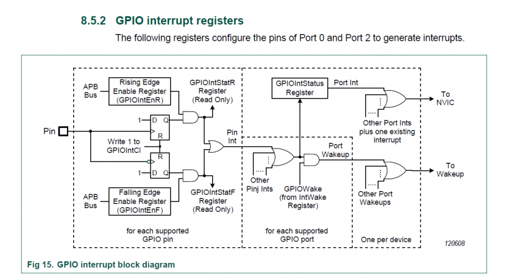
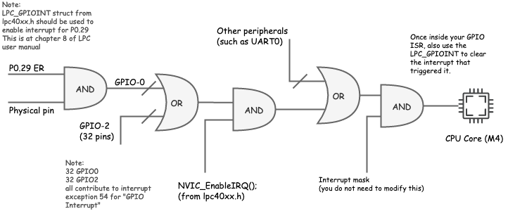

#### Objective

Learn how to create a single dynamic user defined interrupt service routine callback driver/library. Be sure to click through the hyperlinks provided in this article to learn the background knowledge before you jump into the assignment. You may re-use any existing code, such as the API from `gpio.h` header file.

This lab will utilize:

- Semaphores 
  - Wait on [Semaphore Design pattern](http://books.socialledge.com/link/12#bkmrk-design-pattern) 
- [Lookup table](/sjsu---embedded-drivers-rtos/pages/18-lookup-tables/) structures and Function Pointers  

  - You will allow the user to register their callbacks 
  - Be sure to understand how [function pointers](/useful-knowledge/pages/05-function-pointer/) work 
- [Interrupts](/sjsu---embedded-drivers-rtos/pages/20-nested-vector-interrupt-controller-nvic/) 
  - LPC supports rising and falling edge interrupts on certain port pins 
  - These port/pin interrupts are actually OR'd together and use a single CPU interrupt. 
  - On the **SJ2 board**, GPIO interrupts are handled by a dedicated GPIO interrupt (**exception number 54**) 
    - For the SJ1 board, it is: EINT3 interrupt. 

---

##### Where to start

- For Part 0, do the following 
  - **Read the LPC User Manual**, particularly ALL information about `Table 95: GPIO Interrupt` 
  - Browse the code, and fully absorb `interrupt_vector_table.c` and `entry_point.c` 
- For Part 1, first review the Semaphore Design pattern that will be utilized later 

 

---

---

##### Port Interrupts

You will configure GPIO interrupts.  This is supported for `Port0` and `Port2` and the following registers are relevant. Note that there is a typo in the LPC user-manual as pointed by the orange notation below.



For extra reading material, you can take a look at Chapter 5: LPC408x/407x User Manual, and the Chapter 8 section 8.5.2 to understand more about the GPIO interrupt block diagram



 

---

---

#### Assignment

##### Part 0: Simple Interrupt

The first thing you want to do is get a single Port/Pin's interrupt to work **without using the RTOS**. Make sure you fully understand the following diagram before you proceed. You will configure bits to trigger your GPIO interrupt, and you must also clear bits inside of your GPIO interrupt.

.png)

```c
#include <stdio.h>
#include "lpc40xx.h"

// Step 1:
void main(void) {
  // Read Table 95 in the LPC user manual and setup an interrupt on a switch connected to Port0 or Port2
  // a) For example, choose SW2 (P0_30) pin on SJ2 board and configure as input
  //.   Warning: P0.30, and P0.31 require pull-down resistors
  // b) Configure the registers to trigger Port0 interrupt (such as falling edge)

  // Install GPIO interrupt function at the CPU interrupt (exception) vector
  // c) Hijack the interrupt vector at interrupt_vector_table.c and have it call our gpio_interrupt()
  //    Hint: You can declare 'void gpio_interrupt(void)' at interrupt_vector_table.c such that it can see this function

  // Most important step: Enable the GPIO interrupt exception using the ARM Cortex M API (this is from lpc40xx.h)
  NVIC_EnableIRQ(GPIO_IRQn);
 
  // Toggle an LED in a loop to ensure/test that the interrupt is entering ane exiting
  // For example, if the GPIO interrupt gets stuck, this LED will stop blinking
  while (1) {
    delay__ms(100);
    // TODO: Toggle an LED here
  }
}

// Step 2:
void gpio_interrupt(void) {
  // a) Clear Port0/2 interrupt using CLR0 or CLR2 registers
  // b) Use fprintf(stderr) or blink and LED here to test your ISR
}
```

 

---

##### Part 1: Interrupt with Binary Semaphore

You will essentially complete `Part 0`, but with the RTOS using a binary semaphore as a signal to wake a sleeping task. It is recommended to save your code in a separate file (or comment it out), and then start this section of the lab. Do not forget to reference the Semaphore Design Pattern.

For the code that you turn in, you do not have to turn in [Part 0](#bkmrk-part-1%3A-design-ssp%C2%A0) separately since that was just started code for you to get started with the lab. Furthermore, you should improve your code in this part and use the API from `lpc_peripherals.h` to register your interrupt callback: `lpc_peripheral__enable_interrupt(LPC_PERIPHERAL__GPIO, my_gpio_interrupt, "name");`

```c
#include "FreeRTOS.h"
#include "semphr.h"

#include "lpc40xx.h"
  
static SemaphoreHandle_t switch_pressed_signal;

void main(void) {
  switch_pressed_signal = ... ;    // Create your binary semaphore
  
  configure_your_gpio_interrupt(); // TODO: Setup interrupt by re-using code from Part 0
  NVIC_EnableIRQ(GPIO_IRQn);       // Enable interrupt gate for the GPIO
 
  xTaskCreate(sleep_on_sem_task, "sem", (512U * 4) / sizeof(void *), NULL, PRIORITY_LOW, NULL);
  vTaskStartScheduler();
}

// WARNING: You can only use printf(stderr, "foo") inside of an ISR
void gpio_interrupt(void) {
  fprintf(stderr, "ISR Entry");
  xSemaphoreGiveFromISR(switch_pressed_signal, NULL);
  clear_gpio_interrupt();
}

void sleep_on_sem_task(void * p) {
  while(1) {
    // Use xSemaphoreTake with forever delay and blink an LED when you get the signal
  }
}

```

 

---

##### Part 2: Support GPIO interrupts using function pointers

   

In this part, you will use the main GPIO interrupt to be able to dispatch user registered interrupts per pin.

You are designing a library that will allow the programmer to be able to "attach" a function callback to any and each pin on `Port 0`. Implement all methods and it should work as per the description mentioned in the comments above each function declaration.

```cpp
// Objective of the assignment is to create a clean API to register sub-interrupts like so:
void pin30_isr(void) { }
void pin29_isr(void) { }

// Example usage:
void main(void) {
  gpio0__attach_interrupt(30, GPIO_INTR__RISING_EDGE, pin30_isr);
  gpio0__attach_interrupt(29, GPIO_INTR__FALLING_EDGE, pin29_isr);
}
```

Here is starter code for you that demonstrates the use of function pointers:

```cpp
// @file gpio_isr.h
#pragma once
  
typedef enum {
  GPIO_INTR__FALLING_EDGE,
  GPIO_INTR__RISING_EDGE,
} gpio_interrupt_e;

// Function pointer type (demonstrated later in the code sample)
typedef void (*function_pointer_t)(void);

// Allow the user to attach their callbacks
void gpio0__attach_interrupt(uint32_t pin, gpio_interrupt_e interrupt_type, function_pointer_t callback);

// Our main() should configure interrupts to invoke this dispatcher where we will invoke user attached callbacks
// You can hijack 'interrupt_vector_table.c' or use API at lpc_peripherals.h
void gpio0__interrupt_dispatcher(void) {
}
```

And here is the sample code for the implementation:

```cpp
// @file gpio_isr.c
#include "gpio_isr.h"

// Note: You may want another separate array for falling vs. rising edge callbacks
static function_pointer_t gpio0_callbacks[32];

void gpio0__attach_interrupt(uint32_t pin, gpio_interrupt_e interrupt_type, function_pointer_t callback) {
  // 1) Store the callback based on the pin at gpio0_callbacks
  // 2) Configure GPIO 0 pin for rising or falling edge
}

// We wrote some of the implementation for you
void gpio0__interrupt_dispatcher(void) {
  // Check which pin generated the interrupt
  const int pin_that_generated_interrupt = logic_that_you_will_write();
  function_pointer_t attached_user_handler = gpio0_callbacks[pin_that_generated_interrupt];
  
  // Invoke the user registered callback, and then clear the interrupt
  attached_user_handler();
  clear_pin_interrupt(pin_that_generated_interrupt);
}

```

Below image shows the software workflow. Click on the image below to view animation and understand more on how the driver should work.


##### **Extra Credit**

There are a number of ways to go the extra step and separate yourself from an average student. For this lab, you can do several things to earn extra credit:

- Go back to the previous lab, and instead of implementing a task that reads input, design it such that it registers a callback instead. 
- Improve the code quality. Instead of hacky code that barely works, demonstrate your code quality by making your code more robust and clean. 
- You can extend your API in `Part 2` to also support `Port 2` 

 

---

#### Requirements

- You should be able to fully re-write code for `Part 0` or `Part 1`, meaning that you understand the code that you just wrote. You are encouraged to ask questions for any line of code that is not well understood (or magical). 
- Should be able to specify a callback function for any pin for an exposed GPIO given a rising or falling condition  

  - We may ask you to change which pin causes a particular callback to be executed in your code and then recompile and re-flash your board to and prove it works with any pin 

   

Note that printing 4 chars inside an ISR can take 1ms at 38400bps, and this is an eternity for the processor and should never be done (other than todebug)

##### What to turn in:

- Place all relevant source files within a .pdf file. 
- Turn in the** screenshots** of terminal output.