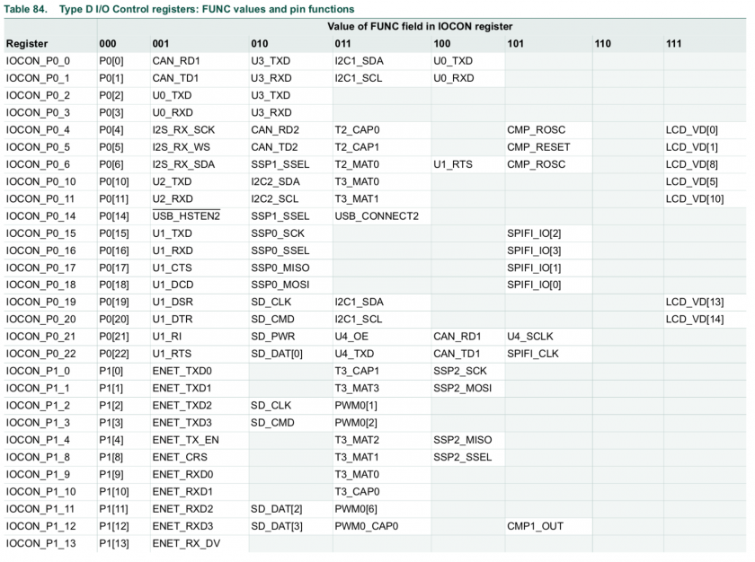
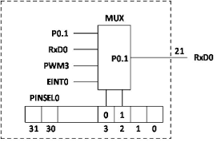
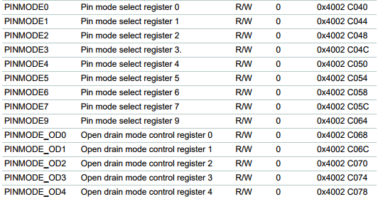
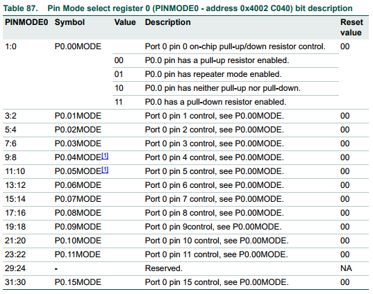
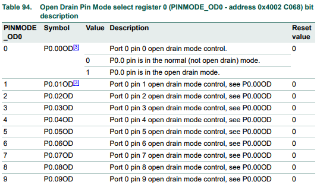
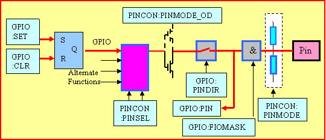

### Objective

Know how to select a specific functionality of a given LPC40xx pin. Know how to select a pin mode.

### Pin Selection

Every GPIO pin of the LPC40xx is capable of other alternative functionalities. Pin selection is the method by which a user is able to designate the functionality of any given pin. For example, GPIO Pin 0.0 can alternatively be used for CAN channel 1 receive, UART channel 3 transmit, and I2C channel 1 data line. 



*Figure 1A. LPC40xx User Manual IOCON*

 

***Figure 1B.** I/O Pin Select Mux (from LPC2148, for illustration purposes only)*

In order to select the I2C2_SDA functionality of pin 0.10, one must set bit 1, reset bit 0 & 3 of the IOCON register function field to 010.

```c
// Using LPC40xx.h pointers
LPC_IOCON->P0_10 &= ~0b010		// reset all bits of function[2:0]
LPC_IOCON->P0_10 |= 0b010;		// set the function bit for I2C2
```

### Pin Mode

The LPC17xx has several registers dedicated to setting a pin's mode. Mode refers to enabling/disabling pull up/down resistors as well as open-drain configuration. PINMODE registers allow users to enable a pull-up (00), enable pull up and pull down (01), disable pull up and pull down (10), and enable pull-down (11). PINMODE_OD registers allow users to enable/disable open-drain mode. 

 

*Figure 2. LPC17xx User Manual PINMODE & PINMODE_OD*

* *

 

*Figure 3. LPC17xx User Manual PINMODE0** *

 

*Figure 4. LPC17xx User Manual PINMODE_OD0*

For example, if one desires to configure pin 0.09 to enable a pull-up resistor and open drain mode, one must clear bits 18 & 19 of PINMODE0 register, and set bit 9 of register PINMODE_OD0.

```c
// Using the memory address from the datasheet
*(0x4002C040) &= ~(0x3 << 18);		// Clear bits 18 & 19
*(0x4002C068) |= (0x1 << 9);		// Set bit 9

// Using LPC17xx.h pointers
LPC_PINCON->PINMODE0 &= ~(0x3 << 18);		// Clear bits 18 & 19
LPC_PINCON->PINMODE_OD0 |= (0x1 << 9);		// Set bit 9

```

You may find it helpful to automate register setting and/or clearing. Per our Coding Standards, [inline functions](http://cmpe.kammce.io/books/cmpe-146/page/course-coding-standards#bkmrk-constexpr-functions-) should be used (not Macros).

 

*Figure 5. LPC17xx Pin Registers & Circuit (credit: [https://sites.google.com/site/johnkneenmicrocontrollers/input_output/io_1768](https://sites.google.com/site/johnkneenmicrocontrollers/input_output/io_1768))*