### Objective

To learn about the use of ADCs, their different types, their related parameters, and how to set up an ADC driver for the LPC40xx.

### What does ADC accomplish?

An Analog to Digital Converter is needed whenever one needs to interface a digital system with an analog device. For example, if one needs to read the voltage across a resistor, and use the value within an algorithm running on the SJOne board, an ADC circuit is needed to convert the analog voltage to a discrete digital value. Luckily, the LPC40xx, like most microcontrollers, includes an ADC circuit that we can utilize.

### Different types of ADC circuits

#### Flash ADC

The simplest and fastest ADC circuit relies on a series of comparators that compare the input voltage to a range of voltage reference values. The digital output of the comparators is wired to a priority encoder. The output of the priority encoder represents the binary value of the input voltage.

Note that the number of bits of the binary output (n) requires (2n-1) comparators. Therefore, the circuit complexity grows exponentially with respect to the number of bits used to represent the converted value (resolution). 

 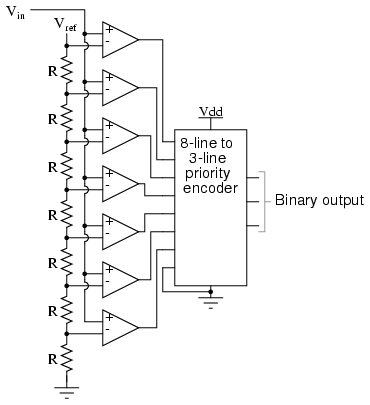 

[http://35.197.33.68:8080/uploads/images/gallery/2018-01-Jan/flash_adc_circuit.png](http://35.197.33.68:8080/uploads/images/gallery/2018-01-Jan/flash_adc_circuit.png)

*Figure 1. Flash ADC Circuit (credit: allaboutcircuits.com)*

 

 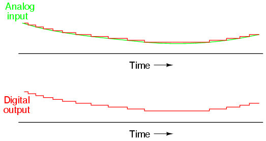 

*Figure 2. Flash ADC Timing (credit: allaboutcircuits.com)*

 

#### Digital Ramp ADC

This type of ADC utilizes an up counter, a comparator, a DAC, and a register. DACs (Digital Analog Converters), as their name suggests, perform the inverse operation of an ADC, i.e. They convert a binary input into an analog voltage output. The up counter starts at zero and counts up synchronously. The output of the counter is wired to the DAC. The analog output of the DAC is compared to the analog input signal. As long as the comparator indicates that the input voltage is larger than the DAC's value, the counter continues to increment. Eventually, the DAC's output will exceed the input voltage, and the comparator will activate the counter's reset signal as well as the register's load signal. The register's output represents the binary value of the input analog signal.

Note that because the counter starts from zero with every sample, the time it takes the circuit to produce the digital output is inconsistent. 

 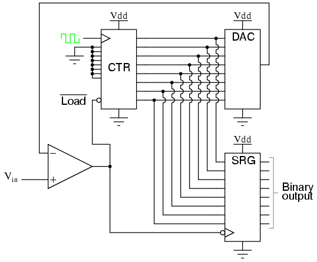

*Figure 3. Digital Ramp ADC Circuit (credit: allaboutcircuits.com)*

 

 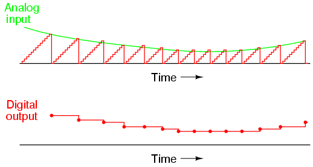 

 

*Figure 4a. Digital Ramp ADC Timing (credit: allaboutcircuits.com)*

 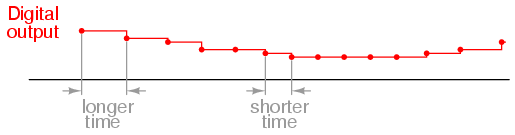 

*Figure 4b. Digital Ramp ADC Timing Variance (credit: allaboutcircuits.com)*

#### Successive Approximation ADC

A successive approximation ADC works very similarly to a digital ramp ADC, except it utilizes a successive approximation register (SAR) in place of the counter. The SAR sets each bit from MSB to LSB according to its greater/less than logic input signal.

This type of ADC is more popular than flash and digital ramp due to its consistent timing and relatively scalable design.

 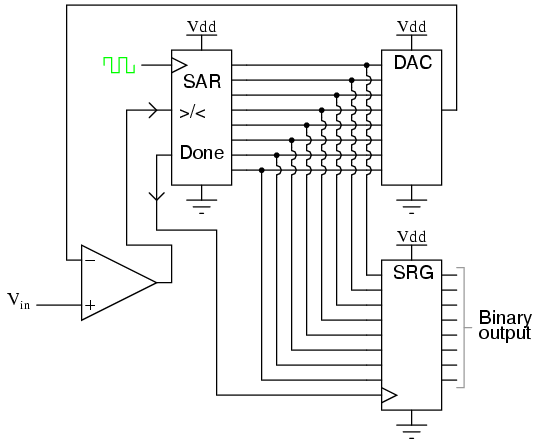 

*Figure 5. Successive Approximation ADC Circuit (credit: allaboutcircuits.com)*

 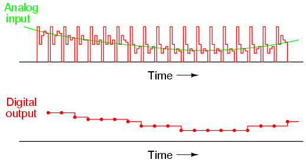 

*Figure 6. Successive Approximation ADC Timing (credit: allaboutcircuits.com)*

#### Tracking ADC

A Tracking ADC works similarly to the Digital Ramp ADC, except instead of an up counter, it utilizes an up-down counter. The output of the comparator determines whether the counter increments or decrements. It doesn't use a register to hold the processed value since it's constantly tracing the input value.

Note that this type of ADC does not respond well to large changes of the input analog signal. Additionally, it suffers from constantly going over and under the input value. This is known as bit bobble. 

 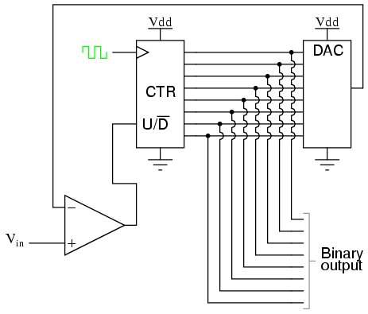 

*Figure 7. Tracking ADC Circuit (credit: allaboutcircuits.com)*

 

 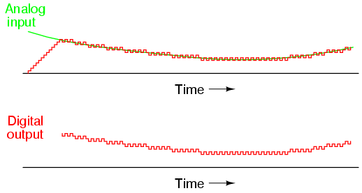 

 

*Figure 8. Tracking ADC Timing (credit: allaboutcircuits.com)*

#### DAC-free ADCs

Besides Flash ADC, all previous ADC circuits rely on using DACs to convert an estimated digital value to an analog one and compare it to the input signal. There are other types of ADC technologies that do not use DACs. They rely on the known time it takes an RC circuit to discharge to match the input analog signal. Single Slope, Dual Slope, and Delta-Sigma ADCs implement this concept.

### ADC Parameters

#### Resolution

This is typically the most-highlighted aspect of any ADC technology. Resolution refers to the number of bits of the ADC's output. It's a measurement of how coarse/fine the converted value is. A four bit 5V ADC offers 16 values for the voltage range 0 V to 5 V (i.e. roughly 312 mV per bit increment). A 10 bit 5V ADC offers 1024 values for the same voltage range (roughly 5 mV per bit increment). 

#### Sampling Frequency

This is simply the circuit's latency (i.e. the rate of converting an analog input signal to digital bits). The highest frequency of an analog signal that a given ADC circuit is able to adequately capture is known as Nyquist frequency. Nyquist frequency is equal to one-half of the circuits sampling frequency. Therefore, to adequately convert an analog signal of frequency n Hz, one must have an ADC circuit with 2n Hz sampling frequency. Otherwise, aliasing happens. Aliasing occurs when an ADC circuit samples an input signal too slowly, thus producing an output signal that is not the *true* input signal, but rather an alias of it.

 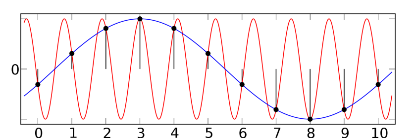  

*Figure 9. ADC Aliasing*

#### Step Recovery

This is a measurement of how quickly an ADC's output is able to respond to a sudden change in input. For example, flash and successive approximation ADCs are able to adjust relatively quickly to input changes while tracking ADC struggles with large input changes.

#### Range

This is a measurement of the range of voltages that an ADC circuit is able to capture and output. For example, the LPC40xx has a range of 0V to 3.3V. Other ADCs may have bigger ranges or even variable ranges that a user can select, such as this device: [https://www.mouser.com/ds/2/609/AD7327-EP-916882.pdf](https://www.mouser.com/ds/2/609/AD7327-EP-916882.pdf)

#### Error

This is a measurement of the systematic error of any given ADC circuit. This is measured by comparing the actual input signal to its digital output equivalent. Note that, this error measurement is only valid within the range of the ADC in question. 

### ADC Driver for LPC40xx

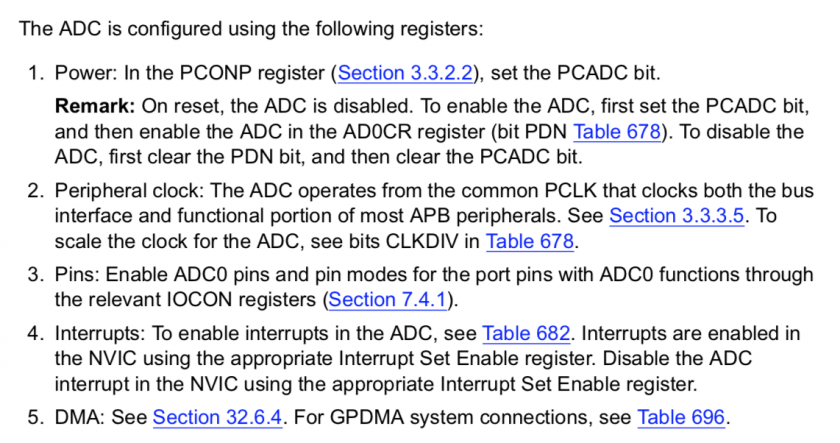

*Figure 10. LPC40xx User Manual ADC Instructions*

#### 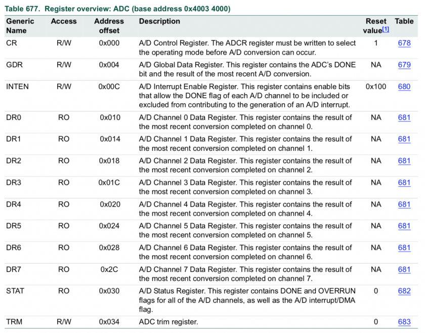

*Figure 11. LPC40xx User Manual ADC Control Register*