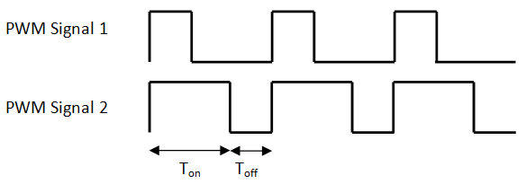
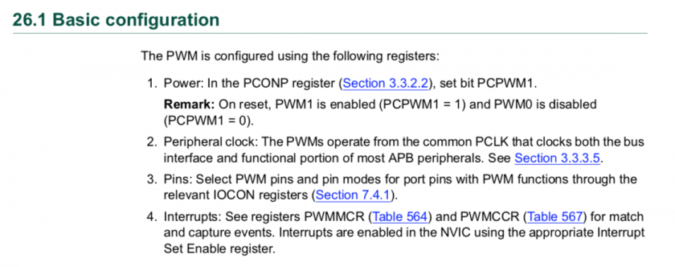

### Objective

To learn about the use of PWM signals, their related parameters, and how to set up an ADC driver for the LPC40xx.

### What is a PWM signal?

A Pulse Width Modulation (PWM) signal is simply a digital signal that is on (high) for part of its period and off (low) for the remainder of its period. If such a signal is on half the time and off the other half, then it's a square wave. 

 

*Figure 1. PWM Signal (credit: www.bvsystems.be)*

### PWM Parameters

#### Duty Cycle

A duty cycle of a certain PWM signal is given as a percentage, and it represents the ratio of the signal "on" time to the signal's full period. In other words, if the duty cycle of a signal is said to be 75%, it means that this signal is high for 75% of its period and low for the remaining 25%. 100% duty cycle implies a constantly high signal, and a 0% duty cycle implies a constantly grounded signal.

#### Frequency

 The frequency of a PWM signal (just like any electrical signal) refers to the rate at which the signal repeats per second. A 1 Hz signal repeats every 1 second while a 1 kHz signal repeats every 1 millisecond.

  

*Figure 2. Parameters of a PWM signal*

### PWM Signal Applications

Generally speaking, a PWM signal is a way for a digital system to interface with an analog device. 

#### DC Motors

DC Motors are controllable via a PWM signal. The duty cycle of the signal is typically linearly proportional to the velocity of the motor. For example, a 60 RPM motor driven by a 50% duty cycle PWM signal will rotate at a 30 RPM velocity. It's worth noting that such a signal needs to run at a high enough frequency (10 kHz for example) so the motor can rotate smoothly. A low-frequency PWM signal (say 10 Hz) will result in an observable choppy motor motion. 

#### LEDs

The brightness of an LED can be controlled via a reasonably high-frequency PWM signal. A 5V 50% PWM signal applied to an LED will have the same brightness effect as a constant 2.5V signal applied to the same LED. 

#### Servos

 Servos are typically controlled by a 50 Hz PWM signal, where the duty cycle of the signal determines the angle of the servo. Typically, the duty cycle ranges from 5% to 10%, causing the servo to rotate to its smallest and largest angles, respectively. 

### PWM Driver for LPC40xx

#### 

#### Theory of Operation

Behind every PWM is a Peripheral (HW) counter (TC).  For "Single Edge" PWM, when the counter starts from zero, the output of the PWM (GPIO) can reset back to logical 1.  Then, when the value of the "Match Register (MR)" occurs, then the PWM output can set to logical 0.  Therefore, the maximum limit of the TC controls the frequency of the PWM signal, and the MR registers control the duty cycle.

#### *[Missing image: LPC Microcontroller PWM Module Timing Diagram]*

#### Software PWM

This section demonstrates the LPC PWM operation in software.  The LPC processor implements similar code, but in the hardware.

```cpp
void lpc_pwm(void)
{
  bool GPIO_PWM1 = true; // Hypothetical GPIO that this PWM channel controls
  uint32_t TC = 0;    // Hardware counter
  uint32_t MR0 = 500; // TC resets when it matches this
  
  // Assumptions: SW instructions add no latency, and delay_us() is the only instruction that takes time
  while (1) 
  {
    if (++TC >= MR0) {
      TC = 0;
      GPIO_PWM1 = true;  // GPIO is HIGH on the reset of TC
    }
    
    if (TC >= MR1) {
      GPIO_PWM1 = false; // GPIO resets upon the match register
    }
    
    // 1uS * 500 = 500uS, so 2Khz PWM
    delay_us(1);
  }
}
```

#### Registers of relevance

What you are essentially trying to control is the PWM frequency and the PWM duty cycle.  For instance, a 50% duty cycle with just a 1Hz PWM will blink your LED once a second.  But a 50% duty cycle 1Khz signal will dim your LED to 50% of the total brightness it is capable of.  There are "rules" that the PWM module uses to alter a GPIO pin's output and** these rules are what you are trying to understand**.  So read up on "Rules of Single Edge Conrolled PWM" in your datasheet and overall the LPC PWM chapter **at minimum 10 times to understand it**.  You may skip the sections regarding "capture", and "interrupts".  Furthermore, to use the simplified PWM, you can use the ***Single Edge*** PWM rather than the more complex ***Double Edge*** because the Single Edge edge PWM is controlled by a dedicated MR register.

**TC, MR0, MCR and PR**: The Prescalar (PR) register controls the tick rate of the hardware counter that can alter the **frequency** of your PWM.  For instance, when the CPU clock is 10Mhz, and the PR = 9, then the TC counts up at the rate of 10/(9+1) = 1 Mhz.  Hence, the PR affects the frequency, but we still need a "max count" to set the frequency with precision.  So if the TC increments at 1Mhz, and MR0 is set to 100, then you will have 1000Khz/100 = 10Khz PWM.

The MCR register controls what happens to the TC when a match occurs.  The one subtle, but **important** thing we need to do is that when the MR0 match occurs, we need the TC to reset to zero to be able to use MR0 as a frequency control.

**TCR and PCR**:  The PCR register enables the channels, so if you have PWM1.4 as an output, that means you need to enable channel 4.  The TCR register is a key register that will enable your PWM module.