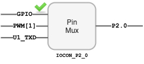
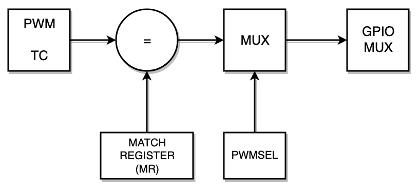
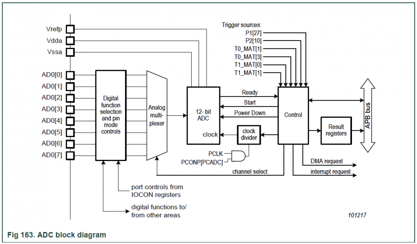
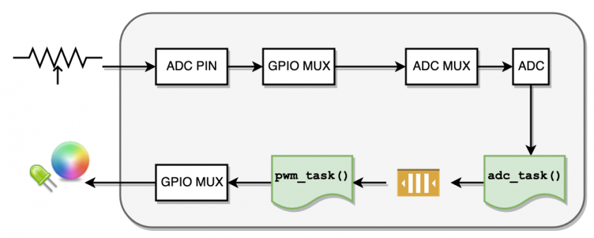

#### Objective

Improve an ADC driver, and use an existing PWM driver to design and implement an embedded application, which uses RTOS queues to communicate between tasks.

This lab will utilize:

- ADC Driver 
  - You will improve the driver functionality 
  - You will use a potentiometer that controls the analog voltage feeding into an analog pin of your microcontroller 
- PWM Driver 
  - You will use an existing PWM Driver to control a GPIO 
  - An led brightness will be controlled, or you can create multiple colors using an RGB LED 
- FreeRTOS Tasks 
  - You will use FreeRTOS queues 

---

---

#### Assignment

**Preparation:**   
Before you start the assignment, please read the following in your LPC User manual (UM10562.PDF)  
- Chapter 7: I/O configuration  
- Chapter 32: ADC

 

---

##### Part 0: Use PWM1 driver to control a PWM output pin

The first thing to do is to select a pin to function as a PWM signal. This means that once you select a pin function correctly, then the pin's function is controlled by the PWM peripheral and you cannot control the pin's HIGH or LOW using the GPIO peripheral. By default, a pin's function is as GPIO, but for example, you can disconnect this function and select the PWM function by using the `IOCON_P2_0`



1. Re-use the PWM driver 
  - Study the `pwm1.h` and `pwm1.c` files under `l3_drivers` directory 
2. Locate the pins that the PWM peripheral can control at `Table 84: FUNC values and pin functions`  

  - These are labeled as `PWM1[x]` where `PWM1` is the peripheral, and `[x]` is a channel 
    - So `PWM1[2]` means PWM1, channel 2 
  - Now find which of these channels are available as a free pin on your SJ2 board and connect the RGB led 
    - Set the `FUNC` of the pin to use this GPIO as a PWM output 
3. Initialize and use the PWM-1 driver 
  - Initialize the PWM1 driver at a frequency of your choice (greater than 30Hz for human eyes) 
  - Set the duty cycle and let the hardware do its job :) 
4. You are finished with Part 0 if you can demonstrate control over an LED's brightness using the HW based PWM method 



```c
#include "pwm1.h"

#include "FreeRTOS.h"
#include "task.h"

void pwm_task(void *p) {
  pwm1__init_single_edge(1000);
  
  // Locate a GPIO pin that a PWM channel will control
  // NOTE You can use gpio__construct_with_function() API from gpio.h
  // TODO Write this function yourself
  pin_configure_pwm_channel_as_io_pin();
  
  // We only need to set PWM configuration once, and the HW will drive
  // the GPIO at 1000Hz, and control set its duty cycle to 50%
  pwm1__set_duty_cycle(PWM1__2_0, 50);
  
  // Continue to vary the duty cycle in the loop
  uint8_t percent = 0;
  while (1) {
    pwm1__set_duty_cycle(PWM1__2_0, percent);
    
    if (++percent > 100) { 
      percent = 0; 
    }
    
    vTaskDelay(100);
  }
}

void main(void) {
  xTaskCreate(pwm_task, ...);
  vTaskStartScheduler();
}
```

 

---

##### Part 1: Alter the ADC driver to enable `Burst Mode`

- Study `adc.h` and `adc.c` files in `l3_drivers` directory and correlate the code with the ADC peripheral by reading the LPC User Manual.  

  - **Do not skim over the driver, make sure you fully understand it.** 
- Identify a pin on the SJ2 board that is an ADC channel going into your ADC peripheral. 
  - Reference the I/O pin map section in `Table 84,85,86: FUNC values and pin functions` 
- Connect a potentiometer to one of the ADC pins available on SJ2 board. Use the ADC driver and implement a simple task to decode the potentiometer values and print them. Values printed should range from 0-4095 for different positions of the potentiometer. 

```c
// TODO: Open up existing adc.h file
// TODO: Add the following API

/**
 * Implement a new function called adc__enable_burst_mode() which will
 * set the relevant bits in Control Register (CR) to enable burst mode.
 */
void adc__enable_burst_mode(void);

/**
 * Note: 
 * The existing ADC driver is designed to work for non-burst mode
 * 
 * You will need to write a routine that reads data while the ADC is in burst mode
 * Note that in burst mode, you will NOT read the result from the GDR register
 * Read the LPC user manual for more details
 */
uint16_t adc__get_channel_reading_with_burst_mode(uint8_t channel_number);
```



```c
#include "adc.h"
  
#include "FreeRTOS.h"
#include "task.h"

void adc_pin_initialize(void) {
  // TODO: Ensure that you also set ADMODE to 0
  // TODO: Ensure you set pull/up and pull/down bits 0
  // TODO: Then use gpio__construct_with_function(...)
}

void adc_task(void *p) {
  adc_pin_initialize();
  adc__initialize();
  
  // TODO This is the function you need to add to adc.h
  // You can configure burst mode for just the channel you are using
  adc__enable_burst_mode();
  
  // Configure a pin, such as P1.31 with FUNC 011 to route this pin as ADC channel 5
  // You can use gpio__construct_with_function() API from gpio.h
  pin_configure_adc_channel_as_io_pin(); // TODO You need to write this function
  
  while (1) {
    // Get the ADC reading using a new routine you created to read an ADC burst reading
    // TODO: You need to write the implementation of this function
    const uint16_t adc_value = adc__get_channel_reading_with_burst_mode(ADC__CHANNEL_2);
    
    vTaskDelay(100);
  }
}

void main(void) {
  xTaskCreate(adc_task, ...);
  vTaskStartScheduler();
}
```

 

---

##### Part 2: Use FreeRTOS Queues to communicate between tasks

- Read [this chapter](/sjsu---embedded-drivers-rtos/pages/36-queues/) to understand how FreeRTOS queues work 
- Send data from the `adc_task` to the RTOS queue 
- Receive data from the queue in the `pwm_task` 



```c
#include "adc.h"
  
#include "FreeRTOS.h"
#include "task.h"
#include "queue.h"

// This is the queue handle we will need for the xQueue Send/Receive API
static QueueHandle_t adc_to_pwm_task_queue;

void adc_task(void *p) {
  // NOTE: Reuse the code from Part 1
  
  int adc_reading = 0; // Note that this 'adc_reading' is not the same variable as the one from adc_task
  while (1) {
    // Implement code to send potentiometer value on the queue
    // a) read ADC input to 'int adc_reading'
    // b) Send to queue: xQueueSend(adc_to_pwm_task_queue, &adc_reading, 0);
    vTaskDelay(100);
  }
}

void pwm_task(void *p) {
  // NOTE: Reuse the code from Part 0
  int adc_reading = 0;

  while (1) {
    // Implement code to receive potentiometer value from queue
    if (xQueueReceive(adc_to_pwm_task_queue, &adc_reading, 100)) {
    }
    
    // We do not need task delay because our queue API will put task to sleep when there is no data in the queue
    // vTaskDelay(100);
  }
}

void main(void) {
  // Queue will only hold 1 integer
  adc_to_pwm_task_queue = xQueueCreate(1, sizeof(int));

  xTaskCreate(adc_task, ...);
  xTaskCreate(pwm_task, ...);
  vTaskStartScheduler();
}
```

 

---

##### Part 3: Allow the Potentiometer to control the RGB LED

At this point, you should have the following structure in place:

- ADC task is reading the potentiometer ADC channel, and sending its values over to a queue 
- PWM task is reading from the queue 

Your next step is:

- PWM task should read the ADC queue value, and control the an LED 

 

---

---

#### Final Requirements

Minimal requirement is to use a single potentiometer, and vary the light output of an LED using a PWM. For **extra credit**, you may use 3 PWM pins to control an RGB led and create color combinations using a single potentiometer.

- Make sure your **Part 3** requirements are completed 
- `pwm_task` should print the values of MR0, and the match register used to alter the PWM LEDs 
  - For example, MR1 may be used to control P2.0, so you will print MR0, and MR1 
  - Use memory mapped `LPC_PWM` registers from `lpc40xx.h` 
- Make sure **BURST MODE** is enabled correctly. 
- `adc_task` should convert the digital value to a voltage value (such as 1.653 volts) and print it out to the serial console 
  - Remember that your VREF for ADC is 3.3, and you can use ratio to find the voltage value 
  - `adc_voltage / 3.3 = adc_reading / 4095`