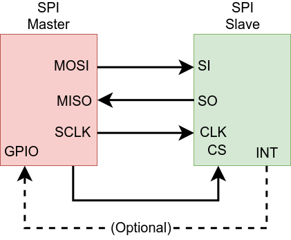
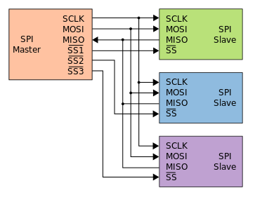
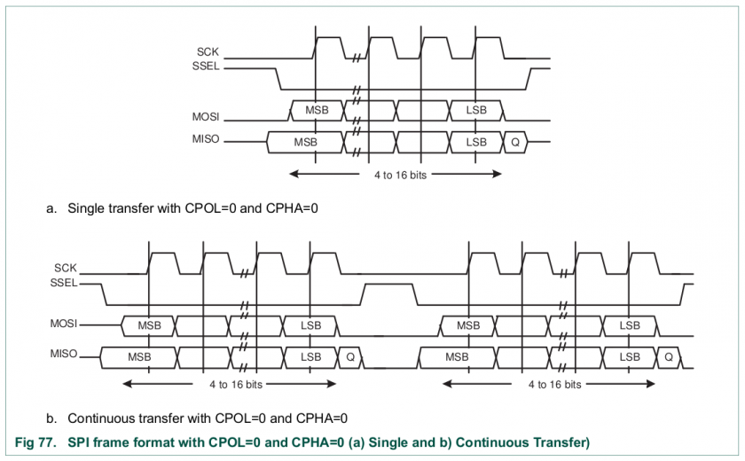
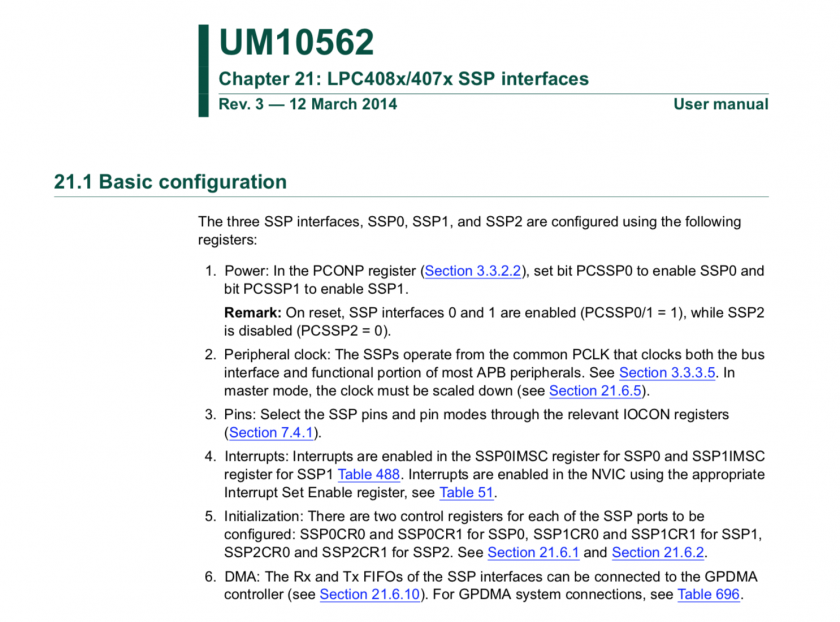

### What is SPI

SPI is a high-speed, full-duplex bus that uses a minimum of 3 wires to exchange data (and a number of device-selected wires). The popularity of this bus rose when SD cards (and its variants ie: micro-sd) officially supported this bus according to the SD specifications. SPI allows microcontrollers to communicate with multiple slave devices.

### SPI Bus Signals

 

 

*Figure 1. SPI Signals*

| **MASTER Pin Name** | **SLAVE Pin Name** | **Pin Function** |
| --- | --- | --- |
| MOSI | SI | **M**aster **O**ut **S**lave **I**n (driven by master), this pin is used to send sends data to the slave device. |
| MISO | SO | **M**aster **I**n **S**lave **O**ut (driven by slave), this pin is used by the slave to send data to the master device. |
| SCLK | CLK | **S**erial **Cl**oc**k** (driven by master), clock that signals when to read MISO and MOSI lines |
| CS | CS | **C**hip **S**elect (driven by master), used to indicate to the slave that you want to talk to it and not another slave device. This will activate the slave's MISO line. MISO line is set to h-z if this is not asserted. MISO is set to high if this signal is asserted. |
|  | INT | **Int**errupt (Optional) (driven by slave), an interrupt signal to alert the master that the slave device wants to communicate. Not all devices have this. This is not always needed. This is not apart of the standard. |

The SCK signal can reach speed of 24Mhz and beyond, however, SD cards are usually limited to 24Mhz according to the specifications. Furthermore, any signal over 24Mhz on a PCB requires special design consideration to make sure it will not deteriorate, thus 24Mhz is the usual maximum. Furthermore, you need a CPU twice as fast as the speed you wish to run to support it. For example, to run at 24Mhz SPI, we need 48Mhz CPU or higher. Because each wire is driven directly (rather than open-collector), higher speeds can be attained compared to 400Khz I2C bus. 

### Multi-slave bus

Suppose that you wanted to interface a single SPI bus to three SD cards, the following will need to be done :

- Connect all MOSI, MISO, and SCK lines together 
- Connect individual CS lines of three SD cards to SPI master (your processor) 

It is also recommended to provide a weak pull-up resistor on each of the SPI wires otherwise some devices like an SD card may not work. 50K resistor should work, however, lower resistor value can achieve higher SPI speeds. 

 

*Figure 2. Typical SPI Bus (wikipedia SPI, user Cburnett)*

As a warning, if your firmware selects more than one SPI slave chip select, and they both attempt to drive the MISO line, since those lines are totem-pole (push-pull), there will be bus contention and could possibly destroy both SPI devices. 

The "CS" section of the SPI/SSP chapter describes the information if your microcontroller is going to be a slave on the SPI bus.  Since your LPC micro is a master in reality, please do not confuse the CS pin for the SPI slave functionality.  Even if the CS pin is actually used to CS the Adesto flash, it is just an ordinary GPIO and will not function as the one described in your SPI/SSP chapter.  
  
Therefore, do not configure the "SSEL" in your PINSEL (or PIN function) since that is reserved for the case when your micro is an SPI Slave.  In your case, the same GPIO that has the "SSEL" capability is a simple GPIO to control the CS of the SPI Flash memory.

## SPI Timing Diagram

 

Figure 3. SPI timing diagram 

SPI has a few timing modes in which data is qualified on the rising or falling edge. In this case, and most, we qualify the MOSI and MISO signals on the rising edge. For a whole transaction to be qualified, the **~CS**  must be asserted. When the CS pin is pulled high (deasserted), the transaction is over and another transaction can be performed. This must be done for each transaction done by the master to the slave. 

The SPI is labeled as SSP on LPC17xx or LPC40xx User Manual due to historic reasons, and this chapter in the datasheet shows the software setup very well. After the SPI is initialized on the hardware pins, the next steps is to write an SPI function that will exchange a byte. **Note that if the master wants to receive data, it must send a data byte out to get a data byte back**. The moment we write to the **DR** (data register) of the SPI peripheral, the MOSI will begin to send out the data. At the same time, the MISO will capture the data byte back to **the same DR register**. In other words, SPI bus is a forced full-duplex bus.

Ensure that two transactions with the SPI device do not occur back to back without a delay. For instance, insert at least 1uS delay between successive DS and CS of another transaction.

### Why use SPI

#### Pros

- **High Speed:** 
  - There is no standard speed limit for SPI beyond how fast a [**Single-Ended Signal**](https://en.wikipedia.org/wiki/Single-ended_signaling) can propagate and how fast an SPI compatible device can react. 
  - In other words, how fast can you talk over a wire and how fast can a slave device read a clock signal. 
- **Simple:** 
  - Doesn't require special timing or a special state-machine to run. It doesn't really need hardware peripheral either. It can be bit-banged via GPIO. 
- **Synchronous:** 
  - This communication standard utilizes a clock to qualify signals. 
- **Full-Duplex:** 
  - Communication both ways. The slave to speak to the master at the same time that the master can speak to the slave device. 
- **Multi-slave:** 
  - You can talk to as many slaves as you have chip selects. 

#### Cons

- **IO/Pin Count:** 
  - IO count increases by one for each slave device you introduce, since each slave device needs a chip select.  
  - You also almost always need at least 4 wires for this communication protocol. 
    - There are some special cases that do not fit this but they are uncommon. 
- **Master Only Control:** 
  - Although the communication protocol can allow for full-duplex communication, the only way for a slave device to be able to communicate with the master is if the master initiates communication. 
  - A slave can only speak when spoken to. 

## Software Driver

 

*Figure 2. SPI Driver from LPC40xx datasheet* 

#### Preparation for the SPI driver

- Note that when we refer to **SPI**, we are referring to the **SSP** peripheral in the LPC user manual. 
  - SSP stands for Synchronous Serial Protocol and SPI is one of the synchronous serial protocols it can perform. 
- Study the schematic, and take a note of which pins have the SSP2 or SPI#2 peripheral pin-out. 
  - Note this down or draw this out. 
- Study and read the SSP2 LPC user manual chapter a few times 
- Study the schematic, and locate the CS pin for the SPI flash attached to SSP2, then write a simple GPIO driver for this to select and deselect this pin 
- Read the SPI flash datasheet that shows the SPI transactions for read/write, signature read etc. 
  - Rev.4 board has Adesto flash, and previous revisions have Atmel flash. 

**Multitasking Warnings**: if your software runs multiple tasks, and these tasks can access SPI, care needs to be taken because if two CS signals are asserted at the same time, hardware damage will occur. This leads to the topic of using a mutex (semaphore) under FreeRTOS and you can read the [FreeRTOS tutorial](http://www.socialledge.com/sjsu/index.php?title=FreeRTOS_Tutorial) to learn more.

Set the clock rate to be below the specification of the SPI device you are interfacing.