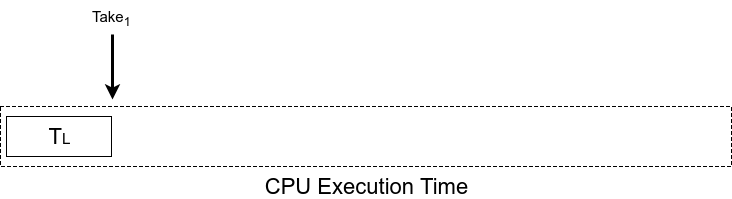
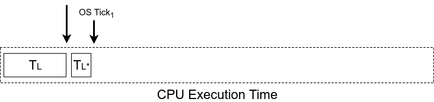
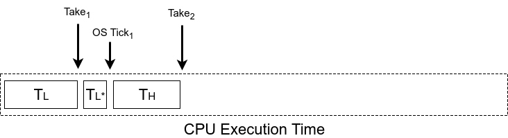
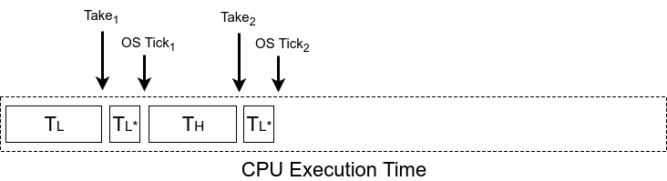
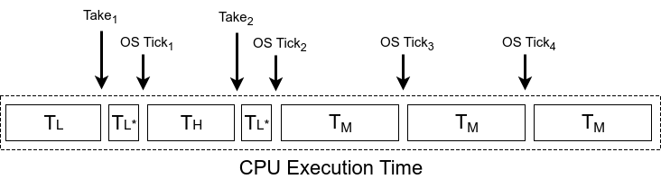
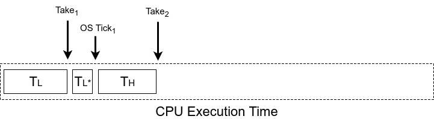
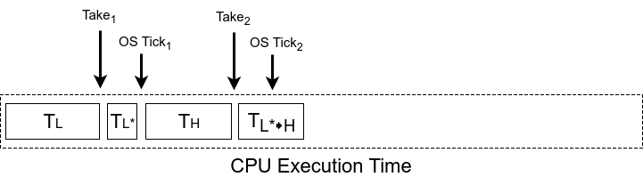
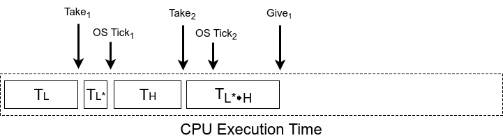
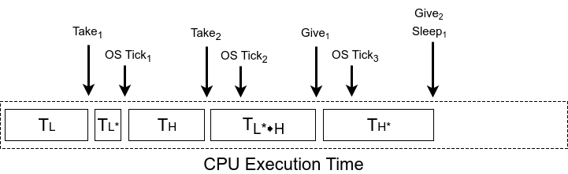
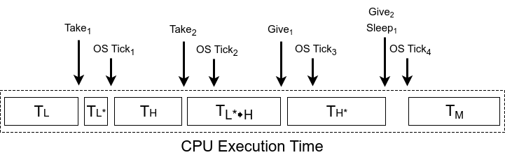

### Binary Semaphore vs Mutex

Binary semaphores and a mutex are nearly the same constructs except that a mutex have the feature of priority inheritance, where in a low priority task can inherit the priority of a task with greater priority if the higher priority task attempts to take a mutex that the low priority task possess.

[This article](https://percepio.com/2016/08/11/rtos-101-semaphores-and-queues/) provides a quick review on Binary Semaphore, Mutex, and Queue.

### Priority Inversion Using a Semaphore

Below is an illustration of the scenario where using a semaphore can cause priority inversion.

  

**Figure 1.** Low priority task is currently running and takes a semaphore.

.png)

**Figure 2.** OS Tick event occurs.

.png)

**Figure 3.** High priority task is ready to run and selected to run.

.png)

**Figure 4.** High priority task attempts to take semaphore and blocks.

.png)

**Figure 5.** Since high priority task is blocked, the next ready task that can run is the low priority task. The OS tick event occurs.

.png)

**Figure 6.** The OS tick event occurs, a middle priority task, that never sleeps is ready to run, it begins to run, high priority task is blocked on semaphore and low priority task is blocked by the middle priority task. This is priority inversion, where a medium priority task is running over a higher priority task. 

### Priority Inheritance using Mutex

Priority inheritance is the means of preventing priority inversion.

 

**Figure 7.** Moving a bit further, the high priority task attempts to take the Mutex

.png)

**Figure 8.** Low priority task inherates the highest priority of the task that attempts to take the mutex it posses.

.png)

**Figure 9.** OS Tick2 occurs, and medium priority task is ready, but the low priority task has inheritated a higher priority, thus it runs above the medium priority task.

.png)

**Figure 10.** Low priority task gives the mutex, low priority task de-inheritates its priority, and the high task immediately begins to run. It will run over the medium task.

.png)

**Figure 11.** At give2 high priority task releases the mutex and sleeps. Some time elapses, and then the medium task begins to run. No priority inversion occurs in this scenario, the RTOS rule of highest priority runs first is held.

### Design Pattern

The design pattern for a mutex should be exclusively used as a **protection token**. Mutexes can be used in place of as semaphores but the addition work of priority inheritance will cause this approach to take longer and thus be less efficient than a semaphore.

```cpp
#include "FreeRTOS.h"
#include "semphr.h"

// In main(), initialize your Mutex:
SemaphoreHandle_t spi_bus_mutex = xSemaphoreCreateMutex();

void task_one()
{
    while(1) {
        if(xSemaphoreTake(spi_bus_mutex, 1000)) {
            // Use Guarded Resource
 
            // Give Semaphore back:
            xSemaphoreGive(spi_bus_mutex);
        }
    }
}
void task_two()
{
    while(1) {
        if(xSemaphoreTake(spi_bus_mutex, 1000)) {
            // Use Guarded Resource
 
            // Give Semaphore back:
            xSemaphoreGive(spi_bus_mutex);
        }
    }
}

```

#### Other notes

Good APIs actually have protection such that the mutex cannot be given accidentally.

- [See this link](https://software-dl.ti.com/dsps/dsps_public_sw/sdo_sb/targetcontent/tirtos/2_14_02_22/exports/tirtos_full_2_14_02_22/docs/doxygen/html/_mutex_p_8h.html)