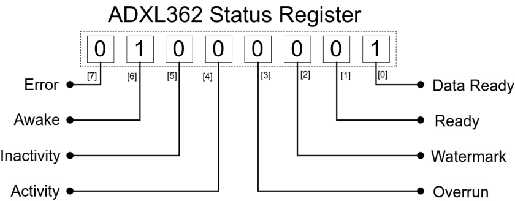

### Please Review the Following

- Structures in C: [http://www.cplusplus.com/doc/tutorial/structures/](http://www.cplusplus.com/doc/tutorial/structures/) 
- Unions in C:  [http://www.cplusplus.com/doc/tutorial/other_data_types/](http://www.cplusplus.com/doc/tutorial/other_data_types/) 

### Register Structure Mapping

Lets observe the status register for the ADXL362 accelerometer. The choice of this device is arbitrary.

 

*Figure 1. ADXL362 Status Register*

Normally, and more portably, to store information about the awake bit, you would do the following:

```cpp
/* Get byte from accelerometer */
uint8_t status = getStatusByte();
/* Store 6th bit using a shift and mask */
bool awake = ((status >> 6) & 0b1);
// You can also do this (to guarantee the result to be true or false only, rather than 0 or (1 << 6) which is 64
bool awake = (status & (1 << 6)) ? true : false;
bool awake = !!(status & (1 << 6));

/* Now use the stored awake boolean */
if(awake)
{
	doAThing();
}
```

The above is fine, but it would be great to do this in a more elegant fashion. For example, the following:

```cpp
/* Get a byte and cast it to our adlx_t structure */
adlx_t status = (adlx_t)getStatusByte();
/* Now retrieve the awake bit using the following syntax */
if(status.awake)
{
	doAThing();
}
```

To do something like this, you can define the **adlx_t **structure in the following way:

```cpp
typedef struct __attribute__((packed))
{
	uint8_t data_ready: 1; 
	uint8_t fifo_ready: 1;
	uint8_t fifo_warning: 1;
	uint8_t fifo_overrun: 1;
	uint8_t activity: 1;
	uint8_t : 1; /* Un-named padding, since I don't care about the inactivity signal */
	uint8_t awake: 1;
	uint8_t error: 1;
} adlx_t;
```

The colon specifies the start of a bit field. The number after the colon is the length in bits that label will take up. The **__attribute__((packed))** is a necessary compiler directive, specific to GCC which tells the compiler to make sure that the structure is packed together in the way that it is shown. It also tells the compiler to not rearrange it or expand it in order to make it more efficient to work with by the CPU.

**NOTE:** that the bit-field example and the shift and mask example are equivalent computationally. One is not *necessarily* more efficient the other. On one hand, you are writing the mask, in the other, the compiler does this for you.

##### Using Unions

Lets say we wanted to set the whole structure to zeros or a specific value, we can do this using **unions**.

```cpp
typedef union
{
	uint8_t byte;
	struct 
	{
		uint8_t data_ready: 1;
		uint8_t fifo_ready: 1;
		uint8_t fifo_warning: 1;
		uint8_t fifo_overrun: 1;
		uint8_t activity: 1;
		uint8_t inactivity: 1;
		uint8_t awake: 1;
		uint8_t error: 1;
	} __attribute__((packed));
} adlx_t;
```

This allows the user to do the following:

```cpp
/* Declare status variable */
adlx_t status;
/* Set whole bit field through the byte member */
status.byte = getStatusByte();

/* Use awake bit */
if (status.awake)
{
	doSomething();
}

/* Clear bit field */
status.byte = 0;
```

What about large data structures? For example, the ID3v1 metadata structure for MP3 files. This datastructure contains title name, artist and many other bits of information about the song to be played. It contains 128 bytes

| **Field** | **Length** | **Description** |
| --- | --- | --- |
| header | 3 | "TAG" |
| title | 30 | 30 characters of the title |
| artist | 30 | 30 characters of the artist name |
| album | 30 | 30 characters of the album name |
| year | 4 | A four-digit year |
| comment | 28 | The comment. |
| zero-byte | 1 | If a track number is stored, this byte contains a binary 0. |
| track | 1 | The number of the track on the album, or 0. Invalid, if previous byte is not a binary 0. |
| genre | 1 | Index in a list of genres, or 255 |

This is not a bit field, but the same principles stand. This can be turned into a structure as well:

```cpp
typedef union
{
	uint8_t buffer[128];
	struct 
	{
		uint8_t header[3];
		uint8_t title[30];
		uint8_t artist[30];
		uint8_t album[30];
		uint8_t year[4];
		uint8_t comment[28];
		uint8_t zero;
		uint8_t track;
		uint8_t genre;
	} __attribute__((packed));
} ID3v1_t;
```

Now, it would take up 128 bytes of memory in to create one of these structures and we want to be conservative. To use use the structure properties, and reduce space usage you can utilize pointers and casting.

```cpp
ID3v1_t mp3;

/* Some function to get the ID3v1 data */
dumpMP3DataIntoBuffer(&mp3.buffer[0]);

/* Compare string TAG with header member */
printf(" Title: %.30s\n", mp3.title);
printf("Artist: %.30s\n", mp3.artist);
```

### Using Macros

Using some casting techniques and macros you can do something like the following:

```cpp
#define ADLX(reg) (*((adlx_t*)(&reg)))

uint8_t status = getStatusByte();

if (ADLX(status).awake)
{
	doAThing();
}
```

### Dangers of Using Bit-fields

The above example that does not use bit-fields is quite portable, but bit-field mapping can be problematic depending on these factors

1. **Endianess of your system:** If a bit-field of a status register is little-endian and your processor is big-endian, the bits will be flipped.  
  1. This link explains this further: [http://opensourceforu.com/2015/03/be-cautious-while-using-bit-fields-for-programming/](http://opensourceforu.com/2015/03/be-cautious-while-using-bit-fields-for-programming/) 
2. **Structure of your struct:** in gcc, using **__attribute__((packed))** is very important, because the compiler may attempt to optimize that structure for speed, by expanding the members of the struct into 32-bits, or it may reorder the members and bit to make easier to do operations on. In these cases, the mapping will no longer work. This is something to consider when using this. This also typically depends on the compiler options for compiling. 
3. **Mixing bit fields and members: **See the link below on some issues that occurred when you mix bit-fields with variables. 
  1. [https://stackoverflow.com/questions/25822679/packed-bit-fields-in-c-structures-gc](https://stackoverflow.com/questions/25822679/packed-bit-fields-in-c-structures-gcc)