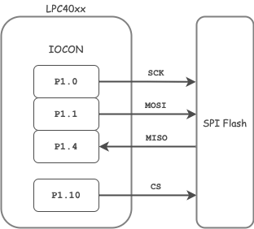

The objective is to learn how to create a thread-safe driver for **Synchronous Serial Port** and to communicate with an external **SPI Flash **device.

This lab will utilize:

- SPI driver (LPC user manual calls SPI as SSP) 
- Code interface for the SPI flash 
- Basic knowledge of data structures 
- Mutex strategy to access the SPI flash safely across multiple tasks (or threads) 
- Logic Analyzer capture 

#### Important Reminders

- Do not forget to select the PIN functions such that the peripheral can control SCK, MOSI, and MISO pins 
  - These should be IOCON registers of LPC40xx 
- You **will not** use the SSEL pin of the SPI driver 
  - The pin that shows SSEL is actually purposed as a GPIO to select the external SPI flash memory 
  - SSEL pin is meant for the purpose of your microcontroller acting as a SLAVE but since you are trying to be the master, this SSEL pin does not apply to you. It is instead re-purposed as a GPIO for your SPI flash memory. 
- Please read this [great article](https://electrosome.com/spi/) also 

 

---

#### Assignment

##### Part 0: SPI Driver



**Preparation:**

- Before you start the assignment, please read **Chapter 21: SSP** in your LPC User manual (`UM10562.pdf`). You can skip the sections related to interrupts or the DMA.  

  - From LPC User manual to understand the different registers involved in writing a SSP2 driver 
  - Refer table 84 from LPC User manual for pin configuration 
- From the schematics pdf(`Schematics-RevE.2.pdf`), identify the pin numbers connected to flash memory and make a note of it because you will be needing them for pin function configuration 
- Read the external SPI flash datasheet (`DS-AT25DN256_039.pdf`) or ([DS-AT25SF041_044](https://www.adestotech.com/wp-content/uploads/DS-AT25SF041_044.pdf)) depends on the board. 

**Implement `ssp2_lab.h` and **`**ssp2_lab.c**`

Note that there is already an  `ssp2.h` in your sample project, but you **will re-write this driver**. Refrain from peeking the existing driver because you will have to re-write more complex drivers during your exams without any reference code. If you get a compiler error about 'duplicate symbol' then please re-name your SSP functions accordingly because this compiler error may be stating that there is existing function with the same name in the SPI driver in another file.

```cpp
#include <stdint.h>

void ssp2__init(uint32_t max_clock_mhz) {
  // Refer to LPC User manual and setup the register bits correctly
  // a) Power on Peripheral
  // b) Setup control registers CR0 and CR1
  // c) Setup prescalar register to be <= max_clock_mhz
}

uint8_t ssp2__exchange_byte(uint8_t data_out) {
  // Configure the Data register(DR) to send and receive data by checking the SPI peripheral status register
}
```

 

---

##### Part 1: SPI Flash Interface

Get the code below to work and validate that you are able to read SPI flash memory's manufacture id and compare it with the SPI flash datasheet to ensure that this is correct.

```cpp
#include "FreeRTOS.h"
#include "task.h"

#include "ssp2_lab.h"

// TODO: Implement Adesto flash memory CS signal as a GPIO driver
void adesto_cs(void);
void adesto_ds(void);

// TODO: Study the Adesto flash 'Manufacturer and Device ID' section
typedef struct {
  uint8_t manufacturer_id;
  uint8_t device_id_1;
  uint8_t device_id_2;
  uint8_t extended_device_id;
} adesto_flash_id_s;

// TODO: Implement the code to read Adesto flash memory signature
// TODO: Create struct of type 'adesto_flash_id_s' and return it
adesto_flash_id_s adesto_read_signature(void) {
  //adesto_flash_id_s data = { 0 };
  
  adesto_cs();
  {
    // Send opcode and read bytes
    // TODO: Populate members of the 'adesto_flash_id_s' struct
  }
  adesto_ds();
  
  //return data;
}

void spi_task(void *p) {
  const uint32_t spi_clock_mhz = 24;
  ssp2__init(spi_clock_mhz);
  
  // From the LPC schematics pdf, find the pin numbers connected to flash memory
  // Read table 84 from LPC User Manual and configure PIN functions for SPI2 pins
  // You can use gpio__construct_with_function() API from gpio.h
  //
  // Note: Configure only SCK2, MOSI2, MISO2.
  // CS will be a GPIO output pin(configure and setup direction)
  todo_configure_your_ssp2_pin_functions();

  while (1) {
    adesto_flash_id_s id = adesto_read_signature();
    // TODO: printf the members of the 'adesto_flash_id_s' struct
 
    vTaskDelay(500);
  }
}

void main(void) {
  xTaskCreate(spi_task, ...);
  vTaskStartScheduler();
}
```

 

---

##### Part 2: SPI Flash Interface with a Mutex

- Read the article in [this link](/sjsu---embedded-drivers-rtos/pages/29-mutexes/) to understand how a mutex is created and used in a task 
- Purposely comment out the task creation of the task from Part 1: `xTaskCreate(spi_task,...)` 
- Study the code below which will attempt to read Adesto flash manufacturer ID in two tasks simultaneously 
- Run the following code, and confirm that it fails 
  - Be sure to initialize your SPI, and CS GPIO as needed 

```cpp
#include "FreeRTOS.h"
#include "task.h"
  
#include "ssp2_lab.h"

void spi_id_verification_task(void *p) {
  while (1) {
    const adesto_flash_id_s id = ssp2__adesto_read_signature();
    
    // When we read a manufacturer ID we do not expect, we will kill this task
    if (0x1F != id.manufacturer_id) {
      fprintf(stderr, "Manufacturer ID read failure\n");
      vTaskSuspend(NULL); // Kill this task
    }
  }
}

void main(void) {
  // TODO: Initialize your SPI, its pins, Adesto flash CS GPIO etc...

  // Create two tasks that will continously read signature
  xTaskCreate(spi_id_verification_task, ...);
  xTaskCreate(spi_id_verification_task, ...);

  vTaskStartScheduler();
}
```

After you confirm that there is a failure while two tasks try to use the SPI bus, resolve this by using a Mutex:

- Protect your `ssp2__adesto_read_signature()` a function such that two tasks will not be able to run this function at the same time. 
- If implemented correctly, you will not see the error `printf` 

 

---

##### Part 3: Extra Credit

Develop functionality to be able to read and write a "page" of the SPI flash memory. Here is a sample code that you can reference to send a `uint32_t` address to the SPI flash with MSB first.

```cpp
#include <stdint.h>

/**
 * Adesto flash asks to send 24-bit address
 * We can use our usual uint32_t to store the address
 * and then transmit this address over the SPI driver
 * one byte at a time
 */
void adesto_flash_send_address(uint32_t address) {
  (void) ssp2__exchange_byte((address >> 16) & 0xFF);
  (void) ssp2__exchange_byte((address >>  8) & 0xFF);
  (void) ssp2__exchange_byte((address >>  0) & 0xFF);
}
```

 

---

#### Conclusion

##### Logic Analyzer Hints

Saleae logic analyzer is a high quality USB analyzer, although you can find many copy cats as well. After you install the software, do the following:

- Hook up SCK, MOSI, and MISO to particular colors, and configure these colors by selecting the SPI bus in logic analyzer software (on windows for example) 
- Setup a trigger 
  - You have to setup a "trigger" which will trigger the logic analyzer data capture 
  - The CS signal transitioning from HIGH to LOW is the right choice, however, the CS signal may not be broken out on a pin header 
  - To provide a trigger, what you can do is that you can SET and RESET two GPIO pins simultaneously. One pin would be the real pin going to Adesto flash, and the second one is an arbitrary pin which is available on your SJ2 pin header that you can connect to the logic analyzer as a trigger 

Saleae logic analyzers are fast, but some others are not as fast. What this means is that you should ensure that your speed of the analyzer is FASTER than the SPI speed that you set. If for example your logic analyzer is only 6Mhz, then you should set your SPI speed slower than 6Mhz otherwise it will not capture the data correctly.

 

---

##### Requirements and what to turn in

- Include all the code you developed in this lab 
- Turn in the** screenshots** of terminal output 
  - Include Manufacturer ID 
- Logic Analyzer Screenshots 
  - This lab requires logic analyzer screenshots. Visit SCE, CmpE294, to borrow Saleae logic analyzer 
  - Connect your pins to the SSP2 MISO, MOSI, SCK and CS signals to the logic analyzer, and select the option in Saleae program to decode SPI frames 
  - In your turned in Canvas artifacts, include the waveform of SPI retrieving manufacture ID