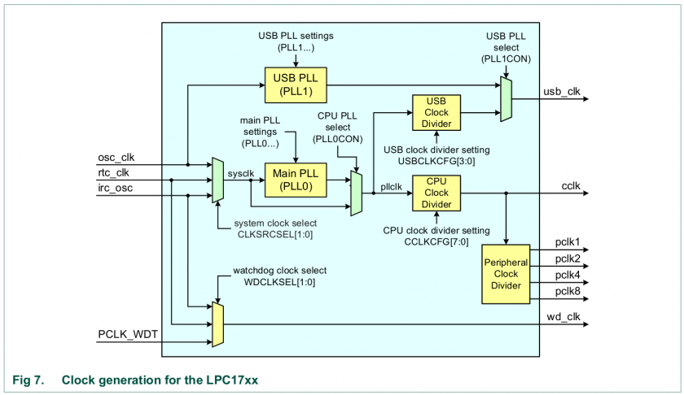
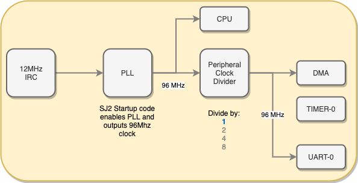
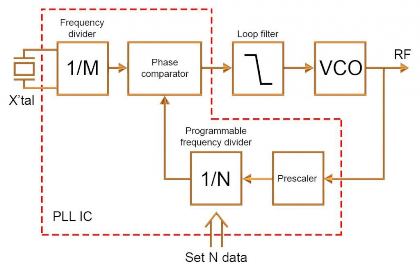

### Clock System & Timing

A crystal oscillator is typically used to drive a processor's clock. You will find that many external crystal oscillator clocks are 20Mhz or less. A processor will utilize a "phased-lock-loop" or "PLL" to generate a faster clock than the crystal. So, you could have a 4Mhz crystal, and the PLL can be used to internally multiply the clock to provide 96Mhz to the processor. The same 96Mhz is then fed to microcontroller peripherals. Many of the peripherals have a register that can divide this higher clock to slower peripherals that may not require a high clock rate.

Figure 1. Clock system of LPC17xx    On the SJ2 board, the 12 Mhz is fed through "PLL" to multiply the frequency to 96 Mhz, which is routed to the core CPU, and to the peripheral clock divider. This single peripheral clock divider then gives you the capability to divide the clock before it goes out to the rest of the peripherals such as I2C, SPI, UART, ADC, PWM etc.   

### Phase Locked Loop (PLL)

#### What is a PLL?

A PLL is a control system that takes in a reference signal at a particular frequency and creates a higher frequency signal. Technically, they can also be used to make lower frequency signals, but a simple frequency divider could easily accomplish this and a frequency divider is simple hardware. 

#### How do PLLs work?

Figure 2. PLL System Diagram

##### Frequency Divider

If the input is a square wave, this device will reduce the number of edges per second proportional to **M**.

##### VCO (Voltage Controlled Output)

This a voltage to frequency converter. The higher the input voltage, the higher the output frequency will be.

##### Phase Comparator

This is used to check if the two frequencies match each other. This device checks for matches by taking two signals and comparing their phase's. 

##### Loop Filter

This converts the pulse output from the Phase comparator to a DC voltage.

##### Programmable Divider

This is frequency divider that divide the frequency of the input signal by the number it is set to.

##### How does everything work together?

The Phase Comparator and loop filter will drive the voltage input of VCO up until it begins to see that both signals are synchronized (or locked) with each other. At this point, the PLL has created an output signal with the same frequency as the input reference signal.

By dividing the frequency that the Phase Comparator is trying to reach, lets say by 2, it will output a voltage twice the input reference signal, creating a higher frequency clock signal.

This is how we are able to use a 12 MHz clock and create a 48 MHz signal clock with it, by multiplying it by 4, or in this case, dividing the feedback frequency by 4.

#### Why use a PLL?

Crystals are extremely consistent frequency sources. PLLs are not very stable and need a control loop to keep them on track. So if a circuit to use crystals is very simple, why not simply just use a high frequency crystal oscillator to generate 100 MHz or more clock signals? There are a few reasons:

- High frequency crystals above 100 Mhz are not common and are hard to find. 
- High frequency signals will be distorted due to: 
  - Series inductance of board traces 
  - Parallel capacitance due to board copper areas and fiber glass 
  - Interference from other external signals like power signals and switching signals 
- Signal distortion may cause the MCU to malfunction. 

Once the signal is within the chip, the environment is a bit more controlled and higher frequencies can be achieved by using a PLL with a crystal as a reference.

### Clock Frequency and Power Consumption

As you increase the clock of a microprocessors the power consumption of the processor will increase following this formula:

#### **P = CV2****f**

- **C** is the capacitance of the CPU (typical MOSFET gate transistors capacitance) 
- **V** CPU core voltage 
- **f** is the frequency used to drive the CPU and its peripherals 

Given this information, we can figure out which options will decrease the power consumption of our CPU. We have a few options.

- **Reduce the capacitance of the CPU** 
  - Which basically means purchasing a CPU or microcontroller with this characteristic. Typically such CPUs will be marked for lower power. 
  - If you cannot change your CPU this is not feasible. 
- **Reduce the CPU core voltage or supply voltage.** 
  - Most micro-controllers perform the best at a particular supply voltage and lowering it, even towards the what the datasheet says is its minimum could be problematic. 
- **Reduce the CPU and Perpheral frequency** 
  - In most cases, this is the most practical option.  
  - You can reduce the system clock frequency you use by manipulating the PLL's clock divider. 
  - You can reduce the power consumption of peripherals by using a lower frequency peripheral clock. 

### Underclocking Advantages

- Reduced heat generation, which is exactly proportional to the power consumption. 
- Longer hardware lifespan. 
- Increased system stability. 
- Increased battery life.