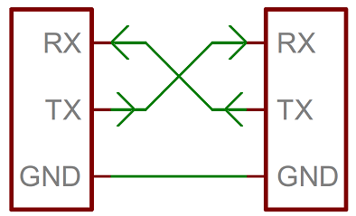
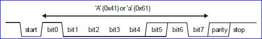
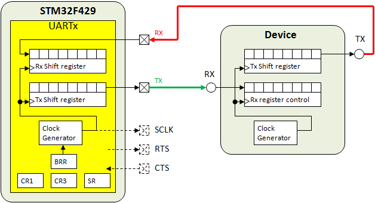
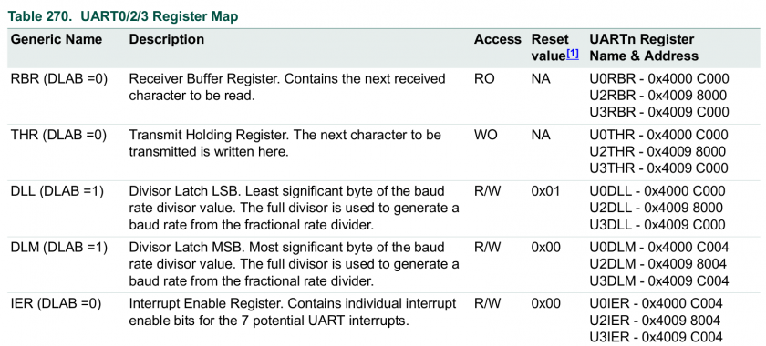
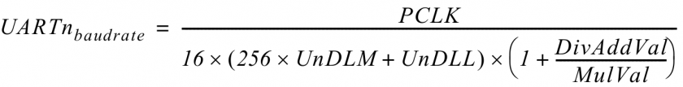

### Objective

The objective of this lesson is to understand UART, and use two boards and setup UART communication between them.

### **UART**

UART stands for Universal Asynchronous Receiver-Transmitter.

 

Figure 1. UART connection between two devices.

For **U**niversal **A**synchronous **R**eceiver **T**ransmitter. There is one wire for transmitting data (**TX**), and one wire to receive data (**RX**). It is asynchronous because there is no clock line between two UART hosts.

#### BAUD Rate

A common parameter is the baud rate known as "bps" which stands for **b**its **p**er **s**econd. If a transmitter is configured with 9600bps, then the receiver must be listening on the other end at the same speed. Using the 9600bps example, each bit time is `1 / 9600` = `104uS`. That means that if a transmitter wants to transmit a byte, it must do so by latching one bit on the wire, and then waiting 104uS before another bit is latched on the wire.

If you were to take a GPIO, and emulate UART at 9600 to send out a byte of data, it would look like this:

```c
// Assumes GPIO is a memory that can set level of a Port/Pin (psuedocode)
void uart_send_at_9600bps(const char byte) {
  // 9600bps means each bit lasts on the wire for 104uS (approximately)
  GPIO = 0; delay_us(104); // Start bit is LOW

  // Check if bit0 is 1, then set the GPIO to HIGH, otherwise set it to LOW
  GPIO = (byte & (1 << 0)) ? 1 : 0; delay_us(104); // Use conditional statement
  GPIO = (bool) (byte & (1 << 1)); delay_us(104);  // Case to bool
  GPIO = (byte & (1 << 2)); delay_us(104);
  GPIO = (byte & (1 << 3)); delay_us(104);
  
  GPIO = (byte & (1 << 4)); delay_us(104);
  GPIO = (byte & (1 << 5)); delay_us(104);
  GPIO = (byte & (1 << 6)); delay_us(104);
  GPIO = (byte & (1 << 7)); delay_us(104);

  GPIO = 1; delay_us(104); // STOP bit is HIGH
}
```

#### UART Frame

UART is a serial communication, so bits must travel on a single wire. If you wish to send a 8-bit byte `(uint8_t)` over UART, the byte is enclosed within a **start** and a **stop** bit. Therefore, to transmit a byte, it would require 2-bits of overhead; this 10-bit of information is called a **UART frame**. Let's take a look at how the character `'A'` is sent over UART. In ASCII table, the character `'A'` has the value of `65`, which in binary is: `0100_0001`. If you inform your UART hardware that you wish to send this data at 9600bps, here is how the frame would appear on an oscilloscope :

 

Figure 2. UART Frame sending letter `'A'`

#### UART Ports

It would normally not make sense to use the main processor (such as NXP LPC40xx) to send data on a wire one bit at a time, thus there are peripherals, or UART co-processor whose job is to solely send and receive data on UART pins without having to tax the main processor.   A micrcontroller can have multiple UART peripherals. Typically, the UART0 peripheral is interfaced to with a USB to serial port converter which allows users to communicate between the computer and microcontroller. This port is used to program your microcontroller. 

#### Benefits

- Hardware complexity is low. 
- No clock signal needed 
- Has a parity bit to allow for error checking 
- As this is one to one connection between two devices, device addressing is not required. 

#### Drawbacks

- The size of the data frame is limited to a maximum of 8 bits (some micros may support non-standard data bits) 
- Doesn’t support multiple slave or multiple master systems 
- The baud rates of each UART must be within ~3% (or lower, depending on device tolerance) of each other 

### Hardware Design

 

Figure 3. Simplified UART peripheral design for the *STM32F429*. SCLK is used for USART.

WARNING: The above is missing a common ground connection

### Software Driver

The UART chapter on LPC40xx has a really good summary page on how to write a UART driver.  **Read the register description of each UART register to understand how to write a driver.** 

#### Memory Shadowing in UART driver

  

Figure 4. Memory Shadowing using DLAB Bit Register

In figure 4, you will see that registers **RBR**/**THR **and** ****DLL **have the same address **0x4000C000**. These registers are shadowed using the DLAB control bit. Setting DLAB bit to 1 allows the user to manipulate **DLL** and **DLM**, and clearing DLAB to 0 will allow you to manipulate the **THR** and **RBR** registers.  

The reason that the DLL register shares the same memory address as the RBR/THR may be historic.  My guess is that it was intentionally hidden such that a user cannot accidentally modify the DLL register.  Even if this case is not very significant present day, the manufacturer is probably using the same UART verilog code from many decades ago.

#### *Control Space Divergence* (CSD) in UART driver

In figure 4, you will see that register **RBR** and **THR** have the same address **0x4000C000**. But also notice that access to each respective register is only from read or write operations. For example, if you read from memory location **0x4000C000, **you will get the information from receive buffer and if you write to memory location **0x4000C000**, you will write to a separate register which the transmit holding register. We call this ***Control Space Divergence*** since access of two separate registers or devices is done on a single address using the read/write control signal is used to multiplex between them. That address is considered to be **C*ontrol Space Divergent***. Typically, the control space aligns with its respective memory or io space.

Note that ***Control Space Divergence*** does not have a name outside of this course. It is Khalil Estell's phrase for this phenomenon.

#### BAUD Rate Formula

 

Figure 5. Baud rate formula  

To set the baud rate you will need to manipulate the **DLM** and **DLL** registers. Notice the **256*UnDLM** in the equation. That is merely another way to write the following (DLM << 8). Shifting a number is akin to multiplying it by 2 to the power of the number of shifts. DLM and DLL are the lower and higher 8-bits of a 16 bit number that divides the UART baudrate clock. DivAddVal and MulVal are used to fine tune the BAUD rate, but for this class, you can simply get "close enough" and ignore these values. Take these into consideration when you need an extremely close baudrate.

## Advanced Design

If you used 9600bps, and sent 1000 characters, your processor would basically enter a "busy-wait" loop and spend 1040ms to send 1000 bytes of data. You can enhance this behavior by allowing your uart send function to enter data to a queue, and return immediately, and you can use the **THRE** or "Transmitter Holding Register Empty" interrupt indicator to remove your busy-wait loop while you wait for a character to be sent.