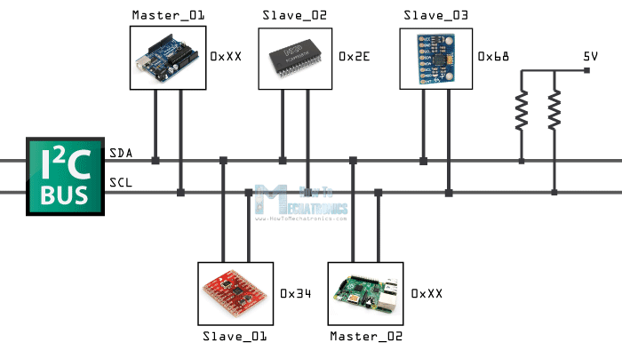
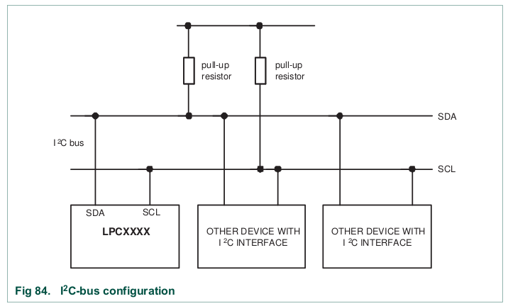
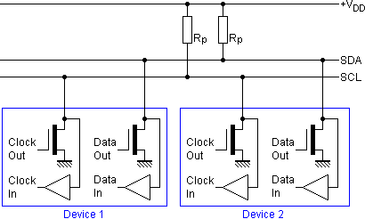
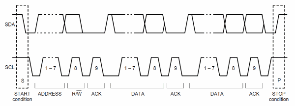
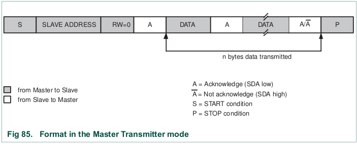
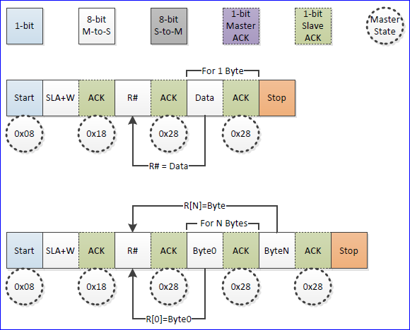
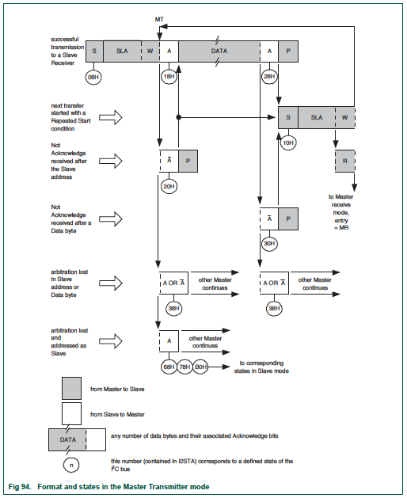
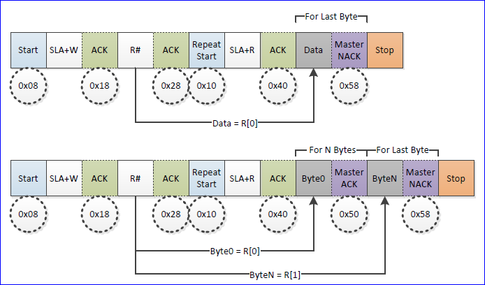
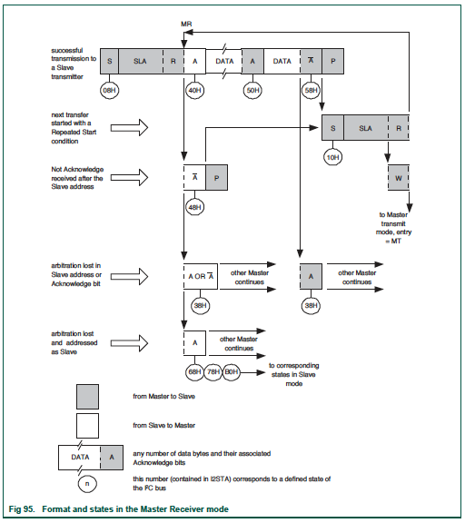

### What is I2C

I2C (Inter-Integrated Circuit) is pronounced "eye-squared see". It is also known as "TWI" because of the initial patent issues regarding this BUS. This is a popular, low throughput (100-1000Khz), half-duplex BUS that only uses two wires regardless of how many devices are on this BUS. Many sensors use this BUS because of its ease of adding to a system.

 

I2C devices connected up to an I2C bus

### Pins of I2C

There are two pins for I2C:

- **SCL**: Serial clock pin  
- **SDA**: Serial data pin 

The **clock** line is usually controlled by the Master with the exception that the slave may pull it low to indicate to the master that it is not ready to send data. 

The **data** line is bi-directional and is controlled by the Master while sending data, and by the slave when it sends data back after a repeat-start condition described below.

### Open-Collector/Open-Drain BUS

I2C is an open-collector BUS, which means that no device shall have the capability of internally connecting either SDA or SCL wires to power source. The communication wires are instead connected to the power source through a "pull-up" resistor. When a device wants to communicate, it simply lets go of the wire for it to go back to logical "high" or "1" or it can connect it to ground to indicate logical "0".  This achieves safe operation of the bus (no case of short circuit), even if a device incorrectly assumes control of the bus.

 

Devices connected to I2C bus.

 

I2C device pin output stage.

### Pull-up resistor

Using a smaller pull-up can achieve higher speeds, but then each device must have the capability of sinking that much more current. For example, with a 5v BUS, and 1K pull-up, each device must be able to sink 5mA.

[Try this link](http://www.falstad.com/circuit/circuitjs.html?cct=%24+3+0.000005+10.20027730826997+50+5+50%0A172+352+200+352+152+0+6+5+5+0+0+0.5+Voltage%0Ar+352+240+352+304+0+1000%0Ag+352+368+352+384+0%0Ac+352+304+352+368+0+0.00001+0%0AS+384+304+432+304+0+1+false+0+2%0Aw+352+240+352+200+0%0Aw+352+304+384+304+0%0Aw+432+320+432+368+0%0Aw+432+368+352+368+0%0Ao+6+64+0+4098+0.0000762939453125+0.025+0+2+6+3%0A), and if the link doesn't work, import this into the circuit simulator:

```
$ 3 0.000005 10.20027730826997 50 5 50
172 352 200 352 152 0 6 5 5 0 0 0.5 Voltage
r 352 240 352 304 0 1000
g 352 368 352 384 0
c 352 304 352 368 0 0.00001 0
S 384 304 432 304 0 1 false 0 2
w 352 240 352 200 0
w 352 304 384 304 0
w 432 320 432 368 0
w 432 368 352 368 0
o 6 64 0 4098 5 0.025 0 2 6 3

```

## Why Use I2C

#### Pros

- **IO/Pin Count:** 
  - 2 pins bus regardless of the number of devices. 
- **Synchronous:** 
  - No need for agreed timing before hand 
- **Multi-Master**  

  - Possible to have multiple masters on a I2C bus 
- **Multi-slave:** 
  - 7-bit address allows up to an absolute maximum of 119 devices (because 8 addresses are reserved) 

#### Cons

- **Slow Speed:** 
  - Typical I2C devices have a maximum speed of 400kHz 
  - Some devices can sense speeds up to 1000kHz or more 
- **Half-Duplex:**  

  - Only one device can talk at a time 
- **Complex State Machine:** 
  - Requires a rather large and complex state machine in order to handle communication 
- **Master Only Control:** 
  - Only a master can drive the bus 
  - An exception to that rule is that a slave can stop the clock if it needs to hold the master in a wait state 
- **Hardware Signal Protocol Overhead** 
  - This protocol includes quite a few bits, not associated with data to handle routing and handshaking. This slows the bus throughput even further 

## Protocol Information

I2C was designed to be able to read and write memory on a slave device. The protocol may be complicated, but a typical "transaction" involving read or write of a register on a slave device is simple granted a "sunny-day scenario" in which no errors occur.

I2C at its foundation is about sending and receiving bytes, but there is a layer of unofficial protocol about how the bytes are interpreted.  For instance, for an I2C write transaction, the master sends three bytes and 99% of the cases, they are interpreted like the following:

1. I2C Slave Device Address (required first byte in I2C protocol) `slave_address` 
2. Device Register `[r]`  

  - For I2C standard, this is just a plain old byte, but 99% of the devices treat this as their "register address" 
  - Your I2C state machine has same state for this one, and the next data byte 
  - Your software will treat this first byte as a special case 
3. Data `[data]`  

  - data to write at the "Device Register" above 

`slave_address[r] = data`

The code samples below illustrates I2C transaction split into functions, but this is the wrong way of writing an I2C driver. An I2C driver should be "transaction-based" and the entire transfer should be carried out using a state machine. The idea is to design your software to walk the I2C hardware through its state to complete an I2C transfer.

#### **Signal Timing Diagram**

 

I2C communication timing diagram

For both START and STOP conditions, SCL has to be high. A high to low transition of SDA is considered as **START** and a low to high transition as **STOP**.

#### **Write Transaction**



Master Transmit format

The master always initiates the transfer, and the device reading the data should always "ACK" the byte. For example, when the master sends the 8-bit address after the START condition, then the addressed slave should ACK the 9th bit (pull the line LOW). Likewise, when the master sends the first byte after the address, the slave should ACK that byte if it wishes to continue the transfer.

A typical I2C write is to be able to write a register or memory address on a slave device. Here are the steps:

1. Master sends START condition followed by device address. Device that is addressed should then "ACK" using the 9th bit. 
2. Master sends device's "memory address" (1 or more bytes). Each byte should be ACK'd by the addressed slave. 
3. Master sends the data to write (1 or more bytes). Each byte should be ACK'd by the addressed slave. 
4. Master sends the STOP condition. 

To maximize throughput and avoid having to send three I2C bytes for each slave memory write, the memory address is considered "starting address". If we continue to write data, we will end up writing data to M, M+1, M+2 etc.

The ideal way of writing an I2C driver is one that is able to carry out an entire transaction given by the function below.

**NOTE:** that the function only shows the different actions hardware should take to carry out the transaction, but your software will be a state machine**.**

```cpp
void i2c_write_slave_reg(void)
{
    // This will accomplish this:
    // slave_addr[slave_reg] = data;
  
    i2c_start();
    i2c_write(slave_addr);
    i2c_write(slave_reg);  // This is "M" for "memory address of the slave"
    i2c_write(data);
    
    /* Optionaly write more data to slave_reg+1, slave_reg+2 etc. */
    // i2c_write(data); /* M + 1 */
    // i2c_write(data); /* M + 2 */

    i2c_stop();
}
```

### Read Transaction

An I2C read is slightly more complex and involves more protocol to follow. What we have to do is switch from "write-mode" to "read-mode" by sending a repeat start, but this time with an ODD address.  This transition provides the protocol to allow the slave device to start to control the data line.  **You can consider an I2C even address being "write-mode" and I2C odd address being "read-mode".**

When the master enters the "read mode" after transmitting the read address after a repeat-start, the master begins to "ACK" each byte that the slave sends. When the master "NACKs", it is an indication to the slave that it doesn't want to read anymore bytes from the slave.

Again, the function shows what we want to accomplish. The actual driver should use state machine logic to carry-out the entire transaction**.**

```cpp
void i2c_read_slave_reg(void) 
{ 
  i2c_start(); 
  i2c_write(slave_addr); 
  i2c_write(slave_reg); 
  
  i2c_start();                  // Repeat start 
  i2c_write(slave_addr | 0x01); // Odd address (last byte Master writes, then Slave begins to control the data line)
  char data = i2c_read(0);      // NACK last byte
  i2c_stop();
}

void i2c_read_multiple_slave_reg(void) 
{ 
  i2c_start(); 
  i2c_write(slave_addr); 
  i2c_write(slave_reg); 
  
  // This will accomplish this:
  // d1 = slave_addr[slave_reg];
  // d2 = slave_addr[slave_reg + 1];
  // d3 = slave_addr[slave_reg + 2];
  i2c_start(); 
  i2c_write(slave_addr | 0x01);
  char d1 = i2c_read(1);      // ACK
  char d2 = i2c_read(1);      // ACK
  char d3 = i2c_read(0);      // NACK last byte
  i2c_stop();
}
```

## I2C Slave State Machine Planning

Before you jump right into the assignment, do the following:

- Read and understand how an I2C master performs slave register read and write operation Look at existing code to see how the master operation handles the I2C state machine function This is important so you can understand the existing code base 
- Next to each of the master state, determine which slave state is entered when the master enters its state 
- Determine how your slave memory or registers will be read or written 

It is important to understand the states, and use the datasheet to figure out what to do in the state to reach the next desired state given in the diagrams below.

In each of the states given in the diagrams below, your software should take the step, and the hardware will go to the next state granted that no errors occur. To implement this in your software, you should:

1. Perform the planned action after observing the current state 
2. Clear the "SI" (state change) bit for HW to take the next step 
3. The HW will then take the next step, and trigger the interrupt when the step is complete 

### Master Write

In the diagram below, note that when the master sends the "R#", which is the register to write, then the slave state machine should save this data byte as it's INDEX location. Upon the next data byte, the indexed data byte should be written.

Stop here and do the following:  
1.  Check `i2c.c`  
2. Compare the code to the state diagram below

[](http://www.socialledge.com/sjsu/index.php?title=File:Tutorial_i2c_master_write_state.png) Figure x. I2C Master Write Transaction 

 

Figure x. Section 19.9.1 in LPC40xx User Manual 

### Master Read

In the diagram below, the master will write the index location (the first data byte), and then perform a repeat start. After that, you should start returning your indexed data bytes.

[](http://www.socialledge.com/sjsu/index.php?title=File:Tutorial_i2c_master_read_state.png) Figure x. I2C Master Read Transaction  

  

Figure x. Section 19.9.2 in LPC40xx User Manual 

### Assignment

Design your I2C slave state machine diagrams with the software intent in each state.

- Re-draw the *Master Read* and *Master Write* diagrams while simultaneously showing the slave state. 
  - In each slave state, show the action you will perform.  
(Refer to section 19.9.3 and 19.9.4 (for SJ1 board) OR 22.9.3 and 22.9.4 (for SJ2 board) in LPC40xx user manual for the slave states) 
  - For instance, when the Master is at state 0x08, determine which state your slave will be at.  
In this state when your slave gets addressed, an appropriate intent may be to reset your variables. 
- You will be treated as an engineering professional, and imagine that your manager has given you this assignment and is asking for the state machine diagrams before you start the code implementation.  
  - Demonstrate excellence, and do not rely on word-by-word instructions.  If you get points deducted, do not complain that "I was not asked to do this".  Do whatever you feel is necessary to demonstrate excellence. 

##### Brainstorming!

- I2C is talking to two accelerometers and started at the same time then which one will first get the bus? 
- What is clock stretching in the I2C Bus, when it happens and how can we solve this problem?