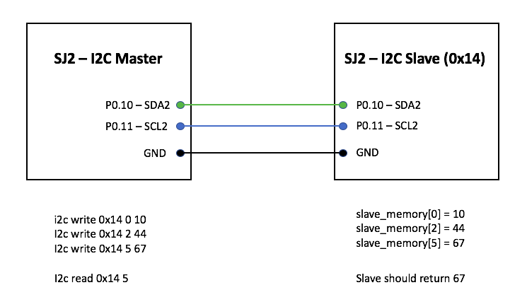

### Overall Objective

We will setup one SJ2 board as a Master board, and another as a Slave board, and the Master board will attempt to read and write memory to/from the Slave board.



---

### Part 0: Understand existing I2C Master driver

Gather per-requisite knowledge:

1. [I2C Bookstack page](/sjsu---embedded-drivers-rtos/pages/39-i2c/) 
2. Read I2C chapter in your LPC User manual 
3. Scan the `i2c.h` and `i2c.c` file, and understand the existing driver 
4. Thorough understanding of pointers 

Unless you have read the material above **minimum of 5-10 times**, there is no point moving forward into this lab. It is extremely important that you are familiar with the I2C bus before you dive into this lab. You should then understand the existing I2C driver that you will be "extending" to support slave operation. Start with the header file interface, and correlate that to the other reading material mentioned above.

---

### Part 1: Attempt to read and write existing devices

##### Part 1.a: Setup

- Load sample project, reboot, and take a note of the I2C discovered devices on startup 
  - There is a boot message indicating various different addresses of the existing I2C slaves 
- Turn on debug printfs at `i2c.c`, re-compile, and re-load the modified project to the board 
  - This will let you trace through I2C states as a read or write transaction is happening 
  - Look for `#define I2C__ENABLE_DEBUGGING` and set this to non-zero 

##### Part 1.b: Read and Write Slave memory

Next step is to get familiar with the I2C CLI command and the existing I2C master driver, which allows you to read and write an I2C Slave devices' memory.

- Load the sample project 
- Try the `i2c read` and `i2c write` CLI commands and attempt to read data from a device, such as the acceleration sensor. 
  - This sensor is at address `0x38` 
  - Open up `MMA8452Q.pdf` and read the `WHO_AM_I` register 
  - Write the `CTRL_REG1` register and activate the sensor 
  - Attempt to read X and the Z-axis and observe that the Z-axis should output the effect of gravity 
- **Pause here**, and go through the output debug printfs and cross check them against the I2C Master state machine diagram 

---

### Part 2: Draw your I2C Slave State Machine

Your objective is to act like an I2C slave device. Just like the acceleration sensor, you will act like a slave device with your own memory locations that a Master device can read or write. The first step in doing so is to draw your I2C Slave driver state machine that you will implement in your code.

Build the following table for your I2C Slave states:

| HW State | Why you got here? | Action to take |
| --- | --- | --- |
|  |  |  |

The key to making the table above is:

- Understanding the I2C Master driver 
  - For each HW state of the Master driver, there is a corresponding Slave state 
- **Table 512 - 515** in the LPC User Manual 

---

### Part 3: Implement your I2C Slave driver

##### Part 3.a

In this step, we will configure your Slave board to respond to a particular I2C bus address. We will add minimal code necessary to be able to be recognized by another master.

Believe it or not, you only have to write a single function to be recognized as a slave on the I2C bus.  Since the I2C Master driver is already initialized, you already have the setup for the Pin FUNC, and the I2C clock, so merely setting up the slave address recognition is needed. Locate the I2C registers and configure your Slave Address registers.

**Pause here**, and attempt to reboot the I2C Master board, and it should recognize your Slave address on startup. Do not proceed further until you can confirm that your slave address setup is working.

```cpp
// TODO: Create i2c_slave_init.h
void i2c2__slave_init(uint8_t slave_address_to_respond_to);
```

Notice that on the I2C slave board, it will print an entry to a new (un-handled) state each time the master board reboots and tries to "discover" the slave devices.

**Hint**

- The I2C `DAT` register is only valid prior to clearing the SI bit 
  - Clear the SI bit AFTER you read the `DAT` register 
- I2C `ADDR` and `MASK` register 
  - MASK can be set to non-zero to allow multiple address recognition 
  - For example, if MASK is`0xC0`and ADDR is`0xF0`, then your slave will recognize the following addresses:  
`0x30`,`0x70`,`0xB0`, and`0xF0`because MASK bit7 and bit6 indicate that those will not be "matched" 

##### Part 3.b

In this step, you will do the following:

- Add extra states to the I2C Interrupt Handler that are relevant to your I2C slave driver 
- Invoke callbacks which will interface your virtual I2C device 

```cpp
// TODO: Create a file i2c_slave_functions.h and include this at the existing i2c.c file

/**
 * Use memory_index and read the data to *memory pointer
 * return true if everything is well
 */
bool i2c_slave_callback__read_memory(uint8_t memory_index, uint8_t *memory);

/**
 * Use memory_index to write memory_value
 * return true if this write operation was valid
 */
bool i2c_slave_callback__write_memory(uint8_t memory_index, uint8_t memory_value);

// TODO: You can write the implementation of these functions in your main.c (i2c_slave_functionc.c is optional)
```

The functions you added above should be called by your i2c.c state machine handler when the right state has been encountered. **This should directly be related to your Part 2**.

Inside the interrupt, you may have to save data variables as the interrupt cycles through the I2C states. The best way to handle this is to add more data members to` typedef i2c_s;` after which you can access members of this struct inside the I2C ISR.

##### Part 3.c

In this step, we provide the skeleton code that you need to integrate in your `main.c` at your Slave board.

```c
#include "i2c_slave_functions.h
#include "i2c_slave_init.h"

static volatile uint8_t slave_memory[256];

bool i2c_slave_callback__read_memory(uint8_t memory_index, uint8_t *memory) {
  // TODO: Read the data from slave_memory[memory_index] to *memory pointer
  // TODO: return true if all is well (memory index is within bounds)
}

bool i2c_slave_callback__write_memory(uint8_t memory_index, uint8_t memory_value) {
  // TODO: Write the memory_value at slave_memory[memory_index]
  // TODO: return true if memory_index is within bounds
}

int main(void) {
  i2c__init_slave(0x86);
  
  /**
   * Note: When another Master interacts with us, it will invoke the I2C interrupt
   *.      which will then invoke our i2c_slave_callbacks_*() from above
   *       And thus, we only need to react to the changes of memory
   */
  while (1) {
    if (slave_memory[0] == 0) {
      turn_on_an_led(); // TODO
    } else {
      turn_off_an_led(); // TODO
    }
    
    // of course, your slave should be more creative than a simple LED on/off
  }

  return -1;
}
```

---

### Final Requirements

**I2C State Machine Lab Submission:**

1. For part 1 (Attempt to read and write existing devices) - Serial terminal screenshots of memory being read and written. 
2. Logic analyzer screenshots for WHO_I_AM, CTRL_REG1 and for reading Accelerometer XYZ axis data.  
3. For Part 2 - Design I2C slave state machine for **Master Write and Slave Read**, **Master Read and Slave Write **along with the table of I2C slave state in both cases. 

**I2C Lab:**

1. Complete Part 3 - Attach Screenshots if you have any. 
2. Extra Credit for Creative Slave device and  Multi-byte read/write. 

- Creative Slave device - Your slave device should act like a real device and do things based on the setting of its slave memory registers 
- Your slave should be able to read and write multiple registers in a single I2C transaction.