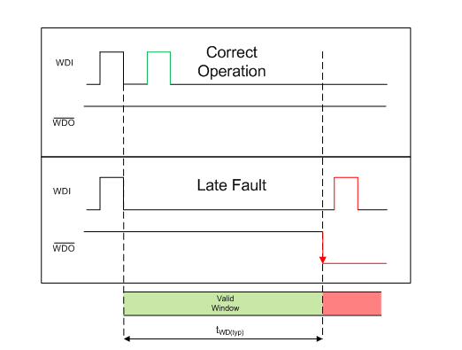

Watchdog is a timer which can continuously check if there is any malfunction in the system operation and perform certain actions to restore normal operation. Watchdogs are commonly found in embedded system devices and provides self reliance to the system. It can take timely action to a critical failure in the system thereby restoring the system to a safe state.

 

**Operation of a standard watchdog timer**

There are hardware and software watchdogs. Hardware watchdog awaits a signal/pulse from a resource in the system during its timer period. If it receives the signal, it will reset itself and restart the timer. This continues till the system operations are normal and stable. If the resource fails or there is any fault in the system, the watchdog receives no indication during its timer period. Once the timer period elapses, it can take certain actions to bring the system back to stable state. The action could be resetting the system or any other action which restores normal operation.

Software watchdog is a task which monitors other tasks. Each task will report to the watchdog about its normal operation. If any of the tasks misbehave, then the watchdog can alert the user/system or take corrective action to get the task back to normal state.

**Ref: [https://e2e.ti.com/cfs-file/__key/communityserver-blogs-components-weblogfiles/00-00-00-03-59/1538.fig2.PNG](https://e2e.ti.com/cfs-file/__key/communityserver-blogs-components-weblogfiles/00-00-00-03-59/1538.fig2.PNG)**