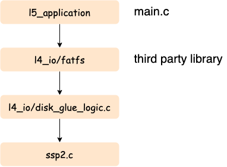
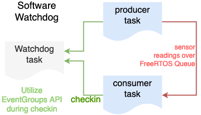

#### Objective

- Learn File I/O API to read and write data to the SD card 
  - This requires a micro SD card that is formatted with FAT32 
- Design a simple application that communicates over the RTOS queue 
- Implement a "Software" Watchdog through FreeRTOS EventGroups API 

 

---

---

##### Prerequisite Knowledge

##### File I/O

You will be using a "file system" API to read (or write) a file. This is a third-party library and is not part of the standard C library, and it is connected to the SD card using the SPI bus.

[Please read this page](http://elm-chan.org/fsw/ff/00index_e.html) for API details; here is the overall data flow which allows you to use high-level API to read and write a file.



 

##### Watchdog

- A "watchdog timer" is a hardware timer 
- It can count up or count down based on the implementation 
- The objective is that when it reaches a ceiling, then it will trigger CPU reset 

```c
void main(void) {
  watchdog_enable(100ms);

  while (true) {
    pacemaker_logic();
    
    // If this function does not run within 100ms, the CPU will reset
    watchdog_checkin();
  }
}
```

 

---

---

#### Lab

##### Part 0: Setup `Producer` and `Consumer` Task

1. Create a **`producer task`** that reads a sensor value every 1ms. 
  - The sensor can be any input type, such as a light sensor, or an acceleration sensor 
  - After collecting 100 samples (after 100ms), compute the average 
  - Write average value every 100ms (avg. of 100 samples) to the **`sensor queue`** 
  - Use medium priority for this task 
2. Create a **`consumer task`** that pulls the data off the **`sensor queue`** 
  - Use infinite timeout value during `xQueueReceive` API 
  - Open a file (i.e.: sensor.txt), and append the data to an output file on the SD card 
  - Save the data in this format: `sprintf("%i, %i\n", ``time``, light)"` 
  - Note that you can get the time using `xTaskGetTickCount()` 
    - The sensor type is your choice (such as light or acceleration) 
  - Note that if you write and close a file every 100ms, it may be very inefficient, so try to come up with a better method such that the file is only written once a second or so... 
    - Also, note that periodically you may have to "flush" the file (or close it) otherwise data on the SD card may be cached and the file may not get written 
  - Use medium priority for this task 

Note: 

-  By configuration, fatfs only support FAT32. Thus, any MicroSD larger than 32 GB needs to be reformatted to FAT32. 
- Alternatively, you can modify the `ffconfig.h` to enable exFAT support. 

```cpp
#include "ff.h"
#include <string.h>

// Sample code to write a file to the SD Card
void write_file_using_fatfs_pi(void) {
  const char *filename = "file.txt";
  FIL file; // File handle
  UINT bytes_written = 0;
  FRESULT result = f_open(&file, filename, (FA_WRITE | FA_CREATE_ALWAYS));

  if (FR_OK == result) {
    char string[64];
    sprintf(string, "Value,%i\n", 123);
    if (FR_OK == f_write(&file, string, strlen(string), &bytes_written)) {
    } else {
      printf("ERROR: Failed to write data to file\n");
    }
    f_close(&file);
  } else {
    printf("ERROR: Failed to open: %s\n", filename);
  }
}

```

 

---

---

##### Part 1: Use FreeRTOS `EventGroup` API

What you are designing is a software check-in system and thus emulating a "Software Watchdog".



 

1. At the end of the loop of each task, set a bit using FreeRTOS event group API. 
  - At the end of each loop of the tasks, set a bit using the **`xEventGroupSetBits()`** 
  - **`producer task`** should set bit1, `**consumer task**` should set bit2 etc. 
  - You are expected to read about the [FreeRTOS Event Group API](https://www.freertos.org/FreeRTOS-Event-Groups.html) yourself 
2. Create a **`watchdog task`** that monitors the operation of the two tasks. 
  - Use high priority for this task. 
  - Use a task delay of 1 second, and wait for all the bits to set. If there are two tasks, wait for bit1, and bit2 etc. 
  - If you fail to detect the bits are set, that means that the other tasks did not reach the end of the loop. 
    - Print a message when the Watchdog task is able to verify the check-in of other tasks 
    - Print an error message clearly indicating which task failed to check-in with the RTOS Event Groups API 

```cpp
void producer_task(void *params) {
  while(1) { // Assume 100ms loop - vTaskDelay(100)
    // Sample code:
    // 1. get_sensor_value()
    // 2. xQueueSend(&handle, &sensor_value, 0);
    // 3. xEventGroupSetBits(checkin)
    // 4. vTaskDelay(100)
  }
}

void consumer_task(void *params) {
  while(1) { // Assume 100ms loop
    // No need to use vTaskDelay() because the consumer will consume as fast as production rate
    // because we should block on xQueueReceive(&handle, &item, portMAX_DELAY);
    // Sample code:
    // 1. xQueueReceive(&handle, &sensor_value, portMAX_DELAY); // Wait forever for an item
    // 2. xEventGroupSetBits(checkin)
  }
}

void watchdog_task(void *params) {
  while(1) {
    // ...
    // vTaskDelay(200);
    // We either should vTaskDelay, but for better robustness, we should
    // block on xEventGroupWaitBits() for slightly more than 100ms because
    // of the expected production rate of the producer() task and its check-in
    
    if (xEventGroupWaitBits(...)) { // TODO
      // TODO
    }
  }
}

```

 

---

---

##### Part 2: Thoroughly test the Application

1. [Create a CLI](/sjsu---embedded-drivers-rtos/pages/08-sj2-board/) to "suspend" and "resume" a task by name. 
  - "task suspend task1" should suspend a task named "task1" 
  - "task resume task2" should suspend a task named "task2" 
2. Run the system, and under normal operation, you will see a file being saved with sensor data values. 
  - Collect the data over several seconds, and then verify by inserting the micro-SD card to your computer 
  - **Plot the file data in Excel to demonstrate.** 
3. Suspend the `producer task` 
  - The watchdog task should display a message and save relevant info to the SD card. 
4. Observe the CPU utilization while your file is being saved  

  - You should observe that the SD card task should utilize more CPU 

What you created is a "software watchdog". This means that in an event when a task is stuck, or a task is frozen, you can save relevant information such that you can debug at a later time.

You may use any built-in libraries for this lab assignment such as a sensor API

---

---

 

#### Conclusion

##### What to turn in

- Positive test case scenario with serial terminal indicating tasks are running normally 
- Suspension of a task, and then negative test case scenario with serial terminal indicating which task failed to check-in 
- Data plot as mentioned in Part 2 
- All relevant source code (compiled and tested) 

##### [FreeRTOS Trace](http://books.socialledge.com/attachments/1)

Please use TraceAlyzer to open this trace and inspect what is going on. The company offers "Academic License" to view the attached file (click on the link above).