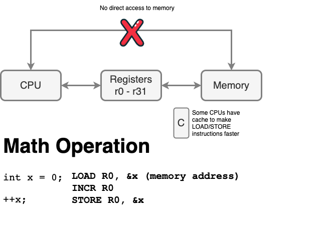

 



```c
// volatile 
int flag; // global memory is part of "BSS" section, guaranteed to be zero (unless a bug in startup code)

void flag_setter_task(void *p) {
  while (1) {
    ++flag;
    vTaskDelay(1000);
  }
}

void flag_checker_task(void *p) {
  puts("Task entry");

  while (1) {
    flag = 0;
    while (0 == flag) {
      ;
    }

    puts("flag has incremented away from value of 0");
    vTaskDelay(1000);
  }
}

```

#### Interview Questions

- What is a `volatile` keyword? 
- Given a code snippet, why you cannot set a breakpoint? 
- Is `const` opposite of volatile? 
- What is the point of "`const volatile *variable`" ? 
  - You as a programmer, cannot write a line of code to modify, but maybe DMA or a peripheral behind you can modify it