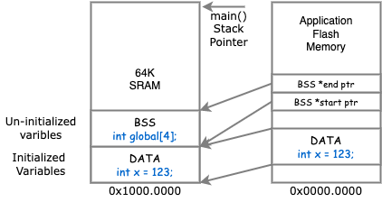

 

### Basic Concept

When your CPU starts up, the RAM is not initialized. So some entity needs to initialize the RAM for us. For a system with an operating system, such as linux or windows, your executable starts up, and the OS initializes the RAM before it calls the main() function. On microcontrollers, the startup process is entirely under your control. So a function needs to run before the main() to initialize the RAM.

Let's take a look at an example:

```c
int x = 123;       // RAM
const int y = 456; // ROM (flash)

/* "data" section : Any RAM with initial values */
int d1 = 123;
static int d2 = 123;
int d3[10] = {1, 2, 3};
float d4 = 1.23;

/* "BSS" section:
 * Uninitialized RAM section, but
 * according to the C standard, un-initialized global variables need to be zero initialized
 */
int b1;
static int b2;
static float b3;
static char b4[30000];

int main(void) {
  y = 1;             // This will not compile
  * ((int*) &y) = 1; // This will crash
  
  // How will this print "x = 123"
  printf("x = %d\n", x);

  return 0;
}
```

### Illustration



Here are snippets of code the zero initialize the BSS and copy the DATA section from ROM to RAM.

```c
static void startup__init_data_sram(void) {
  extern void *_bdata_lma;
  extern void *_bdata_vma;
  extern void *_data_end;

  uint8_t *src_flash = (uint8_t *)&_bdata_lma; // Flash
  uint8_t *dest_ram = (uint8_t *)&_bdata_vma;  // RAM
  while (dest_ram < (uint8_t *)&_data_end) {
    *dest_ram = *src_flash;
    dest_ram++;
    src_flash++;
  }
}

static void startup__init_bss_sram(void) {
  extern void *_bss_start;
  extern void *_bss_end;

  uint8_t *sram_ptr = (uint8_t *)&_bss_start;
  while (sram_ptr < (uint8_t *)&_bss_end) {
    *sram_ptr = 0U;
    sram_ptr++;
  }
}

```